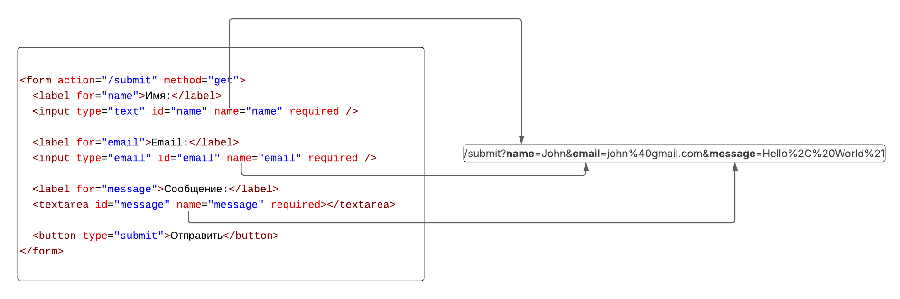

# Суперглобальные переменные и обработка данных форм

## Содержание

- [Суперглобальные переменные и обработка данных форм](#суперглобальные-переменные-и-обработка-данных-форм)
  - [Содержание](#содержание)
  - [Подключение файлов](#подключение-файлов)
  - [Суперглобальные переменные](#суперглобальные-переменные)
    - [Что такое суперглобальные переменные?](#что-такое-суперглобальные-переменные)
    - [`$_GET`](#_get)
    - [`$_POST`](#_post)
    - [`$_REQUEST`](#_request)
    - [`$_SERVER`](#_server)
    - [Остальные суперглобальные переменные](#остальные-суперглобальные-переменные)
  - [Обработка данных форм](#обработка-данных-форм)
    - [Отправка данных с формы](#отправка-данных-с-формы)
    - [Получение данных из формы](#получение-данных-из-формы)
    - [Извлечение и проверка полученных данных](#извлечение-и-проверка-полученных-данных)
    - [Дальнейшая обработка данных](#дальнейшая-обработка-данных)
  - [Организация кода при обработке форм](#организация-кода-при-обработке-форм)
    - [Подход 1: форма и обработка в одном файле](#подход-1-форма-и-обработка-в-одном-файле)
    - [Подход 2: форма и обработка в разных файлах, но в одном запросе](#подход-2-форма-и-обработка-в-разных-файлах-но-в-одном-запросе)
    - [Подход 3: форма и обработчик в разных запросах](#подход-3-форма-и-обработчик-в-разных-запросах)
    - [Сравнение подходов к обработке формы](#сравнение-подходов-к-обработке-формы)
  - [Получение данных из различных элементов формы](#получение-данных-из-различных-элементов-формы)
    - [Атрибут `name` и его роль в получении данных](#атрибут-name-и-его-роль-в-получении-данных)
    - [Группировка данных с помощью `name`](#группировка-данных-с-помощью-name)
    - [Радио (`radio`)](#радио-radio)
    - [Чекбоксы (`checkbox`)](#чекбоксы-checkbox)
    - [Выпадающие списки (`select`)](#выпадающие-списки-select)
  - [Функция `header`](#функция-header)
    - [Про функцию `header`](#про-функцию-header)
    - [Общий синтаксис](#общий-синтаксис)
    - [Сценарии использования функции `header`](#сценарии-использования-функции-header)
      - [1. Перенаправление пользователя](#1-перенаправление-пользователя)
      - [2. Отправка кода состояния ответа](#2-отправка-кода-состояния-ответа)
      - [3. Заголовок `Content-Type`](#3-заголовок-content-type)
    - [Особенность функции `header()`](#особенность-функции-header)
  - [Валидация и фильтрация данных](#валидация-и-фильтрация-данных)
    - [Почему валидация и фильтрация данных важны?](#почему-валидация-и-фильтрация-данных-важны)
    - [Определение фильтрации данных](#определение-фильтрации-данных)
    - [Определение валидации данных](#определение-валидации-данных)
    - [Фильтрация данных формы](#фильтрация-данных-формы)
      - [Удаление лишних пробелов](#удаление-лишних-пробелов)
      - [Удаление специальных символов](#удаление-специальных-символов)
    - [Валидация данных формы](#валидация-данных-формы)
      - [Типы валидации](#типы-валидации)
      - [Проверка наличия данных](#проверка-наличия-данных)
      - [Проверка длины строки](#проверка-длины-строки)
      - [Проверка формата данных (например, email)](#проверка-формата-данных-например-email)
      - [Проверка числового значения](#проверка-числового-значения)
      - [Проверка даты](#проверка-даты)
    - [Пример обработки формы с фильтрацией и валидацией](#пример-обработки-формы-с-фильтрацией-и-валидацией)
      - [Структура проекта](#структура-проекта)
      - [Пример формы (`index.php`)](#пример-формы-indexphp)
      - [Обработчик формы (`handler.php`)](#обработчик-формы-handlerphp)
      - [Вывод ошибок в форме](#вывод-ошибок-в-форме)
      - [Примеры валидации данных](#примеры-валидации-данных)
  - [Пример MiniShop: предварительный расчёт заказа](#пример-minishop-предварительный-расчёт-заказа)
  - [Теперь вы знаете ...](#теперь-вы-знаете-)

## Подключение файлов

Перед тем как перейти к новой теме, напомним ещё один важный механизм PHP - подключение файлов. В реальных проектах код редко находится в одном файле: функции, классы, настройки и вспомогательные компоненты обычно выносятся в отдельные части. Это делает проект более организованным, упрощает повторное использование кода и облегчает сопровождение приложения.

В PHP для подключения одного файла к другому используются несколько _специальных конструкций_:

- `include 'file.php';` - подключает файл к текущему скрипту. Если файл не найден, PHP выведет предупреждение, но выполнение программы продолжится.
- `require 'file.php';` - также подключает файл, но в случае его отсутствия выполнение скрипта будет немедленно остановлено с фатальной ошибкой.
- `include_once 'file.php';` - работает так же, как `include`, но гарантирует, что файл будет подключён только один раз, даже если инструкция вызвана повторно.
- `require_once 'file.php';` - аналогичен `require`, но тоже предотвращает повторное подключение одного и того же файла.

> [!NOTE]
>
> Рекомендуется использовать `require_once` для подключения файлов, содержащих важные функции или классы, чтобы избежать проблем с повторным определением.

_Пример_. Подключение файла с функциями.

```php
<?php
// functions.php

function greet($name) {
    return "Hello, " . htmlspecialchars($name) . "!";
}

function sum($a, $b) {
    return $a + $b;
}

// main.php
require_once 'functions.php';

echo greet("Alice"); // Выведет: Hello, Alice!
echo sum(5, 10); // Выведет: 15
```

Когда PHP встречает одну из директив подключения (`include`, `require`, `include_once`, `require_once`), он открывает указанный файл, считывает его содержимое и вставляет код в текущий контекст выполнения, словно этот код был написан непосредственно в месте подключения.

_Пример_. Как работает подключение файлов.

Если в файле `hello.php` содержится следующий код:

```php
<?php

// hello.php

echo 'Hello, world!';
```

А в файле `index.php` выполняется его подключение:

```php
<?php

// index.php

require_once 'hello.php';

echo 'This is the main file.';
```

При запуске `index.php` интерпретатор PHP не "ссылается" на файл в привычном смысле, а буквально вставляет его содержимое в точку подключения. В результате код будет интерпретирован так, как будто он изначально был записан в одном файле:

```php
<?php

// index.php

echo 'Hello, world!'; // как будто этот код был написан здесь

echo 'This is the main file.';
```

## Суперглобальные переменные

### Что такое суперглобальные переменные?

Еще одной особенностью PHP являются _суперглобальные переменные_.

_Суперглобальные переменные_ - это предопределённые массивы, которые автоматически доступны в любой части программы, независимо от области видимости. Проще говоря, вам не нужно передавать их в функции или объявлять как `global` - они уже "_присутствуют_" везде.

PHP сам заполняет эти массивы данными из различных источников, таких как запросы от клиентов, серверные переменные, HTTP-заголовки и т.д.

> [!TIP]
>
> Если смотреть на это чуть шире, суперглобальные переменные - это своего рода "мост" между пользователем, сервером и вашим PHP-кодом.

Рассмотрим основные суперглобальные переменные, которые мы будем использовать в нашем проекте.

### `$_GET`

Перед тем как понять, что представляет собой `$_GET`, вспомним важный элемент веб-разработки - _query-параметры_.

_Query-параметры_ - это часть URL, которая начинается после знака вопроса `?` и содержит пары "_ключ=значение_", разделённые символом `&`. Они позволяют передавать данные прямо в адресной строке браузера. Такие параметры часто используются для: фильтрации данных, сортировки, поиска.

Например,

```text
https://example.com/search?query=php&sort=asc
```

В данном случае:

- `query` - ключ, значение которого равно `php`
- `sort` - ключ, значение которого равно `asc`

Если вы отправите HTML-форму с методом `GET`, все введённые пользователем данные автоматически попадут в URL именно в виде _query-параметров_.

Для работы с этими данными в PHP используется суперглобальная переменная `$_GET`.

`$_GET` - это ассоциативный массив, в котором:

- Ключи соответствуют именам параметров в URL
- Значения - это данные, переданные пользователем

_Пример_. Получение данных из `$_GET`

```php
<?php

// URL: https://example.com/search.php?query=php&sort=asc

$query = $_GET['query']; // 'php'
$sort = $_GET['sort'];   // 'asc'
```

### `$_POST`

`$_POST` - это суперглобальная переменная, которая используется для получения данных, отправленных через HTML-форму с методом `POST`. В отличие от `$_GET`, данные, переданные через `POST`, не отображаются в URL, а _передаются в теле HTTP-запроса_.

Например, если отправить следующую форму:

```html
<form method="POST" action="submit.php">
  <input type="text" name="username" />
  <input type="submit" value="Submit" />
</form>
```

со значением `username=John`, то в файле `submit.php` мы сможем получить это значение через `$_POST`:

```php
<?php

// submit.php

$username = $_POST['username']; // 'John'
```

### `$_REQUEST`

`$_REQUEST` - это суперглобальная переменная, которая объединяет данные из `$_GET`, `$_POST` и `$_COOKIE`. Она позволяет получить данные из любого из этих источников, не заботясь о том, откуда они пришли. Однако использование `$_REQUEST` может привести к путанице, если в разных источниках есть параметры с одинаковыми именами.

Эта суперглобальная переменная используется редко, так как может создавать проблемы с безопасностью и предсказуемостью данных. Рекомендуется использовать `$_GET` или `$_POST` в зависимости от метода отправки данных.

### `$_SERVER`

`$_SERVER` - это суперглобальная переменная, которая содержит информацию о сервере, заголовках HTTP-запроса и других данных, связанных с текущим запросом. Она предоставляет доступ к таким данным, как:

_Таблица 1. Основные элементы `$_SERVER`_

| Ключ                          | Описание                                     |
| ----------------------------- | -------------------------------------------- |
| `$_SERVER['REQUEST_METHOD']`  | Метод HTTP-запроса (например, `GET`, `POST`) |
| `$_SERVER['REQUEST_URI']`     | URI, который был запрошен                    |
| `$_SERVER['HTTP_USER_AGENT']` | Информация о браузере пользователя           |
| `$_SERVER['REMOTE_ADDR']`     | IP-адрес клиента                             |
| `$_SERVER['SERVER_NAME']`     | Имя сервера                                  |
| `$_SERVER['PHP_SELF']`        | Имя текущего скрипта                         |
| `$_SERVER['HTTP_HOST']`       | Доменное имя сервера                         |

_Пример_. Получение информации о запросе

```php
<?php

if ($_SERVER['REQUEST_METHOD'] === 'POST') {
    echo "Данные были отправлены через POST";
} else {
    echo "Данные были отправлены через GET или другой метод";
}
```

### Остальные суперглобальные переменные

В PHP есть и другие суперглобальные переменные:

- `$_FILES` - содержит информацию о файлах, загруженных через HTML-форму.
- `$_COOKIE` - содержит данные, хранящиеся в cookies, которые были отправлены клиентом.
- `$_SESSION` - используется для хранения данных сессии, которые сохраняются между запросами от одного пользователя.
- `$_ENV` - содержит переменные окружения, которые могут быть настроены на сервере.

## Обработка данных форм

### Отправка данных с формы

После знакомства с суперглобальными переменными возникает вполне логичный вопрос: откуда вообще берутся эти данные? В большинстве случаев - из HTML-форм, с которыми пользователь взаимодействует на странице.

_HTML-форма_ - это элемент веб-страницы, позволяющий пользователю вводить данные и отправлять их на сервер для дальнейшей обработки. По сути, это точка входа пользователя в ваше приложение. Формы могут содержать различные элементы: текстовые поля, флажки, переключатели, выпадающие списки и кнопки отправки.

Отправка формы осуществляется с помощью одного из двух основных методов: `GET` или `POST`.

Рассмотрим, как именно происходит отправка данных с формы и что в этот момент делает браузер. Начнём с формы, использующей метод `GET`.

```html
<form method="GET" action="submit.php">
  <input type="text" name="username" placeholder="Username" />
  <input type="password" name="password" placeholder="Password" />
  <input type="submit" value="Login" />
</form>
```

Предположим, пользователь вводит:

- `john` в поле `username`
- `secret` в поле `password`

После нажатия кнопки "_Login_" браузер формирует URL, добавляя данные формы в виде query-параметров. Как можно заметить ключами являются атрибуты `name` в полях формы, а значениями - то, что ввёл пользователь.

```text
https://example.com/submit.php?username=john&password=secret
```

Теперь рассмотрим ту же форму, но с методом `POST`.

```html
<form method="POST" action="submit.php">
  <input type="text" name="username" placeholder="Username" />
  <input type="password" name="password" placeholder="Password" />
  <input type="submit" value="Login" />
</form>
```

В этом случае данные не будут отображаться в URL. Вместо этого они будут отправлены в теле HTTP-запроса. Браузер сформирует запрос примерно следующего вида:

```http
POST /submit.php HTTP/1.1

username=john&password=secret
```

> [!TIP]
>
> И в случае GET, и в случае POST данные передаются в формате `key=value`, где: `key` - это значение атрибута `name` у поля формы, `value` - это данные, введённые пользователем. Этот формат называется `application/x-www-form-urlencoded` и является стандартным способом отправки данных HTML-форм.

Ниже приведен рисунок, иллюстрирующий процесс сопоставления полей формы с query-параметрами в URL.



_Рисунок 1. Отправка формы с методом GET_

### Получение данных из формы

Теперь, когда мы разобрались с суперглобальными переменными и тем, как браузер отправляет данные, становится понятно, как их получить на стороне PHP.

Если форма использует метод `GET`, данные автоматически будут определены в массиве `$_GET`:

```php
<?php

// submit.php

$username = $_GET['username']; // 'john'
$password = $_GET['password']; // 'secret'
```

Если же используется метод `POST`, данные будут доступны в массиве `$_POST`:

```php
<?php

// submit.php

$username = $_POST['username']; // 'john'
$password = $_POST['password']; // 'secret'
```

Запомните, что названия ключей в `$_GET` и `$_POST` соответствуют атрибутам `name` в полях формы. Поэтому важно правильно их задавать, чтобы потом без проблем получать данные на сервере.

Рекомендуется также проверять метод запроса, чтобы убедиться, что данные были отправлены именно тем способом, который вы ожидаете:

```php
<?php

// submit.php

if ($_SERVER['REQUEST_METHOD'] === 'POST') {
    $username = $_POST['username'];
    $password = $_POST['password'];
    // обработка данных
}
```

### Извлечение и проверка полученных данных

После проверки метода можно собрать данные в один массив. При этом стоит использовать оператор `??`, чтобы избежать ошибок, если какие-то данные не были отправлены.

_Пример_. Извлечение данных из формы с проверкой наличия полей.

```php
<?php

if ($_SERVER['REQUEST_METHOD'] === 'POST') {
    $formData = [
        'name'    => $_POST['name']    ?? '',
        'email'   => $_POST['email']   ?? '',
        'message' => $_POST['message'] ?? '',
    ];

    // Здесь можно добавить валидацию: проверить, заполнены ли поля, корректен ли email и т.д.
}
```

### Дальнейшая обработка данных

После получения и проверки данные можно обработать разными способами:

- Сохранение в базу данных.
- Запись в файл. _Например_, сохранить каждое сообщение в виде строки в текстовом файле:

  ```php
  <?php

  if ($_SERVER['REQUEST_METHOD'] === 'POST') {
      $formData = [
          'name'    => $_POST['name']    ?? '',
          'email'   => $_POST['email']   ?? '',
          'message' => $_POST['message'] ?? '',
      ];

      // Записываем данные в файл messages.txt, каждое сообщение в формате JSON
      file_put_contents('messages.txt', json_encode($formData) . PHP_EOL, FILE_APPEND);

      echo 'Данные успешно отправлены!';
  }
  ```

- Отправка данных на email.
- Отображение результата на экране.
- И другие действия в зависимости от задачи.

## Организация кода при обработке форм

При работе с формой код выполняет две задачи:

- получает и обрабатывает отправленные данные;
- выводит форму и результат обработки.

Эти задачи можно разместить в одном файле или разделить между файлами. Рассмотрим три подхода.

### Подход 1: форма и обработка в одном файле

В небольшом примере достаточно одного PHP-файла. В начале выполняется обработка, затем выводится форма. При первом открытии обработка пропускается, потому что метод запроса - `GET`.

Функция `is_string()` проверяет, является ли полученное значение строкой.

Рассмотрим упрощённый файл `index.php`:

```php
<?php
$message = 'Введите количество и отправьте форму.';

if (($_SERVER['REQUEST_METHOD'] ?? '') === 'POST') {
    $quantity = $_POST['quantity'] ?? null;

    if (is_string($quantity)) {
        $message = 'Строковое значение получено.';
    } else {
        $message = 'Поле quantity отсутствует или передано неверно.';
    }
}
?>
<p><?= $message ?></p>
<form action="index.php" method="post">
    <input name="quantity" type="number" value="2">
    <button type="submit">Отправить</button>
</form>
```

Этот подход удобен, пока логика короткая. Когда обработка разрастается, большой блок PHP затрудняет чтение разметки. Тогда форму и обработку разносят по разным файлам одним из двух подходов.

### Подход 2: форма и обработка в разных файлах, но в одном запросе

Разделим код на два файла:

- `index.php` - принимает запрос и обрабатывает данные;
- `form.php` - содержит форму и выводит подготовленное сообщение.

Браузер обращается к `index.php`, а PHP подключает `form.php` во время обработки этого же запроса.

Файл `index.php`:

```php
<?php
$message = 'Введите количество.';

if (($_SERVER['REQUEST_METHOD'] ?? '') === 'POST') {
    $quantity = $_POST['quantity'] ?? null;
    $message = is_string($quantity)
        ? 'Строковое значение получено.'
        : 'Поле quantity отсутствует или передано неверно.';
}

require __DIR__ . '/form.php';
```

В этом коде:

- `условие ? значение1 : значение2` выбирает первое значение при истинном условии и второе при ложном;
- `__DIR__` содержит путь к папке текущего файла;
- `require` подключает и выполняет указанный файл в месте вызова.

Файл `form.php`:

```php
<p><?= $message ?></p>
<form action="index.php" method="post">
    <input name="quantity" type="number" value="2">
    <button type="submit">Отправить</button>
</form>
```

Последовательность выполнения:

1. Браузер запрашивает `index.php`.
2. Код `index.php` подготавливает `$message`.
3. PHP выполняет `form.php` в месте подключения.
4. PHP выводит `$message`, а браузер получает один ответ.

Оба файла выполняются при обработке одного запроса, поэтому переменная `$message`, подготовленная в `index.php`, доступна в `form.php`. Браузер `form.php` отдельно не запрашивает.

Пользователь открывает только `index.php`: `form.php` предназначен для подключения, а не для самостоятельной обработки. Путь к подключаемому файлу задаёт программа. Подставлять в него значение от пользователя нельзя.

### Подход 3: форма и обработчик в разных запросах

Третий вариант - _отдельная страница с формой_ и _отдельный адрес обработчика_. Браузер сначала получает форму, а затем отправляет данные в другой файл, где они обрабатываются.

Файл `form.php`:

```html
<form action="handler.php" method="post">
  <input name="quantity" type="number" value="2" />
  <button type="submit">Отправить</button>
</form>
```

Файл `handler.php`:

```php
<?php
if (($_SERVER['REQUEST_METHOD'] ?? '') !== 'POST') {
    echo 'Откройте form.php и отправьте форму.';
    exit;
}

$quantity = $_POST['quantity'] ?? null;

if (!is_string($quantity)) {
    echo 'Поле quantity отсутствует или передано неверно.';
    exit;
}

echo 'Строковое значение получено.';
```

Отображение `form.php` и выполнение `handler.php` относятся к разным запросам. Переменные одного PHP-скрипта не переходят в другой автоматически. Данные между этими этапами передаёт браузер в запросе формы.

### Сравнение подходов к обработке формы

| Вопрос                                       | Один файл         | Подключение формы                              | Отдельный обработчик                             |
| -------------------------------------------- | ----------------- | ---------------------------------------------- | ------------------------------------------------ |
| Куда отправляется форма                      | В этот же файл    | В файл, который подключает форму               | В отдельный обработчик                           |
| Как форма получает подготовленные переменные | Из текущего файла | Из области видимости подключения               | Нужно явно организовать передачу или новый вывод |
| Как показать ошибки рядом с полями           | В этом же ответе  | Через переменные подключаемой формы            | Обработчик должен сформировать подходящий ответ  |
| Где удобно применять                         | Короткий пример   | Форма с логикой, которую нужно читать отдельно | Отдельная точка приёма данных                    |

Разделение файлов само по себе не повышает надёжность проверки. Во всех подходах обработчик должен проверять входные значения.

## Получение данных из различных элементов формы

HTML-формы могут содержать разные элементы ввода. Рассмотрим, какие данные они передают серверу.

### Атрибут `name` и его роль в получении данных

Атрибут `name` определяет имя передаваемого параметра. В PHP оно становится ключом массива `$_GET` или `$_POST`.

Рассмотрим простой пример с текстовым полем:

```html
<input type="text" name="username" />
```

После отправки формы значение этого поля будет доступно в PHP следующим образом:

```php
<?php

$_POST['username']; // если используется метод POST
// или
$_GET['username'];  // если используется метод GET
```

> [!IMPORTANT]
>
> Если у элемента формы отсутствует атрибут name, его значение не будет отправлено на сервер.

### Группировка данных с помощью `name`

Атрибут `name` позволяет не только получать отдельные значения, но и _организовывать данные в более сложные структуры_. Это особенно полезно при работе с формами, содержащими логически связанные поля. Или когда нужно передать массив данных, например, при работе с динамическими формами или при отправке нескольких значений одного типа.

Для этого используется синтаксис с квадратными скобками `[]` в атрибуте `name`.

```php
<input type="text" name="user[name]" />
<input type="email" name="user[email]" />
```

В этом случае PHP автоматически сформирует многомерный массив:

```php
<?php

$userName = $_POST['user']['name'];   // имя пользователя
$userEmail = $_POST['user']['email']; // email пользователя

// Также можно получить все данные сразу
$userData = $_POST['user']; // ['name' => '...', 'email' => '...']
```

Такой подход делает код более структурированным и удобным для дальнейшей обработки. Вместо набора разрозненных переменных вы работаете с логически объединёнными данными, что особенно важно в реальных приложениях.

> [!TIP]
>
> Используйте группировку данных для сложных форм. Это упрощает обработку и делает код более читаемым.

### Радио (`radio`)

Радиокнопки позволяют пользователю выбрать только один вариант из нескольких. Все радиокнопки одной группы должны иметь одинаковое значение атрибута `name`, но разные значения атрибута `value`.

```php
<label>
    <input type="radio" name="sex" value="M" checked /> Мужчина
</label>

<label>
    <input type="radio" name="sex" value="F" /> Женщина
</label>
```

_Пример_. Получение данных из радио-кнопок.

```php
<?php

$sex = $_POST['sex']; // 'M' или 'F'
```

### Чекбоксы (`checkbox`)

Если радиокнопки позволяют выбрать только один вариант, то чекбоксы - это элементы, которые могут быть выбраны одновременно. Чекбокс может быть как включён, так и выключен. Если чекбокс не выбран, его значение не будет отправлено на сервер.

Для отправки нескольких значений с помощью чекбоксов используется синтаксис с квадратными скобками `[]` в атрибуте `name`, что позволяет PHP сформировать массив выбранных значений.

_Пример_. Чекбоксы для выбора интересов.

```html
<label>
  <input type="checkbox" name="interests[]" value="sports" /> Спорт
</label>
<label>
  <input type="checkbox" name="interests[]" value="music" /> Музыка
</label>
<label>
  <input type="checkbox" name="interests[]" value="movies" /> Кино
</label>
```

_Пример_. Получение данных из чекбоксов.

```php
<?php

$interests = $_POST['interests'];

 // массив выбранных интересов, например: ['sports', 'music']
```

Для проверки если ли конкретный чекбокс выбран, можно использовать функцию `in_array()`:

```php
<?php

if (in_array('sports', $interests)) {
    echo "Пользователь интересуется спортом";
}
```

### Выпадающие списки (`select`)

Выпадающие списки позволяют пользователю выбрать один или несколько вариантов из списка. Для получения данных из выпадающего списка используется атрибут `name`, аналогично другим элементам формы.

_Пример_. Выпадающий список для выбора страны.

```html
<select name="country">
  <option value="md">Молдова</option>
  <option value="us">США</option>
  <option value="fr">Франция</option>
</select>
```

_Пример_. Получение данных из выпадающего списка.

```php
<?php

$country = $_POST['country'];
// Если выбрана опция "Молдова", $country = 'md'
// Если выбрана опция "США", $country = 'us'
// Если выбрана опция "Франция", $country = 'fr'
```

Если выпадающий список позволяет выбрать несколько вариантов (используя атрибут `multiple`), то данные будут отправлены в виде массива. В этом случае атрибут `name` должен быть оформлен с квадратными скобками `[]`.

_Пример_. Выпадающий список с множественным выбором.

```html
<select name="fruits[]" multiple>
  <option value="apple">Яблоко</option>
  <option value="banana">Банан</option>
  <option value="orange">Апельсин</option>
</select>
```

_Пример_. Получение данных из выпадающего списка с множественным выбором.

```php
<?php

$fruits = $_POST['fruits']; // массив выбранных фруктов, например: ['apple', 'orange']
```

## Функция `header`

### Про функцию `header`

Функция `header()` в PHP используется для отправки HTTP-заголовков клиенту. Эти заголовки определяют, как именно браузер должен обработать полученный ответ.[^1]

С помощью функции `header()` можно:

- _Перенаправлять пользователя_. Например, отправить его на другую страницу после выполнения действия.
- _Указывать тип содержимого_. Например, сообщить браузеру, что возвращается JSON, а не HTML.
- _Управлять кэшированием_. Контролировать, должен ли браузер сохранять данные или запрашивать их заново.
- _Передавать дополнительные служебные данные_. Например, заголовки безопасности или cookies.

### Общий синтаксис

Функция `header()` принимает до трёх аргументов:

```php
header(string $header, bool $replace = true, int $response_code = 0): void
```

Где:

- `$header`. Строка, содержащая имя заголовка и его значение. Например:
  `Location: https://example.com` - для перенаправления
  `Content-Type: application/json` - для указания типа контента
- `$replace`. Логическое значение (по умолчанию true). Определяет, нужно ли заменить ранее отправленный заголовок с тем же именем.
- `$response_code`. Позволяет явно задать HTTP-код ответа (например, 301, 404, 500). Значение `0` означает, что отдельный код этим аргументом не задаётся.

### Сценарии использования функции `header`

#### 1. Перенаправление пользователя

При обработке формы часто требуется перенаправить пользователя на другую страницу. Для этого используется заголовок `Location`.

_Синтаксис_:

```php
header('Location: <Path>');
```

Где,

- `<Path>` - путь к странице, на которую нужно перенаправить пользователя.

Например, после успешной обработки данных формы можно перенаправить пользователя обратно на главную страницу:

```php
<?php

header('Location: index.php');
exit;
```

Можно создать функцию для упрощения перенаправлений:

```php
<?php

function redirect(string $path, int $status = 302): void
{
    header("Location: $path", true, $status);
    exit;
}

redirect('index.php');
redirect('success', 301);
```

#### 2. Отправка кода состояния ответа

Иногда важно сообщить клиенту результат обработки запроса с помощью кода состояния.

_Синтаксис_:

```php
header('<Protocol> <Status Code> <Status Text>');
```

Где,

- `<Protocol>` - версия HTTP (обычно `HTTP/1.1`).
- `<Status Code>` - числовой код состояния (например, 404, 500).
- `<Status Text>` - текстовое описание кода (например, "Not Found", "Internal Server Error").

_Пример_. Отправка кода 404 при отсутствии данных.

```php
<?php

if (empty($data)) {
    header('HTTP/1.1 404 Not Found');
    exit;
}
```

Чтобы избежать ошибок при смене версии HTTP-протокола, рекомендуется использовать переменную `$_SERVER['SERVER_PROTOCOL']`:

```php
if (empty($data)) {
    header($_SERVER['SERVER_PROTOCOL'] . ' 404 Not Found');
    exit;
}
```

#### 3. Заголовок `Content-Type`

Заголовок `Content-Type` определяет тип содержимого ответа, чтобы браузер мог правильно его интерпретировать.

_Синтаксис_:

```php
<?php

header('Content-Type: <MIME-Type>');
```

По умолчанию PHP устанавливает заголовок `Content-Type: text/html`, если он не указан явно.

### Особенность функции `header()`

Функцию `header()` вызывают до отправки тела ответа клиенту: HTTP-заголовки предшествуют содержимому. Без буферизации вывода следующий код вызовет предупреждение:

```php
<?php

echo "Hello, world!";

header('Location: index.php'); // Предупреждение: headers already sent
```

Правильный порядок для перенаправления:

```php
<?php

header('Location: index.php');
exit;
```

## Валидация и фильтрация данных

> [!IMPORTANT]
>
> Золотое правило безопасности: никогда не доверяйте пользовательским данным!

### Почему валидация и фильтрация данных важны?

Веб-приложения активно взаимодействуют с пользователями, принимая от них данные через формы. Однако эти данные могут содержать ошибки, вредоносный код или просто не соответствовать ожидаемому формату. Чтобы избежать проблем, необходимо использовать фильтрацию и валидацию данных.

### Определение фильтрации данных

_Фильтрация данных_ - это процесс удаления или изменения нежелательных символов из введенных пользователем данных.

_Например_:

1. Удаление лишних пробелов.
2. Удаление или экранирование HTML-тегов.
3. Преобразование текста к нужному формату (например, email в нижний регистр).

### Определение валидации данных

_Валидация данных_ - это процесс проверки соответствия введенных данных определенным правилам.

_Например_:

1. Длина строки (_например_, имя должно содержать от 3 до 50 символов).
2. Формат (_например_, email должен соответствовать example@domain.com).
3. Числовое значение (_например_, возраст должен быть в диапазоне 18-100 лет).

### Фильтрация данных формы

После получения данных с формы, необходимо их отфильтровать, чтобы удалить нежелательные символы и подготовить данные к дальнейшей обработке и валидации.

Фильтрация может включать в себя:

1. Удаление лишних пробелов с помощью функции `trim()`.
2. Удаление HTML-тегов с помощью функции `strip_tags()`.
3. Экранирование специальных символов с помощью функции `htmlspecialchars()`.
4. Преобразование текста к нужному формату (например, `strtolower()` для email).

Рассмотрим каждый из этих методов на примере.

#### Удаление лишних пробелов

_Проблема_: Пользователь может случайно ввести данные с лишними пробелами, что может привести к некорректной обработке.

_Решение_:

Использовать функцию `trim()`, которая удаляет пробелы в начале и конце строки. Это пример _нормализации_ - приведения данных к принятому виду.

```php
<?php

$name = trim($_POST['name'] ?? '');
```

#### Удаление специальных символов

_Проблема_: Пользователь может ввести HTML-теги или другие специальные символы, которые могут нарушить структуру страницы или привести к XSS-уязвимостям.

Например, если вставить значение `<script>alert('XSS');</script>` в HTML без экранирования, браузер может выполнить его как код.

_Решение_:

Использовать функции для удаления или экранирования специальных символов:

> [!TIP]
>
> _Экранирование данных_ - это процесс преобразования специальных символов в безопасные HTML-сущности, чтобы предотвратить выполнение вредоносного кода.

1. `htmlspecialchars()`: Преобразует специальные символы в HTML-сущности.
   - `<` становится `&lt;`
   - `>` становится `&gt;`
   - `&` становится `&amp;`
   - `"` становится `&quot;`
   - `'` становится `&#039;`
2. `htmlentities()`: Преобразует все возможные символы в HTML-сущности, включая буквы с диакритическими знаками.
3. `strip_tags()`: Удаляет все HTML и PHP теги из строки.

Допустим, пользователь ввёл строку `<script>alert('XSS');</script>`. Применим к ней функции обработки:

```php
<?php

$name = "<script>alert('XSS');</script>";

$filteredName1 = htmlspecialchars($name);
// Результат: &lt;script&gt;alert(&#039;XSS&#039;);&lt;/script&gt;

$filteredName2 = htmlentities($name);
// Результат: &lt;script&gt;alert(&#039;XSS&#039;);&lt;/script&gt;

$filteredName3 = strip_tags($name);
// Результат: alert('XSS');
```

> [!TIP]
>
> `htmlspecialchars()` подходит для вывода текста в HTML и значений атрибутов в кавычках. Для JavaScript, CSS и других контекстов нужны свои правила. `strip_tags()` удаляет теги, но не заменяет экранирование при выводе.[^2]

_Один из самых распространённых вопросов при работе с данными звучит так_: нужно ли сохранять в базе данных уже отфильтрованные значения, или лучше хранить их в исходном виде и выполнять фильтрацию только в момент вывода.

В большинстве случаев _рекомендуется хранить данные в базе данных в их исходном или нормализованном виде_, а обработку для отображения выполнять при выводе. Такой подход позволяет сохранить исходное значение без потери информации и даёт больше гибкости при дальнейшем использовании данных. Одни и те же данные могут выводиться в разных контекстах: на HTML-странице, в JSON-ответе, в XML-документе, в CSV-файле и так далее. Для каждого из этих случаев правила обработки будут различаться.

### Валидация данных формы

#### Типы валидации

Существует два основных типа валидации данных:

- _Клиентская валидация_ - выполняется на стороне клиента (в браузере) с помощью JavaScript. Она обеспечивает мгновенную обратную связь пользователю, но не является надёжной, так как может быть легко обойдена.
- _Серверная валидация_ - выполняется на стороне сервера (в нашем случае, в PHP). Она является обязательной для обеспечения безопасности и корректности данных, поскольку обработчик сам решает, допустимы ли полученные значения.

Рассмотрим основные методы валидации данных на стороне сервера.

#### Проверка наличия данных

_Проблема_: Пользователь может не заполнить обязательные поля формы, что может привести к некорректной обработке данных.

_Решение_:

Проверить, что все обязательные поля заполнены. Для этого можно использовать функцию `empty()` или проверять наличие данных с помощью оператора `??`.

_Пример_. Проверка наличия данных.

```php
<?php

if (empty($_POST['name']) || empty($_POST['email']) || empty($_POST['message'])) {
    echo 'Пожалуйста, заполните все поля формы.';
    exit;
}
```

#### Проверка длины строки

_Проблема_: Пользователь может ввести слишком короткое или слишком длинное значение, что может быть неуместно или даже опасно.

_Решение_: Проверить количество символов с помощью `mb_strlen($value, 'UTF-8')`. Функция `strlen()` считает байты, поэтому для русскоязычного текста эти результаты различаются. Для `mb_strlen()` требуется расширение `mbstring`.[^3]

_Пример_. Проверка длины строки.

```php
<?php

$name = $_POST['name'] ?? '';

if (mb_strlen($name, 'UTF-8') < 3 || mb_strlen($name, 'UTF-8') > 50) {
    echo 'Имя должно содержать от 3 до 50 символов.';
    exit;
}
```

#### Проверка формата данных (например, email)

_Проблема_: Пользователь может ввести данные в неправильном формате, что может привести к ошибкам при обработке.

_Решение_: Использовать функцию `filter_var()` с соответствующим фильтром для проверки формата данных.

_Пример_. Проверка формата email.

```php
<?php

$email = $_POST['email'] ?? '';

if (!filter_var($email, FILTER_VALIDATE_EMAIL)) {
    echo 'Пожалуйста, введите корректный email.';
    exit;
}
```

Можно также использовать регулярные выражения для более сложных проверок формата данных.

#### Проверка числового значения

_Проблема_: Пользователь может ввести нечисловое значение в поле, которое ожидает число, что может привести к ошибкам при обработке.

_Решение_:

1. Использовать функцию `is_numeric()` для проверки, является ли значение числом.

   ```php
   <?php

   $age = $_POST['age'] ?? '';

   if (!is_numeric($age)) {
       echo 'Пожалуйста, введите числовое значение для возраста.';
       exit;
   }
   ```

2. Использовать функцию `filter_var()` с фильтром `FILTER_VALIDATE_INT` для проверки, является ли значение целым числом. Ошибку проверяют через `=== false`: допустимый результат `0` тоже считается ложным в обычном условии.[^4]

   ```php
   <?php

   $age = $_POST['age'] ?? '';

   if (filter_var(
        $age,
        FILTER_VALIDATE_INT,
        ["options" => ["min_range" => 0, "max_range" => 120]]
    ) === false) {
       echo 'Пожалуйста, введите целое число для возраста.';
       exit;
   }
   ```

#### Проверка даты

_Проблема_: Пользователь может ввести дату в неправильном формате, что может привести к ошибкам при обработке.

_Решение_: Использовать функцию `DateTime::createFromFormat()` для проверки формата даты.

_Пример_. Проверка формата даты.

```php
<?php

$date = $_POST['date'] ?? '';

$dateTime = DateTime::createFromFormat('Y-m-d', $date);

if (!$dateTime || $dateTime->format('Y-m-d') !== $date) {
    echo 'Пожалуйста, введите дату в формате YYYY-MM-DD.';
    exit;
}
```

### Пример обработки формы с фильтрацией и валидацией

#### Структура проекта

Для корректной обработки пользовательских данных используется следующая файловая структура:

- `index.php` - форма для отправки данных.
- `handler.php` - обработчик формы, выполняющий фильтрацию и валидацию данных.
- `functions.php` - дополнительные функции для фильтрации и валидации данных.

#### Пример формы (`index.php`)

```php
<?php

// index.php

require_once 'handler.php';
?>

<form action="index.php" method="post">
    <label for="name">Имя:</label>
    <input type="text" name="name" id="name" required>

    <label for="email">Email:</label>
    <input type="email" name="email" id="email" required>

    <label for="message">Сообщение:</label>
    <textarea name="message" id="message" required></textarea>

    <label for="category">Категория:</label>
    <select name="category" id="category" required>
        <option value="1">Категория 1</option>
        <option value="2">Категория 2</option>
        <option value="3">Категория 3</option>
    </select>

    <button type="submit">Отправить</button>
</form>
```

#### Обработчик формы (`handler.php`)

Для хранения ошибок валидации часто используется массив `$errors`, _где ключ - имя поля_, а _значение - массив ошибок_. Например:

```php
<?php

$errors = [
    'name' => ['Введите ваше имя.'],
];
```

_Пример_. Файл с функциями

```php
<?php

// functions.php

function validateRequired(string $field, string $value): bool
{
    if (empty($value)) {
        return false;
    }
    return true;
}

function validateEmail(string $email): bool
{
    return filter_var($email, FILTER_VALIDATE_EMAIL) !== false;
}

function validateLength(string $field, string $value, int $min, int $max): bool
{
    $length = mb_strlen($value, 'UTF-8');
    return $length >= $min && $length <= $max;
}

function validateEnum(string $field, string $value, array $allowedValues): bool
{
    return in_array($value, $allowedValues, true);
}
```

_Пример_. Файл обработчика формы

```php
<?php

// handler.php

require_once 'functions.php';

function validateForm(array $data): array
{
    $errors = [];

    // Валидация поля name
    if (!validateRequired('name', $data['name'] ?? '')) {
        $errors['name'][] = 'Введите ваше имя.';
    } elseif (!validateLength('name', $data['name'], 3, 50)) {
        $errors['name'][] = 'Имя должно содержать от 3 до 50 символов.';
    }

    // Валидация поля email
    if (!validateRequired('email', $data['email'] ?? '')) {
        $errors['email'][] = 'Введите ваш email.';
    } elseif (!validateEmail($data['email'])) {
        $errors['email'][] = 'Пожалуйста, введите корректный email.';
    }

    // Валидация поля message
    if (!validateRequired('message', $data['message'] ?? '')) {
        $errors['message'][] = 'Введите ваше сообщение.';
    } elseif (!validateLength('message', $data['message'], 10, 1000)) {
        $errors['message'][] = 'Сообщение должно содержать от 10 до 1000 символов.';
    }

    // Валидация поля category
    if (!validateRequired('category', $data['category'] ?? '')) {
        $errors['category'][] = 'Выберите категорию.';
    } elseif (!validateEnum('category', $data['category'], ['1', '2', '3'])) {
        $errors['category'][] = 'Выберите допустимую категорию.';
    }

    return $errors;
}

// Массив для хранения ошибок валидации
$errors = [];

if ($_SERVER['REQUEST_METHOD'] === 'POST') {
    // Каждое поле этой формы должно содержать одну строку.
    foreach (['name', 'email', 'message', 'category'] as $field) {
        if (isset($_POST[$field]) && !is_string($_POST[$field])) {
            $errors[$field][] = 'Ожидается одно строковое значение.';
        }
    }

    if ($errors === []) {
        $formData = [
            'name' => trim($_POST['name'] ?? ''),
            'email' => trim($_POST['email'] ?? ''),
            'message' => trim($_POST['message'] ?? ''),
            'category' => $_POST['category'] ?? '',
        ];

        $errors = validateForm($formData);
    }

    if (empty($errors)) {
        // Данные прошли валидацию, можно продолжать обработку (например, сохранять в БД)
        header('Location: index.php', true, 303);
        exit;
    }
}
```

#### Вывод ошибок в форме

_Пример_. Вывод ошибок для поля `name`.

```php
<label for="name">Имя:</label>
<input type="text" name="name" id="name" required>
<?php if (!empty($errors['name'])): ?>
    <ul>
        <?php foreach ($errors['name'] as $error): ?>
            <li><?php echo htmlspecialchars($error, ENT_QUOTES, 'UTF-8'); ?></li>
        <?php endforeach; ?>
    </ul>
<?php endif; ?>
```

Для остальных полей используется такой же цикл с соответствующим ключом массива `$errors`.

Чтобы сделать код более удобочитаемым, можно вынести обработку ошибок в отдельную функцию (`functions.php`):

```php
<?php

// functions.php

// другие функции...

function getErrors(array $errors, string $field): string {
    $html = '';

    if (!empty($errors[$field])) {
        $html .= '<ul>';
        foreach ($errors[$field] as $error) {
            $html .= '<li>' . htmlspecialchars($error, ENT_QUOTES, 'UTF-8') . '</li>';
        }
        $html .= '</ul>';
    }

    return $html;
}
```

В форме достаточно вызвать функцию для нужного поля:

```php
<?php echo getErrors($errors, 'name'); ?>
```

При ошибке проверки нужно также сохранить введённые значения, чтобы пользователь мог исправить их без повторного заполнения всей формы.

_Пример_. Функция для получения старого значения поля формы

```php
<?php

// functions.php

// другие функции...

function getOldValue(string $field): string
{
    $value = $_POST[$field] ?? '';
    return is_string($value) ? htmlspecialchars($value, ENT_QUOTES, 'UTF-8') : '';
}
```

_Пример_. Использование функции `getOldValue` для сохранения введённых данных

```php
<?php

// index.php

require_once 'handler.php';

?>

<form action="index.php" method="post">
    <label for="name">Имя:</label>
    <input type="text" name="name" id="name" required value="<?php echo getOldValue('name'); ?>">
    <?php echo getErrors($errors, 'name'); ?>

    <label for="email">Email:</label>
    <input type="email" name="email" id="email" required value="<?php echo getOldValue('email'); ?>">
    <?php echo getErrors($errors, 'email'); ?>

    <label for="message">Сообщение:</label>
    <textarea name="message" id="message" required><?php echo getOldValue('message'); ?></textarea>
    <?php echo getErrors($errors, 'message'); ?>

    <label for="category">Категория:</label>
    <select name="category" id="category" required>
        <option value="">Выберите категорию</option>
        <option value="1" <?php echo (getOldValue('category') === '1') ? 'selected' : ''; ?>>Категория 1</option>
        <option value="2" <?php echo (getOldValue('category') === '2') ? 'selected' : ''; ?>>Категория 2</option>
        <option value="3" <?php echo (getOldValue('category') === '3') ? 'selected' : ''; ?>>Категория 3</option>
    </select>
    <?php echo getErrors($errors, 'category'); ?>

    <button type="submit">Отправить</button>
</form>
```

#### Примеры валидации данных

К данному курсу прилагаются следующие примеры валидации формы:

- _Пример 1_. Простой вариант валидации, реализованный на основе функций. _Уровень сложности: легкий_: [code](./code/validation/level-1-basic/)
- _Пример 2_. Вариант валидации с использованием класса `Validator`, который инкапсулирует всю логику валидации и позволяет легко расширять её. _Уровень сложности: средний_: [code](./code/validation/level-2-intermediate/)
- _Пример 3_. Продвинутый вариант валидации с использованием классов: `FormBuilder`, `Validator` и других, которые обеспечивают высокую гибкость и удобство использования. _Уровень сложности: высокий_: [code](./code/validation/level-3-advanced/)

## Пример MiniShop: предварительный расчёт заказа

Соберём форму, которая проверяет данные и рассчитывает стоимость товара. Это предварительный расчёт: программа не создаёт и не сохраняет заказ. Входные данные не должны менять серверную цену.

Правила учебного примера:

- _Цена товара_. Одна единица стоит `120` леев; цена задана на сервере.
- _Количество_. Разрешено целое число от `1` до `10`.
- _Почта_. Поле обязательно и должно пройти проверку формата.
- _Получение_. Допустимы самовывоз `pickup` и курьер `courier`.
- _Подтверждение_. Пользователь должен отметить флажок со значением `yes`.

Проверяем тип перед `trim()`: вместо одиночного значения клиент может отправить массив.

Для количества используем текстовое поле с `inputmode="numeric"`: эта подсказка предлагает цифровую клавиатуру на подходящих устройствах, но не проверяет значение. Текстовое поле позволяет показать исходную строку даже после ошибки вроде `2books`; диапазон проверяет сервер.

Функция `h()` подготавливает строки для вывода в HTML. Флаг `ENT_QUOTES` включает обработку обоих видов кавычек, а `ENT_SUBSTITUTE` заменяет некорректные последовательности символов. Оператор `|` объединяет флаги.

В этом расчёте учитываем только стоимость товара. Стоимость курьерской доставки не рассчитывается. Полный пример находится в файле `code/minishop.php`.

```php
<?php
function h(string $value): string
{
    return htmlspecialchars($value, ENT_QUOTES | ENT_SUBSTITUTE, 'UTF-8');
}

$price = 120;
$email = '';
$quantityInput = '1';
$delivery = 'pickup';
$agree = false;
$errors = [];
$total = null;

if (($_SERVER['REQUEST_METHOD'] ?? '') === 'POST') {
    $rawEmail = $_POST['email'] ?? null;
    $rawQuantity = $_POST['quantity'] ?? null;
    $rawDelivery = $_POST['delivery'] ?? null;
    $rawAgree = $_POST['agree'] ?? null;

    if (!is_string($rawEmail)) {
        $errors['email'] = 'Передайте адрес почты одной строкой.';
    } else {
        $email = trim($rawEmail);

        if ($email === '') {
            $errors['email'] = 'Укажите адрес почты.';
        } elseif (filter_var($email, FILTER_VALIDATE_EMAIL) === false) {
            $errors['email'] = 'Проверьте формат адреса почты.';
        }
    }

    if (!is_string($rawQuantity)) {
        $quantityInput = '';
        $errors['quantity'] = 'Передайте количество одной строкой.';
    } else {
        $quantityInput = trim($rawQuantity);
        $quantity = filter_var($quantityInput, FILTER_VALIDATE_INT, [
            'options' => ['min_range' => 1, 'max_range' => 10],
        ]);

        if ($quantity === false) {
            $errors['quantity'] = 'Введите целое число от 1 до 10.';
        }
    }

    $delivery = '';
    if (!is_string($rawDelivery)
        || !in_array($rawDelivery, ['pickup', 'courier'], true)) {
        $errors['delivery'] = 'Выберите способ получения.';
    } else {
        $delivery = $rawDelivery;
    }

    $agree = is_string($rawAgree) && $rawAgree === 'yes';
    if (!$agree) {
        $errors['agree'] = 'Подтвердите согласие с условиями расчёта.';
    }

    if ($errors === []) {
        $total = $quantity * $price;
    }
}
?>
<!doctype html>
<html lang="ru">
<head>
    <meta charset="UTF-8">
    <title>MiniShop: расчёт</title>
</head>
<body>
<h1>Предварительный расчёт</h1>
<p>Цена товара: 120 леев. Доставка в расчёт не включена.</p>

<form action="minishop.php" method="post">
    <p>
        <label for="email">Почта:</label>
        <input id="email" name="email" type="email"
               value="<?= h($email) ?>" required>
        <span><?= h($errors['email'] ?? '') ?></span>
    </p>
    <p>
        <label for="quantity">Количество:</label>
        <input id="quantity" name="quantity" type="text" inputmode="numeric"
               value="<?= h($quantityInput) ?>" required>
        <span><?= h($errors['quantity'] ?? '') ?></span>
    </p>
    <p>
        <label for="delivery">Получение:</label>
        <select id="delivery" name="delivery" required>
            <option value="">Выберите вариант</option>
            <option value="pickup" <?= $delivery === 'pickup' ? 'selected' : '' ?>>
                Самовывоз
            </option>
            <option value="courier" <?= $delivery === 'courier' ? 'selected' : '' ?>>
                Курьер
            </option>
        </select>
        <span><?= h($errors['delivery'] ?? '') ?></span>
    </p>
    <p>
        <label>
            <input type="checkbox" name="agree" value="yes"
                   <?= $agree ? 'checked' : '' ?> required>
            Согласен с условиями расчёта
        </label>
        <span><?= h($errors['agree'] ?? '') ?></span>
    </p>
    <button type="submit">Рассчитать</button>
</form>

<?php if ($total !== null) { ?>
    <p>Стоимость товара: <?= $total ?> леев.</p>
<?php } ?>
</body>
</html>
```

В примере обработка и форма находятся в одном файле. Значения и ошибки подготавливаются до вывода HTML. Сначала переменные содержат начальные значения, поэтому обычный `GET` показывает форму без сообщений об ошибках.

При отправке обработка выполняется в таком порядке:

1. Скрипт получает исходные значения через `$_POST`.
2. Для каждого поля проверяется ожидаемая структура.
3. Почта и количество нормализуются с помощью `trim()`.
4. Выполняются проверки содержания, а ошибки записываются по именам полей.
5. Стоимость вычисляется только при пустом массиве ошибок.
6. Страница снова показывает форму, текущие значения и результат либо сообщения об ошибках.

Проверка `$errors === []` сравнивает массив с пустым массивом. Если ошибок нет, `$quantity` уже содержит целое число из разрешённого диапазона. При количестве `2` стоимость равна `2 * 120 = 240` леев.

Атрибуты `selected` и `checked` восстанавливают выбор пользователя при повторном отображении формы. Условный оператор `? :` выводит только заранее заданные слова `selected` и `checked`, а строки пользователя проходят через `h()`.

В конце шаблона PHP-условие окружает HTML-абзац: пока `$total` равно `null`, абзац со стоимостью не попадает в ответ.

Проверим несколько ситуаций:

| Вход                                                                | Ожидаемое поведение                                      |
| ------------------------------------------------------------------- | -------------------------------------------------------- |
| Почта `buyer@example.com`, количество `2`, `pickup`, согласие `yes` | Стоимость товара `240` леев                              |
| Количество `0`                                                      | Ошибка допустимого диапазона                             |
| Количество `2books`                                                 | Ошибка записи целого числа                               |
| Параметр `quantity[]=2`                                             | Ошибка структуры поля                                    |
| Способ получения `express`                                          | Ошибка разрешённого набора                               |
| Отсутствует `agree`                                                 | Сообщение о необходимости подтверждения                  |
| Почта содержит HTML-разметку                                        | Ошибка формата; введённые символы показываются как текст |

Страница с предварительным расчётом сразу возвращает результат в ответ на `POST`, потому что ничего не создаёт и не сохраняет.

## Теперь вы знаете ...

1. Как подключать файлы в PHP с помощью `require_once` и `include_once`.
2. Как организовать обработку форм в PHP, разделив логику отображения и обработки данных.
3. Как получать данные из различных элементов формы, таких как текстовые поля, радио-кнопки, чекбоксы и выпадающие списки.
4. Как использовать функцию `header()` для отправки HTTP-заголовков, включая перенаправление пользователя и установку кода состояния ответа.
5. Почему важно фильтровать и валидировать данные, полученные от пользователя, и как это делать с помощью встроенных функций PHP и пользовательских функций.
6. Как структурировать код для обработки форм, используя отдельные файлы для логики обработки и функций, а также как выводить ошибки в форме.
7. Как сохранять введённые пользователем данные в полях формы после отправки, чтобы улучшить пользовательский опыт при возникновении ошибок.

[^1]: The PHP Documentation Group (n.d.). _header_. PHP Manual. Available at: https://www.php.net/manual/en/function.header.php

[^2]: The PHP Documentation Group (n.d.). _Sanitizing Filters; htmlspecialchars_. PHP Manual. Available at: https://www.php.net/manual/en/filter.constants.sanitization.php and https://www.php.net/manual/en/function.htmlspecialchars.php

[^3]: The PHP Documentation Group (n.d.). _mb_strlen; strlen_. PHP Manual. Available at: https://www.php.net/manual/en/function.mb-strlen.php and https://www.php.net/manual/en/function.strlen.php

[^4]: The PHP Documentation Group (n.d.). _filter_var; Validation Filters_. PHP Manual. Available at: https://www.php.net/manual/en/function.filter-var.php and https://www.php.net/manual/en/filter.constants.validation.php
