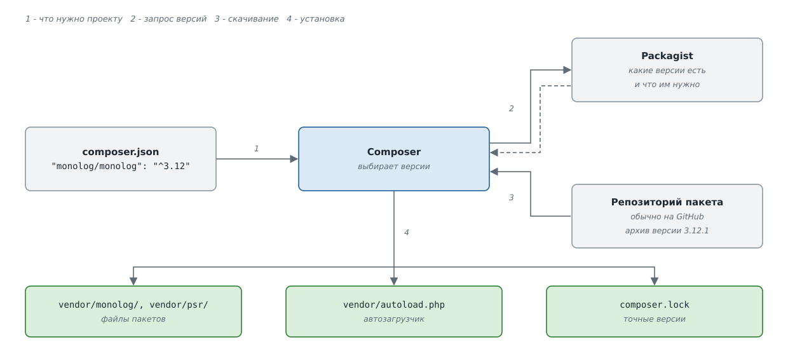
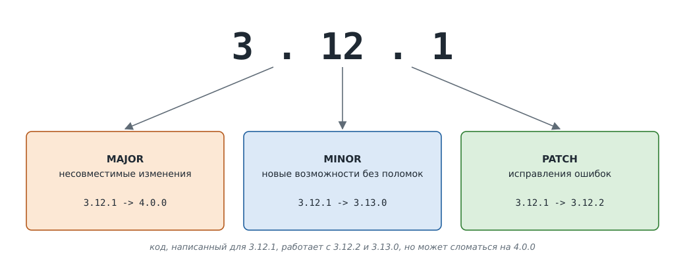
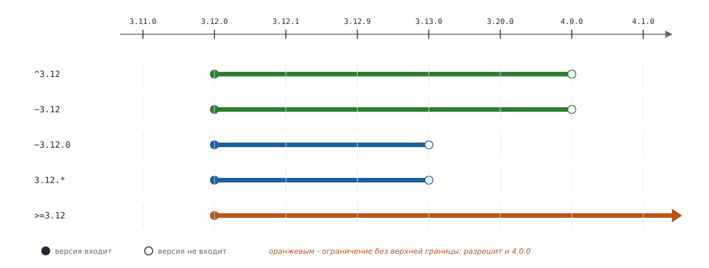
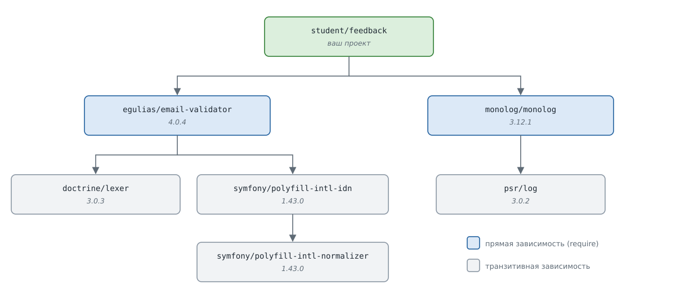
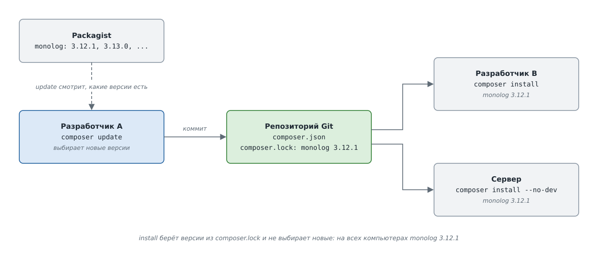
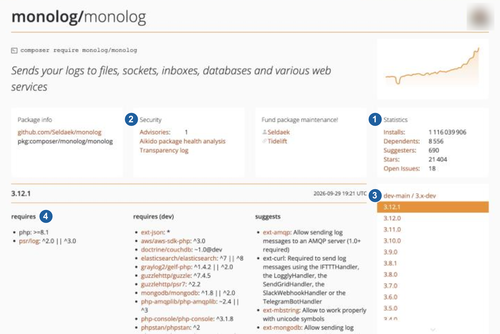

# Composer: менеджер зависимостей PHP

## Содержание

- [Composer: менеджер зависимостей PHP](#composer-менеджер-зависимостей-php)
  - [Содержание](#содержание)
  - [Вопросы для самопроверки](#вопросы-для-самопроверки)
  - [Результаты обучения](#результаты-обучения)
  - [Ретроспектива](#ретроспектива)
  - [Чужой код в проекте](#чужой-код-в-проекте)
  - [Пакеты и менеджеры пакетов](#пакеты-и-менеджеры-пакетов)
  - [Как устроен Composer](#как-устроен-composer)
  - [Установка Composer](#установка-composer)
  - [Первый проект с Composer](#первый-проект-с-composer)
    - [Создание `composer.json`](#создание-composerjson)
    - [Установка пакета](#установка-пакета)
    - [Подключение автозагрузчика Composer](#подключение-автозагрузчика-composer)
    - [Папка `vendor` и Git](#папка-vendor-и-git)
  - [Файл `composer.json`](#файл-composerjson)
    - [Основные поля](#основные-поля)
    - [Требования к PHP и расширениям](#требования-к-php-и-расширениям)
  - [Версии пакетов](#версии-пакетов)
    - [Семантическое версионирование](#семантическое-версионирование)
    - [Ограничения версий](#ограничения-версий)
    - [Стабильность версий](#стабильность-версий)
  - [Транзитивные зависимости](#транзитивные-зависимости)
    - [Дерево зависимостей](#дерево-зависимостей)
    - [Конфликт зависимостей](#конфликт-зависимостей)
  - [Файл `composer.lock`](#файл-composerlock)
    - [Зачем нужен lock-файл](#зачем-нужен-lock-файл)
    - [Команды `install` и `update`](#команды-install-и-update)
  - [Зависимости для разработки](#зависимости-для-разработки)
  - [Обновление зависимостей](#обновление-зависимостей)
    - [Поиск устаревших пакетов](#поиск-устаревших-пакетов)
    - [Команда `composer update`](#команда-composer-update)
    - [Обновление в командной работе](#обновление-в-командной-работе)
  - [Безопасность и выбор пакета](#безопасность-и-выбор-пакета)
    - [Проверка уязвимостей](#проверка-уязвимостей)
    - [Как выбрать пакет](#как-выбрать-пакет)
  - [Автозагрузка своих классов](#автозагрузка-своих-классов)
    - [Правило PSR-4 в `composer.json`](#правило-psr-4-в-composerjson)
    - [Файлы с функциями](#файлы-с-функциями)
    - [Оптимизация автозагрузки](#оптимизация-автозагрузки)
  - [Скрипты Composer](#скрипты-composer)
  - [Удаление зависимостей](#удаление-зависимостей)
  - [Основные команды Composer](#основные-команды-composer)
  - [Собираем решения вместе: форма обратной связи на Composer](#собираем-решения-вместе-форма-обратной-связи-на-composer)
  - [Резюме](#резюме)

## Вопросы для самопроверки

1. Какие проблемы появляются, если копировать чужую библиотеку в папку проекта вручную?
2. Чем менеджер зависимостей проекта отличается от системного менеджера пакетов?
3. Для чего нужны `composer.json`, `composer.lock`, папка `vendor/` и Packagist?
4. Какие версии разрешает ограничение `^3.12`, а какие - `~3.12.0`? Почему для версий `0.x` каретка ведёт себя иначе?
5. Что такое транзитивная зависимость? Почему в проекте может быть только одна версия каждого пакета?
6. Почему `vendor/` не добавляют в репозиторий, а `composer.lock` добавляют? Чем команда `composer install` отличается от `composer update`?
7. Чем `require` отличается от `require-dev`? Что произойдёт с вызовом `dump()` после `composer install --no-dev`?
8. Как узнать, для каких пакетов вышли новые версии? Почему `composer update` не устанавливает новую MAJOR-версию пакета?
9. Что нужно сделать после изменения секции `autoload` в `composer.json`? Почему пакет удаляют командой `composer remove`, а не удалением папки из `vendor/`?

## Результаты обучения

После изучения этой главы вы сможете:

- Объяснить, какие задачи решает менеджер зависимостей.
- Установить Composer и создать проект с файлом `composer.json`.
- Установить пакет из Packagist и использовать его классы через `vendor/autoload.php`.
- Прочитать номер версии по правилам SemVer и выбрать ограничение версии.
- Найти причину конфликта зависимостей по сообщению Composer.
- Объяснить разницу между `composer install` и `composer update` и роль `composer.lock`.
- Разделить зависимости приложения и зависимости для разработки.
- Найти устаревшие пакеты, обновить их и проверить на известные уязвимости.
- Выбрать пакет на Packagist по понятным критериям.
- Настроить автозагрузку своих классов и функций через `composer.json`.
- Удалить зависимость из проекта.

## Ретроспектива

В прошлой главе мы разделили приложение на файлы и папки, написали автозагрузчик по правилам PSR-4 и разложили классы по пространствам имён. В продвинутой версии формы обратной связи появилась учебная библиотека `SimpleMail`: её файл мы положили в папку `lib/` вручную и зарегистрировали для неё второй автозагрузчик.

Настоящие проекты используют десятки чужих библиотек. В этой главе разберём, как подключать их без ручного копирования, следить за их версиями и заменить самодельный автозагрузчик из прошлой главы. Разделы главы идут в том порядке, в каком разработчик работает с зависимостями:

1. Что такое менеджер зависимостей и как устроен Composer.
2. Установка зависимостей: пакеты, версии, транзитивные зависимости, lock-файл и зависимости для разработки.
3. Обновление зависимостей, проверка их безопасности и выбор пакета.
4. Использование зависимостей в коде: автозагрузка и скрипты.
5. Удаление зависимостей.

## Чужой код в проекте

Многие задачи веб-приложения уже решены другими разработчиками:

- запись событий в журнал,
- проверка адреса почты,
- отправка писем,
- работа с датами.

Писать такой код заново долго, и в нём легко допустить ошибку. Для этого можно использовать готовые _библиотеки_.

**Библиотека (library)** - готовый код, который решает определённую задачу и подключается к другим программам. Сама по себе библиотека не запускается: её классы и функции вызывает приложение.

**Зависимость (dependency)** - библиотека, без которой проект не работает. Если приложение вызывает класс библиотеки, приложение зависит от неё.

Самый простой способ подключить библиотеку - скачать её файлы и положить в папку проекта. Пока библиотека одна и маленькая, это работает. С ростом проекта появляются проблемы:

- _Библиотеку нужно найти и скачать вручную_. Каждый разработчик команды делает это сам и может скачать другую версию.
- _Обновлять приходится вручную_. Чтобы получить исправление ошибки, нужно узнать о нём, снова скачать файлы и заменить старые.
- _У библиотеки есть свои зависимости_. Библиотека для отправки писем может использовать библиотеку для работы с шаблонами, а та - ещё одну. Их тоже нужно найти и скачать, причём в подходящих версиях.
- _Версии должны быть совместимы_. Если две библиотеки используют третью, но требуют разных её версий, проект не соберётся. Найти такой конфликт вручную трудно.

Все эти задачи одинаковы для любой библиотеки, поэтому их решают не вручную, а отдельной программой.

## Пакеты и менеджеры пакетов

Чтобы программа могла скачивать и обновлять библиотеки, их нужно оформить одинаково: с именем, номером версии и списком зависимостей. Для этого используют _менеджеры пакетов_.

**Пакет (package)** - библиотека или приложение вместе с описанием: имя, версия, зависимости, правила автозагрузки.

**Репозиторий пакетов (package repository)** - сайт или сервер, где хранятся описания пакетов и откуда их скачивают.

**Менеджер пакетов (package manager)** - программа, которая находит пакеты в репозитории, скачивает подходящие версии вместе с их зависимостями, обновляет и удаляет их.

Менеджеры пакетов есть почти в каждом языке программирования. В JavaScript и Python используются те же идеи под другими названиями:

| Язык       | Менеджер | Репозиторий  | Файл со списком зависимостей |
| ---------- | -------- | ------------ | ---------------------------- |
| PHP        | Composer | Packagist    | `composer.json`              |
| JavaScript | npm      | npm registry | `package.json`[^1]           |
| Python     | pip      | PyPI         | `requirements.txt`[^2]       |

Менеджеры пакетов бывают двух видов:

- _Системный менеджер пакетов устанавливает программы в операционную систему_. Например, `apt` в Debian и Ubuntu управляет пакетами всей системы[^3]. Установленная программа доступна всем пользователям компьютера.
- _Менеджер зависимостей проекта устанавливает библиотеки в папку конкретного проекта_. У двух проектов на одном компьютере могут быть разные версии одной библиотеки, и они друг другу не мешают.

**Менеджер зависимостей (dependency manager)** - менеджер пакетов, который работает на уровне проекта: читает список зависимостей проекта и устанавливает их в папку этого проекта.

Composer относится ко второму виду: по умолчанию он ничего не устанавливает глобально[^4].

## Как устроен Composer

**Composer** - менеджер зависимостей для PHP[^4].

**Packagist** - основной репозиторий пакетов Composer[^5]. Composer по умолчанию ищет пакеты именно там.

Работа Composer опирается на четыре части:

| Часть           | Что это                                                 | Кто создаёт    |
| --------------- | ------------------------------------------------------- | -------------- |
| `composer.json` | список зависимостей проекта и его настройки             | разработчик    |
| `composer.lock` | точные версии всех установленных пакетов                | Composer       |
| `vendor/`       | папка с файлами установленных пакетов и автозагрузчиком | Composer       |
| Packagist       | репозиторий, где Composer находит пакеты                | авторы пакетов |

У каждого пакета есть имя.

**Имя пакета (package name)** - строка вида `vendor/package`: имя автора или организации и название пакета через `/`. Имя записывается строчными буквами, слова разделяются символами `-`, `.` или `_`[^6]. Например, `monolog/monolog` или `egulias/email-validator`. 

> [!NOTE]
> 
> Имя автора нужно, чтобы пакеты разных авторов с одинаковым названием не путались. Это похоже на пространства имён, только для пакетов.



_Рисунок 11.1. Как Composer устанавливает пакет_

На рисунке 11.1 показан путь пакета в проект:

1. Разработчик указывает в `composer.json`, какой пакет нужен.
2. Composer спрашивает у Packagist, какие версии пакета существуют и что им нужно.
3. Composer выбирает подходящие версии и скачивает архивы пакетов. Код пакета обычно лежит в Git-репозитории автора, например на GitHub, а Packagist сообщает, где его взять[^5].
4. Composer распаковывает пакеты в `vendor/`, записывает их точные версии в `composer.lock` и создаёт автозагрузчик.

Каждая из частей разобрана в следующих разделах.

## Установка Composer

> [!NOTE]
>
> Composer - программа на PHP, поэтому для его работы нужен установленный PHP.

Способ установки зависит от операционной системы:

- _Windows_. Необходимо скачать и запустить установщик `Composer-Setup.exe` со страницы [getcomposer.org/download](https://getcomposer.org/download/). Он установит последнюю версию и настроит переменную `PATH`, чтобы команду `composer` можно было запускать из любой папки[^4].
- _macOS и Linux_. Необходимо выполнить в терминале команды со страницы [getcomposer.org/download](https://getcomposer.org/download/). Они скачают установщик, проверят его контрольную сумму и создадут `composer.phar` в текущей папке[^7]. Затем файл необходимо переместить в папку из `PATH`:
  - `mv composer.phar /usr/local/bin/composer`[^4].
  - Если команда отвечает `Permission denied`, её необходимо выполнить через `sudo`: права администратора нужны только для перемещения файла, а не для работы Composer.

Установку проверяет команда:

```bash
composer -V
```

Команда выводит версию Composer и PHP, на котором он работает:

```text
Composer version 2.11.2 2026-11-10 10:09:37
PHP version 8.4.5 (/opt/homebrew/Cellar/php/8.4.5_1/bin/php)
```

Если терминал отвечает `command not found` или `не является внутренней или внешней командой`, папки с Composer нет в `PATH`. _Обычно помогает перезапуск терминала после установки_.

> [!WARNING]
>
> Composer не следует запускать от имени администратора (root). Пакеты могут выполнять свои скрипты во время установки, и эти скрипты получат права администратора. Документация Composer настоятельно советует этого избегать[^8].

## Первый проект с Composer

Composer установлен. Теперь создадим проект и установим в него первую библиотеку.

### Создание `composer.json`

Composer узнаёт о проекте из файла `composer.json` в корневой папке проекта. Файл можно написать вручную или создать командой `composer init`.

_Синтаксис_

```bash
composer init [--name=vendor/package] [--description=описание] [--type=тип] [--license=лицензия] [--no-interaction]
```

- `--name` - имя проекта в формате `vendor/package`.
- `--description` - короткое описание проекта.
- `--license` - условия использования кода, например `MIT`.
- `--type` - тип пакета. Для приложения указывают `project`, для библиотеки - `library` (значение по умолчанию)[^6].
- `--no-interaction` - не задавать вопросов. Без этого флага команда спрашивает имя, описание, автора и зависимости по очереди[^9].

Автора команда берёт из настроек Git: значения `user.name` и `user.email`.

_Пример_. Создадим папку `01_first_project` и выполним в ней:

```bash
composer init --name=student/first-project --type=project --no-interaction
```

Composer выводит `Writing ./composer.json` и создаёт файл:

```json
{
  "name": "student/first-project",
  "type": "project",
  "authors": [
    {
      "name": "Anna Popescu",
      "email": "anna@example.com"
    }
  ],
  "require": {}
}
```

Файл записан в формате JSON. Пустой объект `"require": {}` означает, что зависимостей пока нет.

### Установка пакета

Рассмотрим установку на примере `Monolog` - библиотеки для записи журнала.

Пакет добавляется командой `composer require`.

_Синтаксис_

```bash
composer require vendor/package[:ограничение] [--dev]
```

- `vendor/package` - имя пакета. Можно указать несколько пакетов через пробел.
- `:ограничение` - какие версии подходят, например `monolog/monolog:^3.0`. Если ограничение не указано, Composer выберет его сам[^9].
- `--dev` - добавить пакет в зависимости для разработки, то есть он будет использоваться только при разработке и не попадёт в зависимости для продакшена.

_Пример_ установки пакета Monolog (_выполняется в папке проекта_)

```bash
composer require monolog/monolog
```

После команды в `composer.json` появится новая зависимость:

```json
"require": {
    "monolog/monolog": "^3.12"
}
```

А в папке проекта появятся новые файлы:

```text
01_first_project/
├── composer.json
├── composer.lock        точные версии пакетов
└── vendor/
    ├── autoload.php     автозагрузчик Composer
    ├── composer/        служебные файлы автозагрузчика
    ├── monolog/         пакет monolog/monolog
    └── psr/             пакет psr/log
```

### Подключение автозагрузчика Composer

Composer автоматически создаёт файл `vendor/autoload.php`, который регистрирует автозагрузку для всех установленных пакетов[^10]. Достаточно подключить его один раз в точке входа:

```php
require __DIR__ . '/../vendor/autoload.php';
```

После этого классы любого пакета доступны по полным именам (то есть с указанием пространства имён) или через `use`.

### Папка `vendor` и Git

В папке `vendor/` лежит код чужих пакетов. Документация Composer не рекомендует добавлять её в репозиторий[^11]:

- _Репозиторий становится большим_. Каждое обновление пакета добавляет в историю тысячи изменённых строк чужого кода.
- _История пакетов дублируется_. У каждого пакета уже есть свой репозиторий со своей историей.
- _Папку легко восстановить_. Команда `composer install` создаёт `vendor/` заново по `composer.json` и `composer.lock`.

Поэтому `vendor/` добавляют в `.gitignore`.

Файлы `composer.json` и `composer.lock` в репозиторий добавляют.

Когда другой разработчик клонирует такой репозиторий, папки `vendor/` у него нет. Перед запуском проекта необходимо выполнить `composer install`.

## Файл `composer.json`

Команды `init` и `require` записывают в `composer.json` несколько полей. Рассмотрим их подробнее.

### Основные поля

Для приложения обычно нужны такие поля[^6]:

| Поле          | Что в нём                                                        | Пример                           |
| ------------- | ---------------------------------------------------------------- | -------------------------------- |
| `name`        | имя пакета `vendor/package`                                      | `"student/feedback"`             |
| `description` | короткое описание в одну строку                                  | `"Форма обратной связи"`         |
| `type`        | тип пакета: `project` для приложения, `library` для библиотеки   | `"project"`                      |
| `license`     | условия использования кода, для закрытого кода - `"proprietary"` | `"MIT"`                          |
| `require`     | пакеты, без которых приложение не работает                       | `{"monolog/monolog": "^3.12"}`   |
| `require-dev` | пакеты, нужные только при разработке                             | `{"symfony/var-dumper": "^8.1"}` |
| `autoload`    | правила автозагрузки классов проекта                             | `{"psr-4": {"App\\": "src/"}}`   |
| `scripts`     | короткие команды для частых действий                             | `{"start": "php -S ..."}`        |

Поля `name` и `description` обязательны только для пакетов, которые публикуют на Packagist[^6]. Для приложения они необязательны, но помогают понять, что это за проект.

### Требования к PHP и расширениям

Пакету может понадобиться определённая версия PHP или расширение PHP, например `mbstring` для функции `mb_strlen()`. Composer не может их установить, но может проверить.

**Платформенный пакет (platform package)** - виртуальный пакет, который описывает то, что уже установлено в системе:

- версию PHP (`php`),
- расширение PHP (`ext-имя`)[^12].

Composer ничего не скачивает для платформенного пакета, а сравнивает требование с PHP, на котором запущен.

_Пример_. Форма обратной связи вызывает `mb_strlen()` и использует синтаксис PHP 8.1, например свойства `readonly`. Запишем эти требования в `composer.json`:

```json
"require": {
    "php": ">=8.1",
    "ext-mbstring": "*"
}
```

- Запись `">=8.1"` означает "PHP 8.1 или новее".
- Для расширений документация советует ограничение `*` (любая версия).

Если требование не выполнено, Composer откажется устанавливать зависимости и объяснит причину. Кроме того, `vendor/autoload.php` при подключении проверяет версию PHP. Если приложение перенесли на сервер со старым PHP, оно остановится с понятным сообщением, а не упадёт в случайном месте[^13].

## Версии пакетов

В `composer.json` рядом с именем пакета записано ограничение вроде `^3.12`. Чтобы понять, что оно означает, нужно сначала разобраться, как пакеты нумеруют версии.

Авторы пакетов постоянно выпускают новые версии. Одни версии только исправляют ошибки, другие меняют поведение так, что старый код перестаёт работать. Composer должен понимать, какие версии безопасно ставить в проект.

### Семантическое версионирование

**Семантическое версионирование (Semantic Versioning, SemVer)** - соглашение о номерах версий вида `MAJOR.MINOR.PATCH`, в котором каждая часть номера сообщает, насколько изменился пакет[^14]. Composer и большинство пакетов на Packagist следуют этому соглашению[^15].

Правила SemVer[^14]:

- _MAJOR растёт при несовместимых изменениях_. Например, автор удалил метод или изменил его параметры. Код, который работал со старой версией, может перестать работать. Обычно это очень крупные изменения.
- _MINOR растёт при новых возможностях без поломок_. Старый код продолжает работать, а у пакета появились новые классы или методы.
- _PATCH растёт при исправлении ошибок_. Публичные классы и методы не меняются.
  
> [!NOTE]
> 
> _При росте одной части все младшие обнуляются_. После `3.12.1` новая MINOR-версия будет `3.13.0`, а новая MAJOR-версия - `4.0.0`.



_Рисунок 11.2. Части номера версии_

На рисунке 11.2 разобран номер `3.12.1` установленного Monolog:

- `3` - MAJOR,
- `12` - MINOR,
- `1` - PATCH.

Переход на `3.12.2` или `3.13.0` код проекта не сломает. Переход на `4.0.0` может потребовать правок.

> [!IMPORTANT]
>
> Версии `0.x.y` - особый случай. Стандарт SemVer называет их начальной разработкой, в которой что угодно может измениться в любой момент[^14]. Даже переход с `0.3` на `0.4` может сломать код.

Номер версии может иметь суффикс предварительной версии через дефис: `2.0.0-beta1`, `2.0.0-RC1`[^14]. Рассмотрим такие суффиксы далее в разделе "Стабильность версий".

### Ограничения версий

Указать в `composer.json` одну точную версию можно, но тогда проект не получит даже исправления ошибок. Обычно указывают диапазон подходящих версий.

**Ограничение версии (version constraint)** - запись, которая описывает набор подходящих версий пакета[^15]. Из всех версий, которые удовлетворяют ограничениям, Composer выбирает самую новую.

| Ограничение                                                                 | Пример       | Какие версии подходят                             |
| --------------------------------------------------------------------------- | ------------ | ------------------------------------------------- |
| Точная версия                                                               | `3.12.1`     | только `3.12.1`                                   |
| Диапазон                                                                    | `>=3.0 <4.0` | от `3.0.0` включительно до `4.0.0`, не включая её |
| Звёздочка `*`  - разрешает любые версии в пределах указанной части версии     | `3.12.*`     | `>=3.12.0 <3.13.0`                                |
| Тильда `~` - разрешает обновления только в пределах указанной части версии  | `~3.12`      | `>=3.12.0 <4.0.0`                                 |
| Тильда `~` - разрешает обновления только в пределах указанной части версии  | `~3.12.0`    | `>=3.12.0 <3.13.0`                                |
| Каретка `^` - разрешает обновления до следующей MAJOR-версии                | `^3.12`      | `>=3.12.0 <4.0.0`                                 |
| Каретка `^` для `0.x` - разрешает обновления только в пределах MINOR-версии | `^0.3`       | `>=0.3.0 <0.4.0`                                  |

Правила для тильды и каретки отличаются[^15]:

- _Тильда `~` разрешает расти последней указанной части_. 
  - В `~3.12` последняя часть - MINOR, поэтому подходят `3.13`, `3.14` и так далее до `4.0.0`.
  - В `~3.12.0` последняя часть - PATCH, и подходят только `3.12.x`.
- _Каретка `^` разрешает всё, что не меняет MAJOR_. По правилам SemVer такие обновления не ломают код. Для версий `0.x` каретка осторожнее и не меняет MINOR: `^0.3` не разрешит `0.4.0`.



_Рисунок 11.3. Ограничения версий на оси_

Документация Composer рекомендует каретку `^`: она соответствует SemVer и разрешает все обновления без поломок[^15].

Ограничения без верхней границы, такие как `*` или `>=3.0`, опасны для обычных пакетов. Они разрешают будущую версию `4.0.0`, которая может сломать проект[^16]. Для платформенных пакетов `php` и `ext-*` такие ограничения допустимы: Composer их не устанавливает, а только проверяет.

> [!TIP]
>
> В PowerShell на Windows каретку в командной строке нужно повторить четыре раза: `composer require "monolog/monolog:^^^^3.0"`. Иначе она не дойдёт до Composer[^15].

### Стабильность версий

Кроме номера у версии есть стабильность. Composer различает пять уровней, от наименее стабильного к наиболее стабильному[^15]:

1. `dev`,
2. `alpha`,
3. `beta`,
4. `RC`,
5. `stable`.

Уровень определяется суффиксом: `2.0.0-beta1` - `beta`, `2.0.0-RC1` - `RC`, версия без суффикса - `stable`.

По умолчанию Composer устанавливает только стабильные версии: поле `minimum-stability` в `composer.json` по умолчанию равно `stable`[^6]. Поэтому `composer require` не поставит в проект бета-версию, даже если она новее стабильной.

## Транзитивные зависимости

Ограничения версий задают не только проект, но и каждый его пакет: библиотеки сами используют другие библиотеки. Если устанавливать только то, что указано в `composer.json` проекта, код библиотек не найдёт нужных ему классов. Поэтому Composer устанавливает и зависимости зависимостей. Например, при установке Monolog он поставил ещё и `psr/log`, хотя мы его не просили.

### Дерево зависимостей

**Прямая зависимость (direct dependency)** - пакет, который указан в `require` или `require-dev` файла `composer.json` проекта.

**Транзитивная зависимость (transitive dependency)** - пакет, который нужен не самому проекту, а одной из его зависимостей.

Пакет `psr/log` - транзитивная зависимость: его требует Monolog.

Посмотреть зависимости помогают две команды:

- `composer show` - список установленных пакетов с версиями,
- `composer show --tree` - дерево: прямые зависимости и всё, что они тянут за собой.

_Пример_. Например для библиотеки `egulias/email-validator` и `monolog/monolog` команда `composer show --tree` выводит:

```text
egulias/email-validator 4.0.4 A library for validating emails against several RFCs
|--doctrine/lexer ^2.0 || ^3.0
|  `--php ^8.1
|--php >=8.1
`--symfony/polyfill-intl-idn ^1.26
   |--php >=7.2
   `--symfony/polyfill-intl-normalizer ^1.10
      `--php >=7.2
monolog/monolog 3.12.1 Sends your logs to files, sockets, inboxes, databases and various web services
|--php >=8.1
`--psr/log ^2.0 || ^3.0
   `--php >=8.0.0
```

Каждая строка с отступом - зависимость пакета из строки выше и её ограничение версии. Пакет `egulias/email-validator` требует `doctrine/lexer` и `symfony/polyfill-intl-idn`, а `symfony/polyfill-intl-idn` в свою очередь требует `symfony/polyfill-intl-normalizer`.



_Рисунок 11.4. Дерево зависимостей формы обратной связи_

На рисунке 11.4 то же дерево показано схемой: две прямые зависимости проекта и четыре транзитивные.

Обратный вопрос "почему этот пакет установлен?" решает команда `composer why` (полное название - `composer depends`):

```bash
composer why psr/log
```

```text
monolog/monolog 3.12.1 requires psr/log (^2.0 || ^3.0)
```

Ответ: `psr/log` нужен Monolog, и подходят версии `2.x` и `3.x`.

### Конфликт зависимостей

PHP не может загрузить два класса с одним полным именем. Поэтому в проекте может быть только одна версия каждого пакета. Если два пакета требуют одну и ту же зависимость, Composer ищет версию, которая подходит обоим.

**Конфликт зависимостей (dependency conflict)** - ситуация, когда нет набора версий, который удовлетворяет всем ограничениям проекта и его зависимостей.

_Пример_. В `composer.json` записаны две зависимости:

```json
"require": {
    "psr/log": "^1.1",
    "monolog/monolog": "^3.12"
}
```

Проект использует `psr/log` версии `1.x`, а Monolog 3 требует `psr/log` версии `2.x` или `3.x`. Команда `composer install` останавливается с ошибкой:

```text
Your requirements could not be resolved to an installable set of packages.

// ...
```

Исправить конфликт можно двумя способами:

- _Изменить своё ограничение_. Если код проекта работает с `psr/log` 3, ограничение меняют на `"psr/log": "^3.0"`.
- _Выбрать другую версию пакета_. Если код проекта привязан к `psr/log` 1, для Monolog указывают `"monolog/monolog": "^2.0"`. Monolog 2 совместим с `psr/log` 1: Composer установит `monolog/monolog 2.11.1` и `psr/log 1.1.4`.

Похожее сообщение появляется, если версия PHP слишком старая. На PHP 8.0 команда `composer require monolog/monolog:^3.0` завершится такой строкой:

```text
    - monolog/monolog[3.0.0, ..., 3.12.1] require php >=8.1 -> your php version (8.0.30) does not satisfy that requirement.
```

Здесь мешает платформенный пакет `php`: Monolog 3 требует PHP 8.1, а установлен 8.0.30. Исправление:

- Обновить PHP,
- Выбрать версию пакета, которая работает со старым PHP.

Если ограничение не указано, `composer require monolog/monolog` на PHP 8.0 сам выберет Monolog 2 и ошибки не будет.

## Файл `composer.lock`

Composer выбирает версии в пределах ограничений проекта и его пакетов. Ограничение `^3.12` разрешает много версий. Это удобно для обновлений, но создаёт новую проблему.

### Зачем нужен lock-файл

Допустим, разработчик написал `composer.json` с ограничением `^3.12` в сентябре, когда последней была версия `3.12.1`. Через два месяца выходит `3.13.0`. Его коллега клонирует репозиторий и устанавливает зависимости. Если бы Composer смотрел только на `composer.json`, коллега получил бы `3.13.0`, а сервер, настроенный ещё через месяц, - какую-нибудь `3.14.0`.

Все версии подходят под `^3.12`, но код в них разный. Ошибка, которая есть только в одной версии, проявится на одном компьютере и не проявится на другом.

**Lock-файл (lock file)** - файл `composer.lock`, в котором Composer записывает точную версию каждого установленного пакета, включая транзитивные[^10].

Фрагмент `composer.lock` первого проекта:

```json
{
    "content-hash": "8f849602df37ad949da1c02920f4d9d7",
    "packages": [
        {
            "name": "monolog/monolog",
            "version": "3.12.1",
            "source": {
                "type": "git",
                "url": "https://github.com/Seldaek/monolog.git",
                "reference": "d7059e4c691d05ea1222b5124bed0f961be46e15"
            },
            ...
        }
    ]
}
```

В записи пакета указаны:

- `version` - точная версия `3.12.1`, а не ограничение `^3.12`,
- `reference` - идентификатор коммита в репозитории пакета: по нему Composer получает именно это состояние кода,
- `content-hash` - контрольная сумма важных полей `composer.json`: по ней Composer замечает, что `composer.json` изменили после создания lock-файла.

Lock-файл создаёт и меняет только Composer. Вручную его не правят.

### Команды `install` и `update`

Lock-файл используют две основные команды Composer[^10]:

| Команда                           | Что читает      | Что делает                                                                                                 | Когда запускать                                                             |
| --------------------------------- | --------------- | ---------------------------------------------------------------------------------------------------------- | --------------------------------------------------------------------------- |
| `composer install`                | `composer.lock` | устанавливает точно те версии, которые записаны в lock-файле; если lock-файла нет, ведёт себя как `update` | после клонирования репозитория, после получения чужих изменений, на сервере |
| `composer update`                 | `composer.json` | выбирает самые новые версии в пределах ограничений, переписывает `composer.lock` и устанавливает их        | когда разработчик решил обновить зависимости                                |
| `composer update vendor/package`  | `composer.json` | обновляет только указанный пакет                                                                           | когда нужно обновить один пакет                                             |
| `composer require vendor/package` | `composer.json` | добавляет пакет и обновляет lock-файл                                                                      | когда нужно добавить новый пакет                                            |

Команда `install` нужна каждый раз, когда проект разворачивают на новом компьютере. Команда `update` разобрана в разделе "Обновление зависимостей".

## Зависимости для разработки

Иногда разработчику нужны дополнительные пакеты, которые не нужны приложению в продакшене, а только при разработке. Например:

- инструменты отладки,
- инструменты для тестов,
- инструменты проверки кода.

На сервере они не нужны, а иногда и вредны: инструмент отладки может показать посетителю внутренние данные приложения.

**Dev-зависимость (dev dependency)** - пакет, который нужен только при разработке. Такие пакеты записывают в секцию `require-dev`[^6].

Пакет добавляют в `require-dev` флагом `--dev`:

```bash
composer require --dev symfony/var-dumper
```

Пакет `symfony/var-dumper` добавляет функцию `dump()`. Она выводит содержимое переменной нагляднее, чем `var_dump()`[^17].

Composer записывает пакет в отдельную секцию:

```json
"require": {
    "monolog/monolog": "^3.12"
},
"require-dev": {
    "symfony/var-dumper": "^8.1"
}
```

_Пример_. Файл `public/debug.php`:

```php
<?php

declare(strict_types=1);

require __DIR__ . '/../vendor/autoload.php';

$form = ['name' => 'Анна', 'email' => 'anna@example.com', 'tags' => ['php', 'composer']];

dump($form);
```

Команда `php public/debug.php` выводит:

```text
array:3 [
  "name" => "Анна"
  "email" => "anna@example.com"
  "tags" => array:2 [
    0 => "php"
    1 => "composer"
  ]
]
```

На сервере зависимости устанавливаются без dev-пакетов:

```bash
composer install --no-dev
```

Поэтому в `require-dev` кладут только то, без чего приложение может работать. Вызовы `dump()` удаляют из кода после отладки.

> [!NOTE]
>
> В npm то же разделение называется `dependencies` и `devDependencies`[^1].

## Обновление зависимостей

Зависимости установлены, а их точные версии записаны в `composer.lock`. Со временем авторы пакетов выпускают новые версии, в них:

- Исправляют ошибки,
- Исправляют проблемы безопасности,
- Добавляют новые возможности.

Lock-файл сам их не подхватывает: когда обновлять зависимости, решает разработчик.

### Поиск устаревших пакетов

Прежде чем обновлять зависимости, полезно узнать, для каких пакетов вышли новые версии. Их показывает команда `composer outdated`[^9].

_Синтаксис_

```bash
composer outdated [--direct]
```

- `--direct` - показать только прямые зависимости.

Каждый устаревший пакет команда отмечает знаком[^9]:

- `!` - вышла версия, совместимая по правилам SemVer, обновление рекомендуется,
- `~` - вышла новая MAJOR-версия, обновление возможно, но может потребовать правок кода.

_Пример_. В проекте установлен Monolog `3.11.0`, а в `composer.json` записано ограничение `^3.0`. Команда `composer outdated` выводит:

```text
Legend:
! patch or minor release available - update recommended
~ major release available - update possible

Direct dependencies required in composer.json:
monolog/monolog 3.11.0 ! 3.12.1 Sends your logs to files, sockets, inboxes, ...

Transitive dependencies not required in composer.json:
Everything up to date
```

Строка `monolog/monolog 3.11.0 ! 3.12.1` означает, что установлена версия `3.11.0`, а вышла `3.12.1`. Знак `!` стоит потому, что новая версия отличается только MINOR-частью и подходит под ограничение `^3.0`. Для транзитивных зависимостей новых версий нет: `Everything up to date`.

### Команда `composer update`

Обновление выполняет команда `composer update`. Она уже встречалась в таблице раздела "Команды `install` и `update`".

_Синтаксис_

```bash
composer update [vendor/package]
```

- Без аргументов команда обновляет все пакеты в пределах ограничений `composer.json`.
- С именем пакета обновляется только этот пакет. Можно указать несколько пакетов через пробел[^10].

_Пример_. Обновим Monolog из предыдущего примера:

```bash
composer update monolog/monolog
```

Файл `composer.json` после обновления не изменился: ограничение `^3.0` по-прежнему разрешает версию `3.12.1`. Команда `update` не выходит за пределы ограничений. Чтобы перейти на новую MAJOR-версию, необходимо изменить ограничение в `composer.json` и проверить код приложения: новая MAJOR-версия может быть несовместима со старым кодом.

### Обновление в командной работе

Обновление, выполненное на одном компьютере, нужно передать остальным участникам проекта и серверу. Для этого lock-файл добавляют в репозиторий. Тогда все участники проекта и все серверы получают одинаковые версии пакетов[^10].

Обычный порядок работы выглядит так:

1. Разработчик решает обновить зависимости и запускает `composer update`.
2. Он проверяет, что приложение работает с новыми версиями.
3. Он делает коммит изменённых `composer.json` и `composer.lock`.
4. Коллеги после получения изменений запускают `composer install` и получают те же версии.
5. На сервере тоже запускают `composer install`.



_Рисунок 11.5. Команды `install` и `update` в работе команды_

На рисунке 11.5 `update` выполняет один разработчик, а остальные компьютеры получают версии через lock-файл и команду `install`.

Типичные ошибки при работе с lock-файлом:

- _`composer update` на сервере_. Сервер получит версии, которые никто не проверял. На сервере запускают только `install`.
- _Lock-файл не добавлен в репозиторий_. Тогда каждый `composer install` работает как `update`, и версии на разных компьютерах расходятся.
- _Конфликт слияния в `composer.lock`_. Если два разработчика изменили зависимости в разных ветках, Git может не суметь объединить lock-файл. Править его вручную не нужно.

## Безопасность и выбор пакета

Обновления закрывают не только ошибки, но и уязвимости. Код пакетов попадает в приложение и выполняется на сервере, поэтому ошибка в пакете становится ошибкой приложения.

### Проверка уязвимостей

**Уязвимость (vulnerability)** - ошибка в программе, которую злоумышленник может использовать, например чтобы прочитать чужие данные. Когда уязвимость в пакете находят, публикуют _рекомендацию по безопасности (security advisory)_: описание уязвимости и список версий пакета, в которых она есть.

Composer проверяет пакеты по таким рекомендациям:

- _Команда `composer audit`_ проверяет установленные пакеты и выводит найденные уязвимости. По умолчанию она берёт данные из Packagist[^9]. Если проблем нет, команда выводит `No security vulnerability advisories found.`
- _Команды `require` и `update` проверяют пакеты автоматически_. Строку `No security vulnerability advisories found` можно увидеть в выводе `composer require`[^9].
- _Composer не обновляет пакеты до уязвимых версий_.

Если `audit` нашёл уязвимость, необходимо обновить пакет до версии с исправлением командой `composer update vendor/package`.

Ещё одна проблема - пакеты, которые автор перестал поддерживать. Для них уязвимости никто не исправит. Composer называет такие пакеты заброшенными (abandoned) и сообщает о них при установке и в `composer audit`[^9].

### Как выбрать пакет

Аудит проверяет пакеты, которые уже установлены. Новый пакет рекомендуется оценить ещё до установки. Для одной задачи на Packagist обычно есть несколько пакетов. Их можно найти на [packagist.org](https://packagist.org).

На странице пакета есть готовая команда `composer require` и ссылка на репозиторий с документацией. Данные на странице помогают сравнить пакеты.



_Рисунок 11.6. Страница пакета monolog/monolog на Packagist. Источник: packagist.org, снимок 10.11.2026[^18]_

На рисунке 11.6 показана страница Monolog на 10 ноября 2026 года. Для выбора полезны такие данные:

| Что смотреть                        | Где на странице                                                  | Что это говорит                                                                                                       |
| ----------------------------------- | ---------------------------------------------------------------- | --------------------------------------------------------------------------------------------------------------------- |
| Число установок и зависимых пакетов | блок `Statistics`, строки `Installs` и `Dependents` (метка 1)    | сколько раз пакет установили и сколько других пакетов на нём построено; популярные пакеты лучше проверены             |
| Уязвимости                          | блок `Security`, строка `Advisories` (метка 2)                   | сколько уязвимостей нашли во всех версиях пакета; затрагивают ли они установленную версию, проверяет `composer audit` |
| Последняя версия и её дата          | список версий справа (метка 3), дата - над блоком `requires`     | поддерживается ли пакет сейчас                                                                                        |
| Требования                          | блок `requires` выбранной версии (метка 4)                       | подходит ли пакет к версии PHP проекта и сколько транзитивных зависимостей добавит                                    |
| Лицензия                            | под блоками требований выбранной версии, на рисунок не попала    | можно ли использовать пакет в проекте                                                                                 |
| Пометка `abandoned`                 | предупреждение на странице заброшенного пакета; у Monolog её нет | автор прекратил поддержку                                                                                             |

Числа на странице меняются каждый день, поэтому важен порядок величин, а не точное значение.

## Автозагрузка своих классов

Зависимости установлены, обновлены и проверены. Остаётся использовать их в коде вместе с классами самого проекта. До сих пор автозагрузчик Composer подключал только классы установленных пакетов, но он умеет загружать и классы проекта.

### Правило PSR-4 в `composer.json`

В прошлой главе автозагрузчик связывал префикс пространства имён `App\` с папкой `src/`. В Composer ту же пару записывают в секцию `autoload`[^10]:

```json
"autoload": {
    "psr-4": {
        "App\\": "src/"
    }
}
```

Правила записи:

- _Префикс заканчивается на `\\`_. Это требование Composer[^6].
- _Обратная косая черта удваивается_. В JSON, как и в строках PHP, `\` экранирует следующий символ.
- _Путь к папке указывается от корня проекта_, где лежит `composer.json`[^6].

Composer читает `composer.json` только при установке пакетов и при генерации автозагрузчика. Если секцию `autoload` изменили, автозагрузчик нужно создать заново[^10].

_Синтаксис_

```bash
composer dump-autoload [-o]
```

- `-o` (`--optimize`) - создать оптимизированный автозагрузчик. Он разобран в подразделе "Оптимизация автозагрузки"

_Пример_. Проект содержит классы `App\Contact\ContactForm` и `App\Contact\Validator` в папке `src/Contact/`. После добавления секции `autoload`

```json
{
  "autoload": {
    "psr-4": {
      "App\\": "src/"
    }
  }
}
```

Необходимо пересоздать автозагрузчик командой:

```bash
composer dump-autoload
```

Теперь программа подключает только `vendor/autoload.php` и может использовать классы `App\Contact\ContactForm` и `App\Contact\Validator` без дополнительных `require`.

```php
<?php

declare(strict_types=1);

require __DIR__ . '/../vendor/autoload.php';

use App\Contact\ContactForm;
use App\Contact\Validator;

$form = ContactForm::fromArray(['name' => '<b>Анна</b>', 'email' => 'anna@']);
$errors = (new Validator())->validate($form);

echo $form->name . "\n";
print_r($errors);
```

### Файлы с функциями

В прошлой главе, мы выяснили, что автозагрузчик не подключает функции. Файл `functions.php` приходилось подключать отдельной строкой `require_once`.

В Composer такие файлы перечисляют в секции `files`. Автозагрузчик подключает их при каждом подключении `vendor/autoload.php`[^6]:

```json
"autoload": {
    "psr-4": {
        "App\\": "src/"
    },
    "files": [
        "src/functions.php"
    ]
}
```

### Оптимизация автозагрузки

Для каждого нового класса автозагрузчик PSR-4 строит путь и проверяет, существует ли файл. На рабочем сервере, где важна скорость, эти проверки можно убрать.

**Карта классов (class map)** - массив, в котором каждому полному имени класса заранее сопоставлен путь к его файлу.

Команда `composer dump-autoload -o` превращает правила PSR-4 в карту классов[^19]:

В карту попали три класса:

- `App\Contact\ContactForm`,
- `App\Contact\Validator`,
- служебный класс Composer `Composer\InstalledVersions`.

Теперь автозагрузчик находит файл в массиве, а не проверяет файловую систему.

Документация Composer советует всегда включать эту оптимизацию на рабочем сервере[^19]. При разработке она мешает: новый класс не попадёт в карту, пока снова не выполнят `dump-autoload -o`. На сервере зависимости устанавливают так:

```bash
composer install --no-dev --optimize-autoloader
```

## Скрипты Composer

Секция `autoload` - не единственная настройка `composer.json`, которая упрощает работу с проектом. Разработчики часто повторяют одни и те же команды:

- запуск сервера,
- запуск тестов,
- проверка кода.

Длинную команду легко записать с ошибкой, а новый участник проекта может её не знать.

**Скрипт Composer (Composer script)** - короткое имя для команды или списка команд, записанное в секции `scripts` файла `composer.json`[^20].

_Пример_. Добавим скрипт для запуска встроенного сервера PHP:

```json
"scripts": {
    "start": [
        "Composer\\Config::disableProcessTimeout",
        "php -S localhost:8000 -t public"
    ]
}
```

Скрипт запускают командой `composer run-script start` или короче `composer start`[^20]. Composer выполнит команды по порядку.

Первая строка нужна из-за ограничения времени. Composer останавливает скрипт, который работает дольше 300 секунд[^20]. Встроенный сервер работает, пока его не остановят, и без этой строки он завершился бы через 300 секунд. Вызов `Composer\Config::disableProcessTimeout` снимает ограничение для этого скрипта[^20].

## Удаление зависимостей

Последний этап работы с зависимостью - удаление. Пакет становится ненужным, когда его заменяют другим пакетом или когда из приложения убирают функцию, для которой он был нужен.

Удалять папку пакета из `vendor/` вручную нельзя: пакет останется в `composer.json` и `composer.lock`, и следующий `composer install` вернёт его. Пакет удаляет команда `composer remove`[^9].

_Синтаксис_

```bash
composer remove vendor/package [--dev]
```

- `vendor/package` - имя пакета. Можно указать несколько пакетов через пробел.
- `--dev` - удалить пакет из секции `require-dev`[^9].

Команда выполняет три действия:

1. Удаляет пакет из `composer.json`.
2. Пересчитывает зависимости и обновляет `composer.lock`.
3. Удаляет из `vendor/` сам пакет и его транзитивные зависимости, которые больше не нужны другим пакетам.

_Пример_. Удаление Monolog из проекта, где он единственная прямая зависимость:

```bash
composer remove monolog/monolog
```

```text
./composer.json has been updated
Running composer update monolog/monolog
Loading composer repositories with package information
Updating dependencies
Lock file operations: 0 installs, 0 updates, 2 removals
  - Removing monolog/monolog (3.12.1)
  - Removing psr/log (3.0.2)
Writing lock file
Installing dependencies from lock file (including require-dev)
Package operations: 0 installs, 0 updates, 2 removals
  - Removing psr/log (3.0.2)
  - Removing monolog/monolog (3.12.1)
Generating autoload files
No installed packages - skipping audit.
```

Команда удалила два пакета, хотя в ней указан один. Пакет `psr/log` был транзитивной зависимостью Monolog, и другим пакетам он не нужен. Последняя строка означает, что пакетов в проекте не осталось и проверять на уязвимости нечего.

Перед удалением пакета необходимо убрать из кода все обращения к его классам. Если код по-прежнему создаёт объект `new Logger(...)`, после удаления Monolog PHP остановится с ошибкой `Class "Monolog\Logger" not found`.

## Основные команды Composer

В таблице собраны самые частые команды: от создания проекта до удаления пакета. Полный список выводит `composer list`[^9].

| Команда                                  | Что делает                                                             |
| ---------------------------------------- | ---------------------------------------------------------------------- |
| `composer init`                          | создаёт `composer.json`                                                |
| `composer require vendor/package`        | добавляет пакет в `require` и устанавливает его                        |
| `composer require --dev vendor/package`  | добавляет пакет в `require-dev` и устанавливает его                    |
| `composer install`                       | устанавливает версии из `composer.lock`                                |
| `composer install --no-dev`              | то же, без пакетов из `require-dev`                                    |
| `composer show`, `composer show --tree`  | список установленных пакетов, дерево зависимостей                      |
| `composer why vendor/package`            | какие пакеты требуют указанный пакет                                   |
| `composer why-not vendor/package версия` | что мешает установить указанную версию                                 |
| `composer validate`                      | проверяет `composer.json`                                              |
| `composer outdated`                      | список пакетов, для которых есть новые версии                          |
| `composer update`                        | обновляет пакеты в пределах ограничений и переписывает `composer.lock` |
| `composer update vendor/package`         | обновляет один пакет                                                   |
| `composer update --lock`                 | обновляет `content-hash` в `composer.lock`, не меняя версии            |
| `composer audit`                         | проверяет пакеты на известные уязвимости                               |
| `composer dump-autoload [-o]`            | создаёт автозагрузчик заново                                           |
| `composer имя-скрипта`                   | запускает скрипт из секции `scripts`                                   |
| `composer remove vendor/package`         | удаляет пакет из `composer.json`, `composer.lock` и `vendor/`          |

## Собираем решения вместе: форма обратной связи на Composer

Переведём на Composer форму обратной связи из прошлой главы, уровень `3_advanced`. Вместо учебной библиотеки `SimpleMail` подключим настоящие пакеты:

- _`egulias/email-validator` проверяет адрес почты_.
- _`monolog/monolog` записывает принятые сообщения в журнал_.

Полный проект лежит в папке `code/feedback`.

_Шаг 1. Удаляем лишнее_. Файл `autoload.php` и папка `lib/` больше не нужны: классы проекта загрузит Composer, а библиотеку заменит пакет.

_Шаг 2. Создаём `composer.json` и устанавливаем пакеты_.

```bash
composer init --name=student/feedback --description="Форма обратной связи" --type=project --license=proprietary --no-interaction
composer require egulias/email-validator monolog/monolog
```

Вторая команда устанавливает шесть пакетов: две прямые зависимости и четыре транзитивные.

_Шаг 3. Дописываем `composer.json`_. Добавляем требования к PHP, автозагрузку и скрипт запуска:

```json
{
  "name": "student/feedback",
  "description": "Форма обратной связи",
  "type": "project",
  "license": "proprietary",
  "authors": [
    {
      "name": "Anna Popescu",
      "email": "anna@example.com"
    }
  ],
  "require": {
    "php": ">=8.1",
    "ext-mbstring": "*",
    "egulias/email-validator": "^4.0",
    "monolog/monolog": "^3.12"
  },
  "autoload": {
    "psr-4": {
      "App\\": "src/"
    },
    "files": ["src/functions.php"]
  },
  "scripts": {
    "start": [
      "Composer\\Config::disableProcessTimeout",
      "php -S localhost:8000 -t public"
    ]
  }
}
```

В `require` добавились только платформенные пакеты `php` и `ext-mbstring`: версии пакетов они не меняют. Поэтому необходимо выполнить `composer update --lock`. Команда обновит `content-hash` и заодно создаст автозагрузчик заново с новой секцией `autoload`.

_Шаг 4. Проверяем адрес почты через пакет_. Пакет `egulias/email-validator` предоставляет класс `EmailValidator` с методом `isValid()`.

_Синтаксис_

```php
$validator = new EmailValidator();
$validator->isValid(string $email, EmailValidation $validation): bool
```

- `$email` - проверяемый адрес.
- `$validation` - способ проверки. Объект `new RFCValidation()` проверяет адрес по стандартам RFC[^21].

Метод возвращает `true`, если адрес корректен, и `false` в остальных случаях.

Класс `App\Contact\Validator` получает объект `EmailValidator` через конструктор:

```php
<?php

declare(strict_types=1);

namespace App\Contact;

use Egulias\EmailValidator\EmailValidator;
use Egulias\EmailValidator\Validation\RFCValidation;

class Validator
{
    public const MESSAGE_MIN_LENGTH = 10;
    public const MESSAGE_MAX_LENGTH = 1000;

    public function __construct(private EmailValidator $emailValidator) {}

    public function validate(ContactForm $form): array
    {
        $errors = [];

        if ($form->name === '') {
            $errors['name'] = 'Введите имя';
        }

        if (!$this->emailValidator->isValid($form->email, new RFCValidation())) {
            $errors['email'] = 'Введите корректный email';
        }

        $length = mb_strlen($form->message);

        if ($length < self::MESSAGE_MIN_LENGTH || $length > self::MESSAGE_MAX_LENGTH) {
            $errors['message'] = 'Сообщение должно содержать от 10 до 1000 символов';
        }

        return $errors;
    }
}
```

По сравнению с прошлой главой изменились два места:

- _Проверка адреса_. Вместо `MailValidator::isEmail()` из `SimpleMail` вызывается `isValid()` из пакета.
- _Конструктор_. `Validator` не создаёт `EmailValidator` сам, а получает готовый объект через конструктор. Объект создаёт точка входа: `new Validator(new EmailValidator())`. Так класс не зависит от того, как настроен объект проверки, а сам объект проще заменить.

_Шаг 5. Записываем сообщения в журнал_. Обработчик `ContactHandler` получает журнал через конструктор и после успешной проверки записывает сообщение:

```php
<?php

declare(strict_types=1);

namespace App\Http;

use App\Contact\ContactForm;
use App\Contact\Validator;
use Monolog\Logger;

class ContactHandler implements RequestHandler
{
    public function __construct(
        private Validator $validator,
        private Logger $logger,
    ) {}

    public function handle(array $input): array
    {
        $form = ContactForm::fromArray($input);
        $errors = $this->validator->validate($form);
        $sent = $errors === [];

        if ($sent) {
            $this->logger->info('Новое сообщение', [
                'name' => $form->name,
                'email' => $form->email,
                'message' => $form->message,
            ]);
        }

        return ['form' => $form, 'errors' => $errors, 'sent' => $sent];
    }
}
```

Путь к журналу хранится в настройках `config/app.php`:

```php
<?php

return [
    'siteName' => 'Учебный сайт',
    'adminEmail' => 'admin@example.com',
    'logFile' => __DIR__ . '/../var/log/messages.log',
];
```

_Шаг 6. Обновляем точку входа_. В `public/contact.php` вместо двух `require_once` из прошлой главы осталась одна строка с `vendor/autoload.php`:

```php
<?php

declare(strict_types=1);

require __DIR__ . '/../vendor/autoload.php';

use App\Contact\ContactForm;
use App\Contact\Validator;
use App\Http\ContactHandler;
use Egulias\EmailValidator\EmailValidator;
use Monolog\Handler\StreamHandler;
use Monolog\Level;
use Monolog\Logger;

$config = require __DIR__ . '/../config/app.php';

$result = ['form' => ContactForm::empty(), 'errors' => [], 'sent' => false];

if ($_SERVER['REQUEST_METHOD'] === 'POST') {
    $logger = new Logger('feedback');
    $logger->pushHandler(new StreamHandler($config['logFile'], Level::Info));

    $handler = new ContactHandler(new Validator(new EmailValidator()), $logger);
    $result = $handler->handle($_POST);
}

$form = $result['form'];
$errors = $result['errors'];
$sent = $result['sent'];

$title = 'Обратная связь';
require __DIR__ . '/../templates/header.php';
require __DIR__ . '/../templates/contact_form.php';
require __DIR__ . '/../templates/footer.php';
```

Теперь автозагрузчик Composer подключает всё остальное:

- функцию `h()` для шаблонов - по секции `files`,
- классы `App\...` - по правилу PSR-4 из секции `autoload`,
- классы пакетов - по правилам автозагрузки самих пакетов.

Шаблоны не изменились.

_Шаг 7. Запускаем_. В папке проекта выполняем:

```bash
composer start
```

Проверим форму в два шага:

1. Откроем `http://localhost:8000/contact.php` и отправим форму с пустым именем, адресом `anna@` и сообщением `Привет`. Страница покажет три ошибки, как в прошлой главе.
2. Отправим имя `Анна`, адрес `anna@example.com` и сообщение `Здравствуйте! Хочу задать вопрос.`. Страница ответит `Спасибо, Анна! Сообщение получено.`

После второго шага в файле `var/log/messages.log` появится строка:

```text
[2026-11-10T13:06:21.109258+00:00] feedback.INFO: Новое сообщение {"name":"Анна","email":"anna@example.com","message":"Здравствуйте! Хочу задать вопрос."} []
```

Канал `feedback` задан в `new Logger('feedback')`, а контекст содержит три поля формы.

Структура проекта после перехода на Composer:

```text
feedback/
├── composer.json
├── composer.lock
├── .gitignore               /vendor/ и /var/
├── config/
│   └── app.php
├── public/
│   ├── about.php
│   └── contact.php
├── src/
│   ├── Contact/
│   │   ├── ContactForm.php
│   │   └── Validator.php
│   ├── Http/
│   │   ├── ContactHandler.php
│   │   └── RequestHandler.php
│   └── functions.php
├── templates/
├── var/log/                 создаётся при первой записи
└── vendor/                  создаётся командой composer install
```

По сравнению с прошлой главой исчезли `autoload.php` и `lib/`, а появились `composer.json`, `composer.lock` и `vendor/`. Чтобы развернуть проект на сервере, достаточно скопировать файлы из репозитория и выполнить `composer install --no-dev --optimize-autoloader`.

## Резюме

- Менеджер зависимостей скачивает библиотеки вместе с их зависимостями в подходящих версиях; Composer делает это для PHP-проекта, а Packagist - его основной репозиторий.
- Зависимости проекта перечислены в `composer.json`, а `vendor/autoload.php` подключает классы всех пакетов.
- Номер версии по SemVer читается как `MAJOR.MINOR.PATCH`; ограничение `^3.12` разрешает все версии до `4.0.0`.
- Composer устанавливает и транзитивные зависимости и выбирает одну версию каждого пакета, подходящую всем; если такой нет, он сообщает о конфликте.
- `composer.lock` хранит точные версии: `install` устанавливает их, `update` выбирает новые.
- В репозиторий добавляют `composer.json` и `composer.lock`, а `vendor/` - в `.gitignore`.
- Инструменты разработки записывают в `require-dev`, на сервере выполняют `composer install --no-dev --optimize-autoloader`.
- Секции `autoload.psr-4` и `autoload.files` заменяют самодельный автозагрузчик; после их изменения выполняют `composer dump-autoload`.

[^1]: npm Docs (n.d.). _package.json_. npm Docs. Available at: https://docs.npmjs.com/cli/configuring-npm/package-json

[^2]: Python Packaging Authority (n.d.). _User Guide: Requirements Files_. pip documentation. Available at: https://pip.pypa.io/en/stable/user_guide/

[^3]: Debian (n.d.). _apt(8)_. Debian Manpages. Available at: https://manpages.debian.org/trixie/apt/apt.8.en.html

[^4]: Composer (n.d.). _Introduction_. Composer Documentation. Available at: https://getcomposer.org/doc/00-intro.md

[^5]: Packagist (n.d.). _About Packagist_. Packagist. Available at: https://packagist.org/about

[^6]: Composer (n.d.). _The composer.json schema_. Composer Documentation. Available at: https://getcomposer.org/doc/04-schema.md

[^7]: Composer (n.d.). _Download Composer_. getcomposer.org. Available at: https://getcomposer.org/download/

[^8]: Composer (n.d.). _How to install untrusted packages safely_. Composer Documentation. Available at: https://getcomposer.org/doc/faqs/how-to-install-untrusted-packages-safely.md

[^9]: Composer (n.d.). _Command-line interface / Commands_. Composer Documentation. Available at: https://getcomposer.org/doc/03-cli.md

[^10]: Composer (n.d.). _Basic usage_. Composer Documentation. Available at: https://getcomposer.org/doc/01-basic-usage.md

[^11]: Composer (n.d.). _Should I commit the dependencies in my vendor directory?_. Composer Documentation. Available at: https://getcomposer.org/doc/faqs/should-i-commit-the-dependencies-in-my-vendor-directory.md

[^12]: Composer (n.d.). _Composer platform dependencies_. Composer Documentation. Available at: https://getcomposer.org/doc/articles/composer-platform-dependencies.md

[^13]: Composer (n.d.). _Runtime Composer utilities_. Composer Documentation. Available at: https://getcomposer.org/doc/07-runtime.md

[^14]: Preston-Werner, T. (2013). _Semantic Versioning 2.0.0_. semver.org. Available at: https://semver.org/spec/v2.0.0.html

[^15]: Composer (n.d.). _Versions and constraints_. Composer Documentation. Available at: https://getcomposer.org/doc/articles/versions.md

[^16]: Composer (n.d.). _Why are unbound version constraints a bad idea?_. Composer Documentation. Available at: https://getcomposer.org/doc/faqs/why-are-unbound-version-constraints-a-bad-idea.md

[^17]: Symfony (n.d.). _The VarDumper Component_. Symfony Documentation. Available at: https://symfony.com/doc/current/components/var_dumper.html

[^18]: Packagist (n.d.). _monolog/monolog_. Packagist. Available at: https://packagist.org/packages/monolog/monolog

[^19]: Composer (n.d.). _Autoloader optimization_. Composer Documentation. Available at: https://getcomposer.org/doc/articles/autoloader-optimization.md

[^20]: Composer (n.d.). _Scripts_. Composer Documentation. Available at: https://getcomposer.org/doc/articles/scripts.md

[^21]: Gulias, E. (n.d.). _EmailValidator_. GitHub, egulias/EmailValidator. Available at: https://github.com/egulias/EmailValidator
