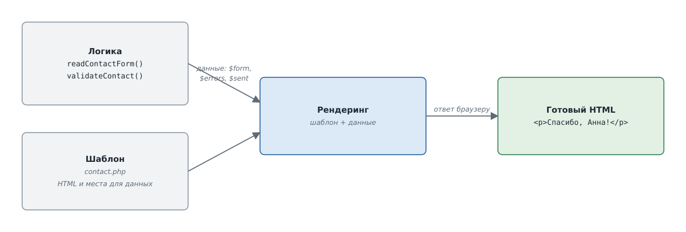
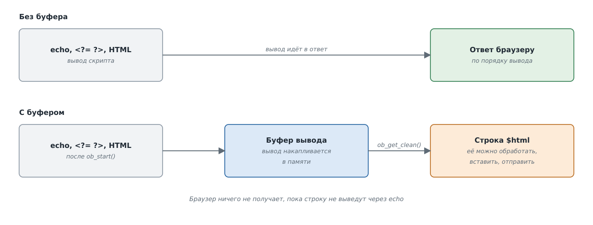
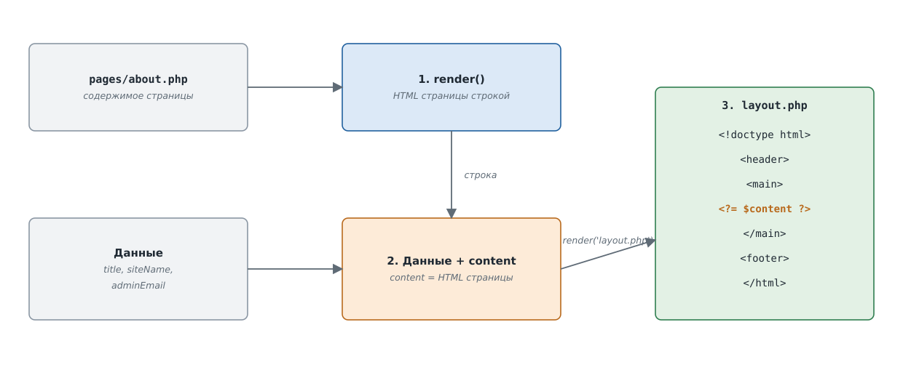
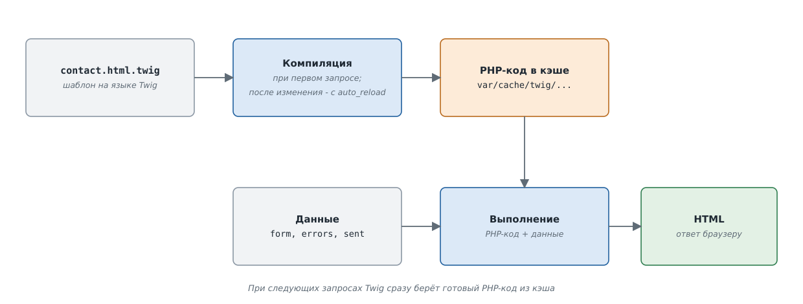
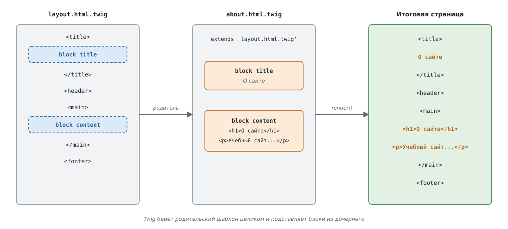

# Шаблоны и шаблонизация в PHP

## Содержание

- [Шаблоны и шаблонизация в PHP](#шаблоны-и-шаблонизация-в-php)
  - [Содержание](#содержание)
  - [Вопросы для самопроверки](#вопросы-для-самопроверки)
  - [Результаты обучения](#результаты-обучения)
  - [Ретроспектива](#ретроспектива)
  - [Логика и представление](#логика-и-представление)
  - [Шаблоны и рендеринг](#шаблоны-и-рендеринг)
    - [PHP как язык шаблонов](#php-как-язык-шаблонов)
    - [Правила хорошего шаблона](#правила-хорошего-шаблона)
    - [Как оценивать методы шаблонизации](#как-оценивать-методы-шаблонизации)
  - [1. Подключение частей страницы](#1-подключение-частей-страницы)
    - [Эталон](#эталон)
    - [Преимущества и недостатки](#преимущества-и-недостатки)
  - [2. Шаблоны с метками](#2-шаблоны-с-метками)
    - [Эталон](#эталон-1)
    - [Преимущества и недостатки](#преимущества-и-недостатки-1)
  - [3. Функция рендеринга](#3-функция-рендеринга)
    - [Задача 1: шаблон внутри функции](#задача-1-шаблон-внутри-функции)
    - [Задача 2: функция extract()](#задача-2-функция-extract)
    - [Задача 3: буферизация вывода](#задача-3-буферизация-вывода)
    - [Эталон](#эталон-2)
    - [Преимущества и недостатки](#преимущества-и-недостатки-2)
  - [4. Layout-шаблон](#4-layout-шаблон)
    - [Эталон](#эталон-3)
    - [Частичные шаблоны](#частичные-шаблоны)
    - [Преимущества и недостатки](#преимущества-и-недостатки-3)
  - [Готовые шаблонизаторы](#готовые-шаблонизаторы)
    - [Что добавляет шаблонизатор](#что-добавляет-шаблонизатор)
    - [Распространённые шаблонизаторы](#распространённые-шаблонизаторы)
  - [5. Twig](#5-twig)
    - [Установка и настройка](#установка-и-настройка)
    - [Синтаксис шаблонов Twig](#синтаксис-шаблонов-twig)
    - [Наследование шаблонов](#наследование-шаблонов)
    - [Эталон](#эталон-4)
    - [Преимущества и недостатки](#преимущества-и-недостатки-4)
  - [6. Smarty](#6-smarty)
    - [Эталон](#эталон-5)
    - [Преимущества и недостатки](#преимущества-и-недостатки-5)
  - [Сравнение методов](#сравнение-методов)
  - [Собираем решения вместе: форма обратной связи на Twig](#собираем-решения-вместе-форма-обратной-связи-на-twig)
  - [Резюме](#резюме)

## Вопросы для самопроверки

1. Чем логика приложения отличается от представления? Почему условие, которое выбирает между формой и благодарностью, относится к представлению?
2. Что такое рендеринг шаблона? Что нужно, чтобы его выполнить?
3. Какие недостатки есть у подключения заголовка и подвала страницы через `require`?
4. Почему шаблон с метками не может сам вывести список ошибок? Что произойдёт, если подставить в метку готовый HTML?
5. Что делают `ob_start()` и `ob_get_clean()`? Зачем они нужны функции рендеринга?
6. Почему шаблон, который выполняется внутри функции `render()`, не видит переменную `$config` из точки входа?
7. Почему в layout-шаблоне содержимое страницы выводится без функции `h()`?
8. Что дают автоэкранирование и наследование шаблонов в Twig? Чем опасен фильтр `raw`? Как Smarty экранирует вывод по умолчанию?

## Результаты обучения

После изучения этой главы вы сможете:

- Объяснить, чем логика приложения отличается от представления, и разделить их на странице.
- Объяснить, что такое шаблон, рендеринг и шаблонизатор.
- Собрать страницу из частей через `require` и назвать недостатки этого способа.
- Написать шаблон с метками и функцию, которая подставляет в него экранированные данные.
- Получить результат шаблона в виде строки с помощью буферизации вывода.
- Написать функцию рендеринга, которая передаёт шаблону только нужные данные.
- Собрать страницу из layout-шаблона, шаблона страницы и частичных шаблонов.
- Установить Twig, написать шаблоны с наследованием и объяснить автоэкранирование.
- Сравнить методы шаблонизации и выбрать подходящий для проекта.

## Ретроспектива

В главе об организации кода общие части страницы, заголовок и подвал, вынесли в файлы `templates/header.php` и `templates/footer.php` и подключили конструкцией `require`. В прошлой главе форма обратной связи перешла на Composer: пакеты устанавливаются одной командой, а их классы загружает автозагрузчик.

Разметка страниц при этом не изменилась. Части страницы берут переменные, которые точка входа задала до `require`, а каждое выводимое значение разработчик экранирует вручную функцией `h()`. В этой главе разберём, как отделить HTML от логики так, чтобы разметка получала данные явно, а вывод экранировался надёжно.

## Логика и представление

На данный момент страница веб-приложения выполняет две разные задачи:

- обрабатывает данные,
- показывает результат.

Пока обе области записаны в одном файле вперемешку, изменить одну, не задев другую, трудно.

**Логика приложения (application logic)** - код, который получает и обрабатывает данные: читает запрос, проверяет поля формы, сохраняет и вычисляет значения.

**Представление (presentation, view)** - код, который показывает данные пользователю: HTML-разметка и вывод значений в ней.

Рассмотрим пример. Страница "Обратная связь" показывает форму с полями "Имя", "Email" и "Сообщение", проверяет отправленные данные и благодарит за сообщение. Её части делятся так:

| Часть страницы                                        | Что это       |
| ----------------------------------------------------- | ------------- |
| чтение полей из `$_POST` и удаление пробелов по краям | логика        |
| проверка, что длина сообщения от 10 до 1000 символов  | логика        |
| решение, что ошибок нет и сообщение принято           | логика        |
| разметка формы с тремя полями и кнопкой               | представление |
| текст ошибки рядом с полем                            | представление |
| заголовок страницы с названием сайта                  | представление |

Логику и представление разделяют по нескольким причинам:

- _Они меняются по разным причинам_. Новое правило проверки не меняет разметку, а новый дизайн не меняет правила проверки.
- _С ними работают разные люди_. Фронтенд-разработчик правит HTML и не должен разбираться в обработке формы.
- _Одни и те же данные можно показать по-разному_. Принятое сообщение можно показать на странице "Спасибо" и отправить администратору письмом, а логика у них общая.

Во всех примерах этой главы логика страницы одна и та же. Она записана в начале файла `public/contact.php`:

```php
$form = ['name' => '', 'email' => '', 'message' => '']; // поля пока пустые
$errors = [];
$sent = false;

if ($_SERVER['REQUEST_METHOD'] === 'POST') {
    $form = readContactForm($_POST);  // читаем поля формы
    $errors = validateContact($form); // проверяем их
    $sent = ($errors === []);         // ошибок нет - сообщение принято
}
```

Функция `readContactForm()` берёт из `$_POST` три поля формы, а функция `validateContact()` проверяет их и возвращает найденные ошибки. В результате у страницы появляются три переменные:

| Переменная | Что в ней                                 | Пример значения                                   |
| ---------- | ----------------------------------------- | ------------------------------------------------- |
| `$form`    | что ввёл пользователь                     | `['name' => 'Анна', 'email' => 'anna@mail', ...]` |
| `$errors`  | ошибки по полям, пустой массив без ошибок | `['email' => 'Введите корректный email']`         |
| `$sent`    | `true`, если сообщение принято            | `false`                                           |

Эта часть в главе больше не меняется. Каждый метод отвечает только на один вопрос: как показать эти три переменные в HTML.

В разметке тоже бывают условия, и это не логика. Условие "если сообщение принято, показать благодарность, иначе форму" только выбирает, что показать, поэтому его место в разметке. Условие "если сообщение короче 10 символов, это ошибка" решает, правильно ли заполнена форма. Это логика, и её место в функции `validateContact()`.

## Шаблоны и рендеринг

Чтобы отделить представление от логики, HTML страницы выносят в отдельный файл, а логика только передаёт ему значения. Для этого подхода используют пять связанных понятий.

**Шаблон (template)** - заготовка HTML-страницы или её части, в которой вместо конкретных значений оставлены места для подстановки.

**Данные шаблона (template data)** - значения, которые программа подставляет в места шаблона. Обычно их передают ассоциативным массивом:

- ключ называет место в шаблоне,
- а значение - то, что туда подставить.

**Рендеринг (rendering)** - получение готового HTML из шаблона и данных: каждое место в шаблоне заменяется значением из данных.

**Шаблонизация (templating)** - способ организовать код, при котором HTML хранится в шаблонах, а логика готовит данные и запускает рендеринг.

**Шаблонизатор (template engine)** - программа или её часть, которая выполняет рендеринг: находит шаблон, подставляет в него данные и возвращает HTML. Шаблонизатором может быть собственная функция из нескольких строк или готовая библиотека.

_Пример_. Место для подстановки здесь условно записано как `{title}`, в каждом методе главы оно записывается по-своему.

| Понятие              | Пример                   |
| -------------------- | ------------------------ |
| Шаблон               | `<h1>{title}</h1>`       |
| Данные шаблона       | `['title' => 'О сайте']` |
| Результат рендеринга | `<h1>О сайте</h1>`       |



_Рисунок 12.1. Рендеринг шаблона_

На рисунке 12.1 показан путь страницы:

1. Логика готовит данные: заголовок, поля формы и ошибки.
2. Рендеринг подставляет данные в шаблон.
3. Готовый HTML уходит в ответ браузеру.

Не путайте шаблонизацию и шаблонизатор.

- _Шаблонизация_ - это подход: HTML отдельно, логика отдельно.
- _Шаблонизатор_ - код, который выполняет рендеринг: собственная функция или готовая библиотека.

В методах 1-4 этой главы рендеринг выполняют сам PHP и собственные функции, в методах 5 и 6 - готовые библиотеки.

### PHP как язык шаблонов

Всё, что находится в PHP-файле вне тегов `<?php` и `?>`, PHP выводит без изменений. Поэтому файл PHP уже может служить шаблоном: HTML записан как есть, а значения вставлены через PHP. Документация PHP прямо называет это способом создавать шаблоны[^1].

В шаблонах на PHP обычно используют две конструкции:

- _Короткий тег вывода `<?=`_. Запись `<?= $title ?>` - сокращение для `<?php echo $title ?>`[^2].
- _Альтернативный синтаксис управляющих конструкций_. Вместо фигурных скобок после условия ставится двоеточие, а блок закрывается словом `endif;`, `endforeach;`, `endfor;` или `endwhile;`[^3].

_Пример_. Список ошибок в шаблоне:

```php
<?php if ($errors !== []): ?>
    <ul>
    <?php foreach ($errors as $error): ?>
        <li><?= h($error) ?></li>
    <?php endforeach; ?>
    </ul>
<?php endif; ?>
```

Слова `endif` и `endforeach` показывают, какой блок закончился. В длинной разметке это читается легче, чем несколько одинаковых скобок `}`.

### Правила хорошего шаблона

Шаблон отвечает только за представление, поэтому к нему предъявляют четыре требования:

- _Шаблон только выводит данные_. Он не читает `$_POST`, не обращается к базе данных и не проверяет поля формы.
- _Шаблон получает данные явно_. По вызову рендеринга видно, какие значения нужны шаблону.
- _Условия и циклы в шаблоне работают с готовыми данными_. Условие выбирает, какую часть показать, а цикл выводит элементы списка.
- _Каждое значение экранируется при выводе_. Данные пользователя выводятся только через `htmlspecialchars()` или функцию-обёртку `h()`.

> [!IMPORTANT]
>
> Экранирование защищает от XSS, только если оно подходит месту вывода. В тексте страницы и в значениях атрибутов HTML используется `htmlspecialchars()`. Для значений внутри JavaScript и в адресах URL нужны другие способы кодирования[^4].

### Как оценивать методы шаблонизации

Дальше разобраны шесть методов: четыре на собственном коде и два на готовых шаблонизаторах. Каждый следующий метод устраняет главные недостатки предыдущего, поэтому методы стоит читать по порядку.

Каждый метод показан на двух страницах веб-приложения:

- "Обратная связь",
- "О сайте".

Раздел "Эталон" показывает образцовую реализацию целиком: обработку формы, начало и конец страницы, форму. Раздел "Преимущества и недостатки" оценивает метод по одним и тем же вопросам:

1. Можно ли поместить в шаблон логику приложения?
2. Видно ли явно, какие данные получает шаблон?
3. Кто отвечает за экранирование: разработчик в каждом месте вывода или сам механизм?
4. Можно ли повторно использовать части страницы и её общий каркас?
5. Требует ли метод сторонних библиотек и изучения нового синтаксиса?

## 1. Подключение частей страницы

Самый простой метод - разделить страницу на несколько файлов и подключить их конструкцией `require`.

- Начало страницы, форма и конец страницы лежат в отдельных файлах,
- точка входа подключает их по порядку.

Подключённому файлу нужны данные, например заголовок страницы. Код подключённого файла выполняется так, будто он написан на месте строки с `require`[^5]. Поэтому файл `header.php` видит переменную `$title`, которую точка входа задала перед подключением.

### Эталон

Файлы проекта:

```text
01_require_parts/
├── config/
│   └── app.php              название сайта и адрес администратора
├── public/
│   ├── about.php            точка входа "О сайте"
│   └── contact.php          точка входа "Обратная связь"
├── src/
│   ├── contact.php          readContactForm() и validateContact()
│   └── functions.php        функция h()
└── templates/
    ├── header.php           начало страницы
    ├── contact_form.php     форма или благодарность
    └── footer.php           конец страницы
```

Точка входа `public/contact.php` сначала обрабатывает форму, а затем задаёт заголовок и подключает три части страницы:

```php
<?php

declare(strict_types=1);

require_once __DIR__ . '/../src/functions.php';
require_once __DIR__ . '/../src/contact.php';
$config = require __DIR__ . '/../config/app.php';

// 1. Логика: обрабатываем форму
$form = ['name' => '', 'email' => '', 'message' => '']; // поля пока пустые
$errors = [];
$sent = false;

if ($_SERVER['REQUEST_METHOD'] === 'POST') {
    $form = readContactForm($_POST);  // читаем поля формы
    $errors = validateContact($form); // проверяем их
    $sent = ($errors === []);         // ошибок нет - сообщение принято
}

// 2. Представление: подключаем части страницы
$title = 'Обратная связь';
require __DIR__ . '/../templates/header.php';
require __DIR__ . '/../templates/contact_form.php';
require __DIR__ . '/../templates/footer.php';
```

Начало страницы `templates/header.php` выводит `$title` и `$config`, которые задала точка входа:

```php
<!doctype html>
<html lang="ru">
<head>
    <meta charset="utf-8">
    <title><?= h($title) ?> - <?= h($config['siteName']) ?></title>
</head>
<body>
    <header><?= h($config['siteName']) ?></header>
    <main>
        <h1><?= h($title) ?></h1>
```

Форма `templates/contact_form.php` выводит благодарность или форму с ошибками:

```php
<?php if ($sent): ?>
        <p>Спасибо, <?= h($form['name']) ?>! Сообщение получено.</p>
<?php else: ?>
        <form method="post">
            <p>
                <label>Имя <input name="name" value="<?= h($form['name']) ?>"></label>
                <?= h($errors['name'] ?? '') ?>
            </p>
            <p>
                <label>Email <input name="email" value="<?= h($form['email']) ?>"></label>
                <?= h($errors['email'] ?? '') ?>
            </p>
            <p>
                <label>Сообщение <textarea name="message"><?= h($form['message']) ?></textarea></label>
                <?= h($errors['message'] ?? '') ?>
            </p>
            <button type="submit">Отправить</button>
        </form>
<?php endif; ?>
```

Конец страницы `templates/footer.php`:

```php
    </main>
    <footer>Вопросы: <?= h($config['adminEmail']) ?></footer>
</body>
</html>
```

PHP выполняет три файла по очереди, и браузер получает одну страницу:

- начало из `header.php`,
- форму или благодарность,
- конец из `footer.php`.

Другая страница - "О сайте" - (`about.php`) подключает те же `header.php` и `footer.php`, поэтому новое название сайта появится на обеих страницах после правки одного файла.

### Преимущества и недостатки

| Преимущества                                                                          | Недостатки                                                                                                                   |
| ------------------------------------------------------------------------------------- | ---------------------------------------------------------------------------------------------------------------------------- |
| _Нет зависимостей_. Нужен только PHP.                                                 | _Данные передаются неявно_. Шаблон видит все переменные точки входа, и по вызову `require` не видно, какие из них ему нужны. |
| _Шаблон - обычный HTML_. Значения вставляются через `<?= ?>`.                         | _Разметка разорвана_. Тег `<main>` открывается в `header.php`, а закрывается в `footer.php`.                                 |
| _Общие части хранятся в одном месте_. Начало и конец страницы правятся в одном файле. | _Экранирование ручное_. Забытый вызов `h()` в одном месте открывает дорогу XSS.                                              |
|                                                                                       | _Логику ничто не останавливает_. В шаблоне можно прочитать `$_POST` или проверить поле, и PHP не помешает.                   |

> [!TIP]
>
> Типичная ошибка - не задать переменную до `require`. Если в точке входа нет строки `$title = 'Обратная связь';`, файл `header.php` обратится к несуществующей переменной, и PHP остановится с ошибкой. Ошибку видно только при открытии страницы, потому что список переменных, которые нужны `header.php`, нигде не записан.

_Итог метода 1_. Страница собрана из общих частей, но у метода три главных недостатка: шаблон получает данные неявно, каждое значение нужно экранировать вручную, а шаблон может править только тот, кто знает PHP. Метод 2 устраняет эти недостатки другим способом: убирает PHP из шаблона совсем.

## 2. Шаблоны с метками

В первом методе шаблон - это PHP-файл, в котором HTML перемешан с PHP-вставками. В отличие от него, данный метод использует обычный HTML-файл, а места для данных отмечены метками. Такой шаблон может править человек без знания PHP, а все значения экранирует одна функция.

**Метка (placeholder)** - условное обозначение в тексте шаблона, вместо которого подставляется значение, например `{{name}}`.

**Шаблон с метками** - HTML-файл без PHP-кода, в котором места для данных обозначены метками. Программа читает файл как текст и заменяет метки значениями.

### Эталон

Файлы шаблонов:

```text
templates/
├── about.html               страница "О сайте"
├── contact.html             страница с формой
└── thanks.html              страница с благодарностью
```

Шаблон `templates/contact.html` содержит страницу целиком: начало, форму и конец.

```html
<!doctype html>
<html lang="ru">
  <head>
    <meta charset="utf-8" />
    <title>{{title}} - {{siteName}}</title>
  </head>
  <body>
    <header>{{siteName}}</header>
    <main>
      <h1>{{title}}</h1>
      <form method="post">
        <p>
          <label>Имя <input name="name" value="{{name}}" /></label>
          {{nameError}}
        </p>
        <p>
          <label>Email <input name="email" value="{{email}}" /></label>
          {{emailError}}
        </p>
        <p>
          <label
            >Сообщение <textarea name="message">{{message}}</textarea>
          </label>
          {{messageError}}
        </p>
        <button type="submit">Отправить</button>
      </form>
    </main>
    <footer>Вопросы: {{adminEmail}}</footer>
  </body>
</html>
```

Шаблон `thanks.html` устроен так же, но вместо формы в нём строка `<p>Спасибо, {{name}}! Сообщение получено.</p>`.

Чтобы заполнить такой шаблон данными, нужна _функция-шаблонизатор_. В примере это функция `fillTemplate()` в файле `src/template.php`:

```php
function fillTemplate(string $file, array $data): string
{
    $replacements = [];

    foreach ($data as $key => $value) {
        $replacements['{{' . $key . '}}'] = htmlspecialchars((string) $value, ENT_QUOTES, 'UTF-8');
    }

    $template = file_get_contents(__DIR__ . '/../templates/' . $file);

    return strtr($template, $replacements);
}
```

Функция работает в три шага:

1. _Строит массив замен_. Каждый ключ данных функция заключает в двойные фигурные скобки и получает метку, а значение экранирует.
2. _Читает файл шаблона как обычный текст_.
3. _Заменяет метки значениями_. Функция получает текст и массив замен вида `"метка => значение"`, и возвращает текст, в котором все метки заменены[^6].

_Пример_. Из данных

```php
['title' => 'О сайте', 'siteName' => 'Учебный сайт']
```

функция строит массив замен:

```php
['{{title}}' => 'О сайте', '{{siteName}}' => 'Учебный сайт']
```

Затем она находит в тексте шаблона `{{title}}` и `{{siteName}}` и подставляет вместо них `О сайте` и `Учебный сайт`.

В шаблоне нет условий, поэтому выбор между формой и благодарностью делает точка входа `public/contact.php`:

```php
<?php

declare(strict_types=1);

require_once __DIR__ . '/../src/template.php';
require_once __DIR__ . '/../src/contact.php';
$config = require __DIR__ . '/../config/app.php';

// 1. Логика: обрабатываем форму
$form = ['name' => '', 'email' => '', 'message' => '']; // поля пока пустые
$errors = [];
$sent = false;

if ($_SERVER['REQUEST_METHOD'] === 'POST') {
    $form = readContactForm($_POST);  // читаем поля формы
    $errors = validateContact($form); // проверяем их
    $sent = ($errors === []);         // ошибок нет - сообщение принято
}

// 2. Представление: подставляем данные в шаблон с метками
if ($sent) {
    echo fillTemplate('thanks.html', [
        'title' => 'Обратная связь',
        'siteName' => $config['siteName'],
        'adminEmail' => $config['adminEmail'],
        'name' => $form['name'],
    ]);
    exit;
}

echo fillTemplate('contact.html', [
    'title' => 'Обратная связь',
    'siteName' => $config['siteName'],
    'adminEmail' => $config['adminEmail'],
    'name' => $form['name'],
    'email' => $form['email'],
    'message' => $form['message'],
    'nameError' => $errors['name'] ?? '',
    'emailError' => $errors['email'] ?? '',
    'messageError' => $errors['message'] ?? '',
]);
```

Каждой метке шаблона соответствует ключ массива. Для поля без ошибки передаётся пустая строка, и на месте метки ничего не появляется.

### Преимущества и недостатки

| Преимущества                                                                                  | Недостатки                                                                                                         |
| --------------------------------------------------------------------------------------------- | ------------------------------------------------------------------------------------------------------------------ |
| _В шаблоне нет PHP_. Логику в шаблон не положить, и править его может человек без знания PHP. | _Нет условий и циклов_. Выбор между формой и благодарностью и вывод списков переходят в PHP-код.                   |
| _Экранирование в одном месте_. `fillTemplate()` экранирует все значения сама.                 | _Каркас страницы повторяется_. Начало и конец страницы скопированы в `about.html`, `contact.html` и `thanks.html`. |
| _Данные передаются явно_. Метки шаблона совпадают с ключами массива.                          | _Ошибки не видны сразу_. Метка без значения остаётся на странице как текст `{{nameError}}`.                        |
| _Подходит для простых текстов_. Так удобно хранить шаблоны писем и уведомлений.               | _Самодельное решение_. Каждую новую возможность, например условие, приходится писать самому.                       |

_Итог метода 2_. Функция `fillTemplate()` устроена удобно: она получает имя шаблона и данные, а возвращает HTML строкой, и шаблон видит только переданные данные. Недостаток метода - в самом шаблоне. В нём нет условий и циклов, поэтому выбор между формой и благодарностью ушёл в точку входа, а каркас страницы скопирован в каждый файл.

## 3. Функция рендеринга

Третий метод соединяет сильные стороны двух прошлых методов.

- От второго метода (Шаблон с метками) берёт функцию, которая получает имя шаблона и данные и возвращает HTML.
- От первого метода (PHP-шаблон) - шаблон на PHP с условиями и циклами.

|                  | Метод 2: `fillTemplate()`             | Метод 3: `render()`                                |
| ---------------- | ------------------------------------- | -------------------------------------------------- |
| Вызов            | `fillTemplate('contact.html', $data)` | `render('contact.php', $data)`                     |
| Шаблон           | HTML с метками `{{title}}`            | PHP-файл с `<?= h($title) ?>`, условиями и циклами |
| Что видит шаблон | только данные из массива              | только данные из массива                           |
| Результат        | HTML строкой                          | HTML строкой                                       |

Написать `render()` так же, как `fillTemplate()`, не получится. Метки можно заменить функцией `strtr()`, а PHP-шаблон нужно выполнить, то есть отобразить переменные, выполнить условные конструкции и циклы, для этого можно использовать конструкцию `require` внутри функции. Но, нужно позаботится о следующих задачах:

| Задача                                                   | Средство PHP                       |
| -------------------------------------------------------- | ---------------------------------- |
| 1. Шаблон должен видеть только переданные данные         | подключение шаблона внутри функции |
| 2. Ключи массива данных должны стать переменными шаблона | функция `extract()`                |
| 3. HTML шаблона нужно вернуть из функции, а не вывести   | буферизация вывода                 |

### Задача 1: шаблон внутри функции

Если подключить шаблон внутри функции, его код выполняется в области видимости этой функции[^5] и только видит те переменные, которые доступны в этой функции.

_Пример_. Шаблон `site_name.php` выводит название сайта:

```php
<header><?= $siteName ?></header>
```

Чтобы шаблон увидел переменную, её нужно передать в функцию как параметр.

```php
function showHeader(string $siteName): void
{
    require __DIR__ . '/site_name.php';
}

showHeader('Учебный сайт'); // <header>Учебный сайт</header>
```

Именно это свойство нужно функции рендеринга: _шаблон видит только то, что ему передали_.

### Задача 2: функция extract()

Разным шаблонам нужны разные переменные, поэтому функция рендеринга не может заранее объявить параметр для каждой из них. Данные передаются одним массивом, а шаблон обращается к обычным переменным: `$title`, а не `$data['title']`.

Извлечь ключи массива в переменные позволяет встроенная функция `extract()`.

_Синтаксис_

```php
extract(array &$array, int $flags = EXTR_OVERWRITE, string $prefix = ""): int
```

- `$array` - массив, ключи которого станут именами переменных.
- `$flags` - что делать, если переменная с таким именем уже есть. `EXTR_OVERWRITE` заменяет её значение, `EXTR_SKIP` оставляет старое[^8].
- `$prefix` - приставка к именам переменных; в главе не нужна.

Функция возвращает количество созданных переменных.

_Пример_

```php
<?php

$count = extract(['title' => 'О сайте', 'siteName' => 'Учебный сайт']);

echo $title, PHP_EOL;    // О сайте
echo $siteName, PHP_EOL; // Учебный сайт
echo $count, PHP_EOL;    // 2
```

Функцию `extract()` нельзя вызывать для данных пользователя, например для `$_GET`: пользователь сам выберет имена переменных и подменит значения[^8]. Функции рендеринга передают только массив, который собрала сама программа.

### Задача 3: буферизация вывода

Функция `showHeader()` из примера выводит HTML сразу. Функция `render()` должна поступить иначе: _выполнить шаблон, но не отправить его HTML в ответ, а вернуть строкой_.

Чтобы получить вывод в переменную, его нужно перехватить до отправки.

**Буфер вывода (output buffer)** - область памяти, в которую PHP складывает вывод скрипта вместо того, чтобы передать его в ответ[^9].



_Рисунок 12.2. Буферизация вывода_

На рисунке 12.2 показана работа с буфером в три шага:

1. Программа включает буфер.
2. Всё, что скрипт выводит дальше, попадает в буфер, а не в ответ.
3. Программа забирает содержимое буфера строкой и выключает буфер.

Шаги 1 и 3 выполняют две функции.

_Синтаксис_

```php
ob_start(): bool
ob_get_clean(): string|false
```

- `ob_start()` включает буфер и возвращает `true` при успехе. У функции есть необязательные параметры, но для шаблонов они не нужны.
- `ob_get_clean()` возвращает содержимое буфера строкой и выключает буфер. Если буфер не был включён, функция возвращает `false`[^10].

_Пример_. Шаблон `templates/greeting.php` содержит одну строку:

```php
<p>Здравствуйте, <?= htmlspecialchars($name, ENT_QUOTES, 'UTF-8') ?>!</p>
```

Программа подключает его внутри буфера:

```php
$name = 'Анна';

ob_start();
require __DIR__ . '/templates/greeting.php';
$html = ob_get_clean();
```

Браузер пока ничего не получил, а в переменной `$html` лежит строка `<p>Здравствуйте, Анна!</p>`. Её можно:

- вывести через `echo`,
- вставить в другой HTML,
- отправить письмом.

Документация PHP приводит этот приём как способ "_подключить файл в переменную_"[^5].

### Эталон

Функция `render()` в файле `src/view.php` соединяет три решения:

```php
function render(string $template, array $data = []): string
{
    extract($data, EXTR_SKIP);

    ob_start();
    require __DIR__ . '/../templates/' . $template;

    return ob_get_clean();
}
```

Функция работает в три шага:

1. `extract()` превращает ключи массива данных в переменные функции. Флаг `EXTR_SKIP` не даёт данным заменить параметр `$template`.
2. `ob_start()` включает буфер, а `require` выполняет шаблон внутри функции. Шаблон видит только переменные функции, то есть переданные данные.
3. `ob_get_clean()` возвращает HTML шаблона строкой.

Шаблон, который выполняет функция `render()`, написан на самом PHP: это HTML со вставками `<?= ?>` и альтернативным синтаксисом. Так он отличается от шаблона с метками и от шаблонов на собственном языке шаблонизатора, которые разобраны дальше.

**Нативный шаблон (native template)** - шаблон, записанный на PHP и выполняемый функцией рендеринга.

Точка входа `public/contact.php` обрабатывает форму и перечисляет всё, что нужно шаблону:

```php
<?php

declare(strict_types=1);

require_once __DIR__ . '/../src/view.php';
require_once __DIR__ . '/../src/contact.php';
$config = require __DIR__ . '/../config/app.php';

// 1. Логика: обрабатываем форму
$form = ['name' => '', 'email' => '', 'message' => '']; // поля пока пустые
$errors = [];
$sent = false;

if ($_SERVER['REQUEST_METHOD'] === 'POST') {
    $form = readContactForm($_POST);  // читаем поля формы
    $errors = validateContact($form); // проверяем их
    $sent = ($errors === []);         // ошибок нет - сообщение принято
}

// 2. Представление: рендерим шаблон
echo render('contact.php', [
    'title' => 'Обратная связь',
    'siteName' => $config['siteName'],
    'adminEmail' => $config['adminEmail'],
    'form' => $form,
    'errors' => $errors,
    'sent' => $sent,
]);
```

Шаблон `templates/contact.php` подключает начало и конец страницы и выводит форму:

```php
<?php require __DIR__ . '/header.php'; ?>
<?php if ($sent): ?>
        <p>Спасибо, <?= h($form['name']) ?>! Сообщение получено.</p>
<?php else: ?>
        <form method="post">
            <p>
                <label>Имя <input name="name" value="<?= h($form['name']) ?>"></label>
                <?= h($errors['name'] ?? '') ?>
            </p>
            <!-- поля "Email" и "Сообщение" устроены так же -->
            <button type="submit">Отправить</button>
        </form>
<?php endif; ?>
<?php require __DIR__ . '/footer.php'; ?>
```

Шаблон `contact.php` выполняется внутри функции `render()`. Файлы `header.php` и `footer.php` он подключает сам, поэтому их код тоже выполняется внутри `render()` и видит те же переменные:

```text
render('contact.php', [...])
└── contact.php              видит $title, $siteName, $adminEmail, $form, $errors, $sent
    ├── header.php           видит те же переменные
    └── footer.php           видит те же переменные
```

Поэтому начало страницы `templates/header.php` выводит `$title` и `$siteName` из массива данных, а не `$config['siteName']`:

```php
<!doctype html>
<html lang="ru">
<head>
    <meta charset="utf-8">
    <title><?= h($title) ?> - <?= h($siteName) ?></title>
</head>
<body>
    <header><?= h($siteName) ?></header>
    <main>
        <h1><?= h($title) ?></h1>
```

Конец страницы `templates/footer.php` выводит `$adminEmail`:

```php
    </main>
    <footer>Вопросы: <?= h($adminEmail) ?></footer>
</body>
</html>
```

### Преимущества и недостатки

| Преимущества                                                                             | Недостатки                                                                                              |
| ---------------------------------------------------------------------------------------- | ------------------------------------------------------------------------------------------------------- |
| _Данные передаются явно_. Шаблон видит только то, что перечислено в вызове `render()`.   | _Экранирование ручное_. Каждое значение по-прежнему нужно обернуть в `h()`.                             |
| _Шаблон остаётся обычным PHP_. Условия, циклы и `<?= ?>` работают без нового синтаксиса. | _Логику ничто не останавливает_. PHP-шаблон может вызвать любую функцию, в том числе обратиться к базе. |
| _Результат - строка_. HTML можно вставить в другой шаблон или отправить письмом.         | _Разметка по-прежнему разорвана_. Тег `<main>` открыт в `header.php`, а закрыт в `footer.php`.          |
| _Нет зависимостей_. Функция занимает несколько строк.                                    |                                                                                                         |

_Итог метода 3_. Функция `render()` передаёт шаблону только нужные данные и возвращает HTML строкой. Но каркас страницы по-прежнему разорван: начало лежит в `header.php`, а конец в `footer.php`. Четвёртый метод использует то, что `render()` возвращает строку, и хранит каркас страницы в одном файле.

## 4. Layout-шаблон

У страниц с `header.php` и `footer.php` общая проблема: каркас страницы разорван на два файла. Тег `<main>` открывается в одном файле и закрывается в другом, и каждая страница должна подключить обе части в правильном порядке. Удобнее хранить каркас целиком и вставлять в него содержимое страницы.

**Layout (макет)** - шаблон всей страницы, от `<!doctype html>` до `</html>`, с местом, куда вставляется содержимое конкретной страницы.

Чтобы вставить содержимое в layout, его нужно сначала получить строкой. Функция `render()` уже это умеет.

### Эталон

Файлы шаблонов:

```text
templates/
├── layout.php               каркас страницы
├── pages/
│   ├── about.php            содержимое страницы "О сайте"
│   └── contact.php          содержимое страницы "Обратная связь"
└── partials/
    └── field.php            поле формы
```

Layout `templates/layout.php` содержит начало и конец страницы в одном файле. Содержимое страницы он выводит из переменной `$content`:

```php
<!doctype html>
<html lang="ru">
<head>
    <meta charset="utf-8">
    <title><?= h($title) ?> - <?= h($siteName) ?></title>
</head>
<body>
    <header><?= h($siteName) ?></header>
    <main>
        <h1><?= h($title) ?></h1>
        <?= $content ?>
    </main>
    <footer>Вопросы: <?= h($adminEmail) ?></footer>
</body>
</html>
```

Переменная `$content` выводится без `h()`: в ней уже готовый HTML страницы, значения в котором экранированы при её рендеринге.

Функция `renderPage()` в `src/view.php` собирает страницу из двух шаблонов:

```php
function renderPage(string $page, array $data = []): string
{
    $content = render('pages/' . $page, $data);

    return render('layout.php', array_merge($data, ['content' => $content]));
}
```



_Рисунок 12.3. Сборка страницы из layout и шаблона страницы_

На рисунке 12.3 показан порядок сборки:

1. `render()` выполняет шаблон страницы и возвращает его HTML строкой.
2. Строка добавляется к данным под ключом `content`.
3. `render()` выполняет layout, и тот выводит `$content` внутри `<main>`.

Точка входа `public/contact.php` обрабатывает форму и вызывает `renderPage()`:

```php
<?php

declare(strict_types=1);

require_once __DIR__ . '/../src/view.php';
require_once __DIR__ . '/../src/contact.php';
$config = require __DIR__ . '/../config/app.php';

// 1. Логика: обрабатываем форму
$form = ['name' => '', 'email' => '', 'message' => '']; // поля пока пустые
$errors = [];
$sent = false;

if ($_SERVER['REQUEST_METHOD'] === 'POST') {
    $form = readContactForm($_POST);  // читаем поля формы
    $errors = validateContact($form); // проверяем их
    $sent = ($errors === []);         // ошибок нет - сообщение принято
}

// 2. Представление: рендерим страницу внутри layout
echo renderPage('contact.php', [
    'title' => 'Обратная связь',
    'siteName' => $config['siteName'],
    'adminEmail' => $config['adminEmail'],
    'form' => $form,
    'errors' => $errors,
    'sent' => $sent,
]);
```

Шаблон страницы `pages/contact.php` содержит только форму или благодарность, без начала и конца страницы. Шаблон страницы `pages/about.php` состоит из одной строки `<p>Учебный сайт с формой обратной связи.</p>`.

### Частичные шаблоны

В форме обратной связи три почти одинаковых блока: подпись, поле ввода и текст ошибки. Если писать каждый блок вручную, исправление разметки придётся вносить в три места. Повторяющуюся разметку выносят в отдельный шаблон и рендерят его столько раз, сколько нужно.

**Частичный шаблон (partial)** - небольшой шаблон одной части страницы, который рендерится внутри другого шаблона.

Частичный шаблон `templates/partials/field.php`:

```php
<p>
    <label>
        <?= h($label) ?>
<?php if ($multiline ?? false): ?>
        <textarea name="<?= h($name) ?>"><?= h($value) ?></textarea>
<?php else: ?>
        <input name="<?= h($name) ?>" value="<?= h($value) ?>">
<?php endif; ?>
    </label>
<?php if ($error !== ''): ?>
    <span class="error"><?= h($error) ?></span>
<?php endif; ?>
</p>
```

Запись `$multiline ?? false` нужна потому, что параметр необязательный: если его не передали, поле обычное.

Шаблон страницы `pages/contact.php` рендерит частичный шаблон для каждого поля:

```php
<?php if ($sent): ?>
    <p>Спасибо, <?= h($form['name']) ?>! Сообщение получено.</p>
<?php else: ?>
    <form method="post">
        <?= render('partials/field.php', [
            'label' => 'Имя',
            'name' => 'name',
            'value' => $form['name'],
            'error' => $errors['name'] ?? '',
        ]) ?>
        <!-- поля "Email" и "Сообщение" рендерятся так же, у сообщения 'multiline' => true -->
        <button type="submit">Отправить</button>
    </form>
<?php endif; ?>
```

Здесь `render()` вызывается во время рендеринга другого шаблона, и буферы оказываются вложены друг в друга. PHP это допускает: `ob_get_clean()` забирает содержимое последнего включённого буфера[^9]. Поэтому вложенный вызов возвращает HTML поля, а буфер страницы продолжает собирать остальное.

### Преимущества и недостатки

| Преимущества                                                                                         | Недостатки                                                                                                      |
| ---------------------------------------------------------------------------------------------------- | --------------------------------------------------------------------------------------------------------------- |
| _Каркас хранится целиком_. Весь HTML страницы от `<!doctype html>` до `</html>` лежит в одном файле. | _Экранирование ручное_. В layout, страницах и частичных шаблонах каждое значение нужно обернуть в `h()`.        |
| _Шаблон страницы содержит только своё_. Новая страница - это небольшой файл в `pages/`.              | _Одно место для содержимого_. Чтобы вставить свой текст ещё и в `<title>` или в подвал, нужны новые переменные. |
| _Данные передаются явно_. Layout и частичные шаблоны получают массив данных.                         | _Логику ничто не останавливает_. Шаблоны по-прежнему на PHP.                                                    |
| _Нет зависимостей_. Хватает двух функций по несколько строк.                                         |                                                                                                                 |

Типичная ошибка - экранировать `$content` в layout. Запись `<?= h($content) ?>` превратит готовый HTML страницы в текст: браузер покажет `<p>Учебный сайт с формой обратной связи.</p>` вместе с тегами. Обратная ошибка опаснее: вывести без `h()` значение, которое ввёл пользователь. Без экранирования выводят только строки, которые сами получены рендерингом шаблона.

_Итог метода 4_. Функций `render()` и `renderPage()` хватает для небольшого сайта, но три недостатка остаются: каждое значение экранируется вручную, у layout одно место для содержимого, а в шаблоне можно выполнить любой PHP-код. Их устраняют готовые шаблонизаторы.

## Готовые шаблонизаторы

Ручное экранирование, одно место для содержимого и PHP-код в шаблоне - задачи, общие для всех веб-приложений. Поэтому их не решают заново в каждом проекте, а берут готовый шаблонизатор - библиотеку, которую устанавливают через Composer.

### Что добавляет шаблонизатор

У шаблонизатора свой язык шаблонов. Шаблон на этом языке нельзя выполнить как PHP, поэтому шаблонизатор сначала переводит его.

**Компиляция шаблона (template compilation)** - перевод шаблона с языка шаблонизатора в PHP-код, который затем выполняется с данными.

Если задана папка кэша, скомпилированный код сохраняется в ней, и при следующих запросах шаблонизатор берёт готовый PHP-код вместо новой компиляции. Так работают распространённые шаблонизаторы, например Twig[^11], Smarty[^12] и Blade[^13]. В Twig шаблон после изменения компилируется заново, только если включена настройка `auto_reload`[^14].



_Рисунок 12.4. Как шаблонизатор обрабатывает шаблон_

Кроме собственного языка, шаблонизатор обычно решает три задачи, которые самодельная функция `render()` не решает.

**Автоэкранирование (autoescaping)** - режим, в котором шаблонизатор сам экранирует каждое выводимое значение, без вызова `h()`.

**Наследование шаблонов (template inheritance)** - способ строить шаблоны, при котором дочерний шаблон берёт родительский и заменяет в нём отмеченные части, блоки. По сути это layout с несколькими местами для содержимого.

Третья задача - ограничить шаблон. В шаблоне шаблонизатора нельзя выполнить произвольный PHP-код: условия и циклы в нём есть, но служат только для выбора, что показать.

### Распространённые шаблонизаторы

| Шаблонизатор | Где используется                      | Язык шаблонов             | Экранирование по умолчанию                       |
| ------------ | ------------------------------------- | ------------------------- | ------------------------------------------------ |
| Twig         | отдельно и во фреймворке Symfony[^15] | свой, `{{ name }}`        | включено[^16]                                    |
| Smarty       | отдельно                              | свой, `{$name}`           | выключено, включается настройкой[^12]            |
| Blade        | фреймворк Laravel, файлы `.blade.php` | PHP и директивы `@if`     | `{{ }}` экранирует через `htmlspecialchars`[^13] |
| Plates       | отдельно                              | нативные PHP-шаблоны[^17] | нет, значения экранирует разработчик             |

Symfony и Laravel - популярные фреймворки PHP. Дальше подробно разобраны Twig и Smarty. Blade используют в проектах на Laravel, а Plates - это готовая библиотека с тем же подходом, что у функции `render()` с layout и частичными шаблонами.

## 5. Twig

**Twig** - шаблонизатор для PHP с собственным языком шаблонов. Twig развивает команда Symfony[^15], а распространяется он как пакет Composer `twig/twig`.

### Установка и настройка

Twig устанавливается командой:

```bash
composer require "twig/twig:^3.0"
```

Twig 3 требует PHP 8.1 и новее[^18].

Для работы нужны два объекта: загрузчик, который находит файлы шаблонов, и окружение, которое компилирует и рендерит их.

_Синтаксис_

```php
$loader = new \Twig\Loader\FilesystemLoader(string $path);
$twig = new \Twig\Environment($loader, array $options = []);
$twig->render(string $name, array $context = []): string
```

- `$path` - папка с шаблонами.
- `$options` - настройки окружения:
  - `cache` - папка для скомпилированных шаблонов или `false`, чтобы не сохранять их. По умолчанию `false`[^14].
  - `auto_reload` - `true`, чтобы Twig компилировал шаблон заново после его изменения. Нужен при разработке, если задан `cache`[^14].
  - `strict_variables` - `true`, чтобы обращение к несуществующей переменной вызывало ошибку. По умолчанию `false`: Twig молча выводит пустое значение[^14].
- `$name` - имя шаблона относительно папки `$path`.
- `$context` - данные шаблона.

Метод `render()` возвращает готовый HTML. Обычно приложение создаёт одно окружение и рендерит через него все шаблоны[^14].

_Пример_. Функция `createTwig()` в файле `src/twig.php`:

```php
<?php

declare(strict_types=1);

use Twig\Environment;
use Twig\Loader\FilesystemLoader;

function createTwig(): Environment
{
    $loader = new FilesystemLoader(__DIR__ . '/../templates');

    return new Environment($loader, [
        'cache' => __DIR__ . '/../var/cache/twig',
        'auto_reload' => true,
    ]);
}
```

Скомпилированные шаблоны появятся в `var/cache/twig` после первого запроса. Эту папку, как и `vendor/`, не добавляют в репозиторий.

### Синтаксис шаблонов Twig

В шаблоне Twig три вида специальных записей[^16]:

| Запись      | Что делает                       | Пример                        |
| ----------- | -------------------------------- | ----------------------------- |
| `{{ ... }}` | выводит значение                 | `{{ title }}`                 |
| `` | тег: условие, цикл, наследование | `...` |
| `{# ... #}` | комментарий, в HTML не попадает  | `{# поле формы #}`            |

_Тег (tag)_ - команда шаблона Twig в скобках ``, например `if`, `for` или `extends`.

Точка обращается к ключу массива или свойству объекта: `{{ form.name }}` выведет `$form['name']`, если `form` - массив, и `$form->name`, если объект.

**Фильтр (filter)** - функция Twig, которая преобразует значение перед выводом. Фильтр записывается после значения через символ `|`, и фильтры можно соединять в цепочку[^16].

| Фильтр    | Что делает                                             | Пример                           | Результат     |
| --------- | ------------------------------------------------------ | -------------------------------- | ------------- |
| `upper`   | переводит в верхний регистр                            | `{{ 'анна'\|upper }}`            | `АННА`        |
| `length`  | считает элементы массива или символы строки            | `{{ errors\|length }}`           | `3`           |
| `default` | подставляет значение, если значения нет или оно пустое | `{{ errors.name\|default('') }}` | пустая строка |
| `raw`     | выводит значение без экранирования                     | `{{ content\|raw }}`             | HTML как есть |

Список ошибок, который в нативном шаблоне занимал несколько строк с `<?php ?>`, в Twig выглядит так:

```twig

    <ul>
    
        <li>{{ error }}</li>
    
    </ul>

```

Проверка `errors is not empty` истинна, если массив не пуст. Функции `h()` здесь нет: Twig экранирует `{{ error }}` сам, потому что автоэкранирование включено по умолчанию[^16]. Цикл в Twig один - `for`, тега `while` в Twig нет[^19].

### Наследование шаблонов

Layout из самодельного метода имеет одно место для содержимого. В Twig родительский шаблон отмечает несколько _блоков_, а дочерний шаблон заменяет те из них, которые ему нужны.

_Блок (block)_ - именованная часть родительского шаблона, которую дочерний шаблон может заменить своим содержимым.

Родительский шаблон `templates/layout.html.twig`:

```twig
<!doctype html>
<html lang="ru">
<head>
    <meta charset="utf-8">
    <title> - {{ siteName }}</title>
</head>
<body>
    <header>{{ siteName }}</header>
    <main>
        
    </main>
    <footer>Вопросы: {{ adminEmail }}</footer>
</body>
</html>
```

Дочерний шаблон `templates/about.html.twig`:

```twig


О сайте


    <h1>О сайте</h1>
    <p>Учебный сайт с формой обратной связи.</p>

```

Тег `extends` говорит, что шаблон расширяет `layout.html.twig`. Twig берёт родительский шаблон целиком и подставляет на место блоков `title` и `content` содержимое из дочернего. Точка входа рендерит дочерний шаблон: `$twig->render('about.html.twig', $config)`.



_Рисунок 12.5. Наследование шаблонов в Twig_

Всё содержимое дочернего шаблона должно находиться внутри блоков: текст вне блоков Twig не принимает.

Частичный шаблон подключается тегом `include`. После слова `with` перечисляются данные для него, а слово `only` запрещает частичному шаблону видеть остальные переменные[^20]:

```twig

```

### Эталон

Файлы шаблонов:

```text
templates/
├── layout.html.twig         родительский шаблон
├── about.html.twig          страница "О сайте"
├── contact.html.twig        страница "Обратная связь"
└── partials/
    └── field.html.twig      поле формы
```

Шаблон страницы `templates/contact.html.twig`:

```twig


Обратная связь


    <h1>Обратная связь</h1>
    
        <p>Спасибо, {{ form.name }}! Сообщение получено.</p>
    
        <form method="post">
            
            
            
            <button type="submit">Отправить</button>
        </form>
    

```

Частичный шаблон `templates/partials/field.html.twig`:

```twig
<p>
    <label>
        {{ label }}
        
            <textarea name="{{ name }}">{{ value }}</textarea>
        
            <input name="{{ name }}" value="{{ value }}">
        
    </label>
    
        <span class="error">{{ error }}</span>
    
</p>
```

Ключ ошибки есть в массиве `errors`, только если поле заполнено неверно. Фильтр `default('')` подставляет пустую строку, если ключа нет.

Точка входа `public/contact.php` обрабатывает форму и рендерит страницу:

```php
<?php

declare(strict_types=1);

require __DIR__ . '/../vendor/autoload.php';
require_once __DIR__ . '/../src/twig.php';
require_once __DIR__ . '/../src/contact.php';
$config = require __DIR__ . '/../config/app.php';

// 1. Логика: обрабатываем форму
$form = ['name' => '', 'email' => '', 'message' => '']; // поля пока пустые
$errors = [];
$sent = false;

if ($_SERVER['REQUEST_METHOD'] === 'POST') {
    $form = readContactForm($_POST);  // читаем поля формы
    $errors = validateContact($form); // проверяем их
    $sent = ($errors === []);         // ошибок нет - сообщение принято
}

// 2. Представление: рендерим шаблон Twig
$twig = createTwig();

echo $twig->render('contact.html.twig', array_merge($config, [
    'form' => $form,
    'errors' => $errors,
    'sent' => $sent,
]));
```

Функция `array_merge()` добавляет к настройкам `$config` данные формы, и шаблоны получают их одним массивом. В шаблонах нет ни одного вызова `h()`, а имя `<b>Анна</b>` всё равно выводится как текст: Twig экранирует каждое значение в `{{ }}`.

### Преимущества и недостатки

| Преимущества                                                                                               | Недостатки                                                                               |
| ---------------------------------------------------------------------------------------------------------- | ---------------------------------------------------------------------------------------- |
| _Автоэкранирование_. Забыть экранирование нельзя: Twig экранирует все значения в `{{ }}` сам.              | _Новый язык_. Нужно выучить теги, фильтры и правила наследования.                        |
| _Наследование с несколькими блоками_. Дочерний шаблон заменяет заголовок, содержимое и любые другие блоки. | _Зависимость_. Проекту нужны Composer и пакет `twig/twig` с транзитивными зависимостями. |
| _Логика не помещается в шаблон_. PHP-код в шаблоне Twig не выполняется.                                    | _Кэш_. Нужна папка для скомпилированных шаблонов, доступная PHP для записи.              |
| _Понятные ошибки_. Twig сообщает имя шаблона и номер строки с ошибкой.                                     |                                                                                          |

Типичная ошибка - фильтр `raw` для данных пользователя. Фильтр отключает экранирование, поэтому шаблон `<p>Спасибо, {{ name|raw }}!</p>` с именем `<script>alert(1)</script>` выведет работающий тег `<script>`. Без фильтра та же строка выводится как `&lt;script&gt;alert(1)&lt;/script&gt;`. Фильтр `raw` применяют только к HTML, который приложение сформировало само.

_Итог метода 5_. Twig устраняет все три недостатка метода 4: экранирует вывод сам, поддерживает наследование с несколькими блоками и не выполняет PHP-код в шаблоне. Цена - новый язык шаблонов и зависимость от библиотеки. Метод 6 показывает другой распространённый шаблонизатор с теми же возможностями, но с важным отличием в экранировании.

## 6. Smarty

**Smarty** - шаблонизатор PHP с собственным языком шаблонов. Как и Twig, он компилирует шаблоны в PHP-файлы[^12] и поддерживает наследование шаблонов[^21]. Текущая версия - Smarty 5. Она устанавливается через Composer командой `composer require smarty/smarty`, а главный класс называется `Smarty\Smarty`[^22].

Синтаксис Smarty похож на Twig, но использует одинарные фигурные скобки:

| Запись                                     | Что делает                                         |
| ------------------------------------------ | -------------------------------------------------- |
| `{$name}`, `{$form.name}`                  | выводит переменную или ключ массива                |
| `{if $sent}...{else}...{/if}`              | условие                                            |
| `{foreach $errors as $error}...{/foreach}` | цикл                                               |
| `{$value\|default:''}`                     | _модификатор_, аналог фильтра Twig                 |
| `{extends file='layout.tpl'}`              | наследование, пишется в первой строке шаблона[^23] |
| `{block name=content}...{/block}`          | блок родительского шаблона                         |
| `{include file='field.tpl' label='Имя'}`   | частичный шаблон с данными                         |

### Эталон

Функция `createSmarty()` в файле `src/smarty.php`:

```php
<?php

declare(strict_types=1);

use Smarty\Smarty;

function createSmarty(): Smarty
{
    $smarty = new Smarty();
    $smarty->setTemplateDir(__DIR__ . '/../templates');
    $smarty->setCompileDir(__DIR__ . '/../var/smarty/compile');
    $smarty->setEscapeHtml(true);

    return $smarty;
}
```

Папка для скомпилированных шаблонов должна быть доступна PHP для записи[^22]. Метод `setEscapeHtml(true)` включает автоэкранирование.

Шаблон страницы `templates/contact.tpl`:

```smarty
{extends file='layout.tpl'}

{block name=title}Обратная связь{/block}

{block name=content}
    <h1>Обратная связь</h1>
    {if $sent}
        <p>Спасибо, {$form.name}! Сообщение получено.</p>
    {else}
        <form method="post">
            {include file='field.tpl' label='Имя' name='name' value=$form.name error=$errors.name|default:''}
            {include file='field.tpl' label='Email' name='email' value=$form.email error=$errors.email|default:''}
            {include file='field.tpl' label='Сообщение' name='message' value=$form.message error=$errors.message|default:'' multiline=true}
            <button type="submit">Отправить</button>
        </form>
    {/if}
{/block}
```

Родительский шаблон `templates/layout.tpl`:

```smarty
<!doctype html>
<html lang="ru">
<head>
    <meta charset="utf-8">
    <title>{block name=title}{/block} - {$siteName}</title>
</head>
<body>
    <header>{$siteName}</header>
    <main>
        {block name=content}{/block}
    </main>
    <footer>Вопросы: {$adminEmail}</footer>
</body>
</html>
```

Частичный шаблон `field.tpl` устроен так же, как `field.html.twig`: `{{ label }}` превращается в `{$label}`, а `...` - в `{if $error}...{/if}`.

Точка входа `public/contact.php` обрабатывает форму, передаёт данные методом `assign()` и выводит страницу методом `display()`:

```php
<?php

declare(strict_types=1);

require __DIR__ . '/../vendor/autoload.php';
require_once __DIR__ . '/../src/smarty.php';
require_once __DIR__ . '/../src/contact.php';
$config = require __DIR__ . '/../config/app.php';

// 1. Логика: обрабатываем форму
$form = ['name' => '', 'email' => '', 'message' => '']; // поля пока пустые
$errors = [];
$sent = false;

if ($_SERVER['REQUEST_METHOD'] === 'POST') {
    $form = readContactForm($_POST);  // читаем поля формы
    $errors = validateContact($form); // проверяем их
    $sent = ($errors === []);         // ошибок нет - сообщение принято
}

// 2. Представление: рендерим шаблон Smarty
$smarty = createSmarty();
$smarty->assign($config);
$smarty->assign('form', $form);
$smarty->assign('errors', $errors);
$smarty->assign('sent', $sent);
$smarty->display('contact.tpl');
```

Метод `assign()` принимает имя и значение или массив, ключи которого станут переменными. Метод `display()` рендерит шаблон и сразу выводит результат.

### Преимущества и недостатки

| Преимущества                                                       | Недостатки                                                                                                                          |
| ------------------------------------------------------------------ | ----------------------------------------------------------------------------------------------------------------------------------- |
| _Наследование и частичные шаблоны_. Возможности те же, что у Twig. | _Экранирование выключено по умолчанию_. Без `setEscapeHtml(true)` шаблоны выводят данные как есть.                                  |
| _Короткий синтаксис_. Вывод переменной - это `{$name}`.            | _Одинарные скобки_. Запись JavaScript вида `{a: 1}` внутри шаблона Smarty принимает за свою и останавливается с ошибкой компиляции. |
| _Логика отделена_. В шаблоне работают только конструкции Smarty.   | _Зависимость_. Нужны Composer, пакет и папки для скомпилированных шаблонов.                                                         |
|                                                                    | _Устаревшие примеры_. Многие примеры в интернете написаны для старых версий без Composer и пространства имён `Smarty\`.             |

Типичная ошибка - перенести привычку из Twig и не включить экранирование. Документация Smarty прямо говорит, что по умолчанию Smarty ничего не экранирует[^12]. Шаблон `<p>Спасибо, {$name}!</p>` с именем `<script>alert(1)</script>` выведет работающий тег `<script>`. После `setEscapeHtml(true)` та же строка выводится как `&lt;script&gt;alert(1)&lt;/script&gt;`.

_Итог метода 6_. Smarty даёт те же возможности, что Twig, но защищает от XSS только после `setEscapeHtml(true)`. Все шесть методов сведены в одну таблицу в следующем разделе.

## Сравнение методов

Методы различаются тем, какую работу каждый берёт на себя: кто экранирует вывод, как передаются данные, где хранится каркас.

| Вопрос                           | 1. `require`                 | 2. Метки               | 3. `render()`                | 4. Layout                  | 5. Twig                | 6. Smarty                          |
| -------------------------------- | ---------------------------- | ---------------------- | ---------------------------- | -------------------------- | ---------------------- | ---------------------------------- |
| Можно ли выполнить PHP в шаблоне | да                           | нет                    | да                           | да                         | нет                    | нет                                |
| Как шаблон получает данные       | все переменные точки входа   | массив для меток       | массив `$data`               | массив `$data`             | массив в `render()`    | метод `assign()`                   |
| Кто экранирует вывод             | разработчик в каждом месте   | `fillTemplate()`       | разработчик                  | разработчик                | Twig                   | Smarty после `setEscapeHtml(true)` |
| Есть ли условия и циклы          | да                           | нет                    | да                           | да                         | да                     | да                                 |
| Как устроен общий каркас         | начало и конец в двух файлах | копия в каждом шаблоне | начало и конец в двух файлах | один layout с одним местом | наследование с блоками | наследование с блоками             |
| Нужна ли библиотека              | нет                          | нет                    | нет                          | нет                        | `twig/twig`            | `smarty/smarty`                    |

Методы не исключают друг друга: например, шаблоны писем с метками могут жить в одном проекте с Twig. Выбор зависит от проекта:

- _Учебный пример из одной-двух страниц_. Подключения частей через `require` достаточно.
- _Небольшой сайт без Composer_. Функция `render()` с layout и частичными шаблонами передаёт данные явно и хранит каркас страницы целиком.
- _Текст, который правит не программист_. Шаблон с метками подходит, если в нём только простые подстановки, например в письме.
- _Проект с Composer из многих страниц, над которым работает команда_. Подходит шаблонизатор с автоэкранированием, например Twig, или шаблонизатор выбранного фреймворка.

## Собираем решения вместе: форма обратной связи на Twig

Переведём на Twig форму обратной связи из прошлой главы. В ней уже есть:

- Composer,
- классы `App\Contact\ContactForm`, `App\Contact\Validator` и `App\Http\ContactHandler`,
- журнал Monolog,
- шаблоны `header.php`, `contact_form.php` и `footer.php`.

_Шаг 1. Устанавливаем Twig_. В папке проекта выполняем:

```bash
composer require "twig/twig:^3.0"
```

Composer устанавливает четыре пакета: `twig/twig` и три его транзитивные зависимости:

- `symfony/deprecation-contracts`,
- `symfony/polyfill-ctype`,
- `symfony/polyfill-mbstring`.

Twig 3 требует PHP 8.1 и новее, а проекту из прошлой главы нужна та же версия, поэтому требование `"php": ">=8.1"` в `composer.json` не меняется.

_Шаг 2. Удаляем старые шаблоны_. Файлы `templates/header.php`, `templates/contact_form.php` и `templates/footer.php` больше не нужны. Функция `h()` тоже не нужна: экранирует Twig.

_Шаг 3. Создаём окружение Twig_. Файл `src/functions.php` подключается автозагрузчиком Composer по секции `autoload.files`. Вместо `h()` в нём теперь функция `createTwig()`:

```php
<?php

declare(strict_types=1);

use Twig\Environment;
use Twig\Loader\FilesystemLoader;

function createTwig(): Environment
{
    $loader = new FilesystemLoader(__DIR__ . '/../templates');

    return new Environment($loader, [
        'cache' => __DIR__ . '/../var/cache/twig',
        'auto_reload' => true,
        'strict_variables' => true,
    ]);
}
```

Настройка `strict_variables` превращает опечатку в имени переменной в ошибку с именем шаблона и номером строки. Без неё Twig молча вывел бы пустое место.

_Шаг 4. Пишем шаблоны_. В папке `templates/` создаём четыре шаблона Twig:

- родительский `layout.html.twig` с блоками `title` и `content`,
- страницы `about.html.twig` и `contact.html.twig`, которые его расширяют,
- частичный шаблон поля `partials/field.html.twig`.

Шаблон `contact.html.twig` получает те же данные `form`, `errors` и `sent`: их возвращает обработчик `ContactHandler`. Значение `form` здесь - объект `ContactForm` с публичными свойствами, и запись `{{ form.name }}` читает свойство объекта так же, как ключ массива.

_Шаг 5. Обновляем точки входа_. В конце `public/contact.php` разбор `$result` на переменные, строка с `$title` и три `require` заменяются двумя строками:

```php
$twig = createTwig();

echo $twig->render('contact.html.twig', array_merge($config, $result));
```

Страница `public/about.php` стала короче:

```php
<?php

declare(strict_types=1);

require __DIR__ . '/../vendor/autoload.php';

$config = require __DIR__ . '/../config/app.php';

$twig = createTwig();

echo $twig->render('about.html.twig', $config);
```

_Шаг 6. Запускаем_. В папке проекта выполняем `composer start` и проверяем форму в два шага:

1. Открываем `http://localhost:8000/contact.php` и отправляем форму с пустым именем, адресом `anna@` и сообщением `Привет`. Страница показывает три ошибки: "Введите имя", "Введите корректный email" и "Сообщение должно содержать от 10 до 1000 символов".
2. Отправляем имя `<b>Анна</b>`, адрес `anna@example.com` и сообщение `Здравствуйте! Хочу задать вопрос.`. Страница отвечает `Спасибо, <b>Анна</b>! Сообщение получено.`, и теги видны как текст: в HTML-коде страницы стоит `&lt;b&gt;Анна&lt;/b&gt;`.

Журнал `var/log/messages.log` получает запись о новом сообщении, как и в прошлой главе: работу с журналом переход на Twig не затронул.

Структура проекта после перехода на Twig:

```text
feedback/
├── composer.json            добавлен twig/twig
├── composer.lock
├── .gitignore               /vendor/ и /var/
├── config/
│   └── app.php
├── public/
│   ├── about.php
│   └── contact.php
├── src/
│   ├── Contact/
│   │   ├── ContactForm.php
│   │   └── Validator.php
│   ├── Http/
│   │   ├── ContactHandler.php
│   │   └── RequestHandler.php
│   └── functions.php        createTwig() вместо h()
├── templates/
│   ├── layout.html.twig
│   ├── about.html.twig
│   ├── contact.html.twig
│   └── partials/
│       └── field.html.twig
└── var/                     журнал и кэш Twig, создаются при первом запросе
```

По сравнению с прошлой главой изменились только:

- `composer.json` и `composer.lock`,
- шаблоны,
- функция в `src/functions.php`,
- последние строки точек входа.

Классы логики остались прежними: представление заменено, а логика не тронута.

## Резюме

- Логика приложения обрабатывает данные, представление их показывает; шаблон отвечает только за представление.
- Рендеринг выполняет шаблон с данными и даёт готовый HTML; каждое значение пользователя экранируется при выводе.
- Подключение частей через `require` просто, но шаблон видит все переменные, а каркас страницы разорван.
- Шаблоны с метками подходят для простых подстановок без условий и циклов, например для писем.
- `ob_start()` и `ob_get_clean()` превращают вывод шаблона в строку; на них построены `render()` и layout.
- Функция `render()` передаёт шаблону только перечисленные данные, а layout хранит каркас страницы целиком.
- Twig компилирует шаблоны в PHP, экранирует вывод сам и поддерживает наследование с блоками; фильтр `raw` отключает экранирование.
- Smarty похож на Twig, но экранирование в нём нужно включить методом `setEscapeHtml(true)`.

[^1]: PHP Documentation Group (n.d.). _Escaping from HTML_. PHP Manual. Available at: https://www.php.net/manual/en/language.basic-syntax.phpmode.php

[^2]: PHP Documentation Group (n.d.). _PHP tags_. PHP Manual. Available at: https://www.php.net/manual/en/language.basic-syntax.phptags.php

[^3]: PHP Documentation Group (n.d.). _Alternative syntax for control structures_. PHP Manual. Available at: https://www.php.net/manual/en/control-structures.alternative-syntax.php

[^4]: OWASP Foundation (n.d.). _Cross Site Scripting Prevention Cheat Sheet_. OWASP Cheat Sheet Series. Available at: https://cheatsheetseries.owasp.org/cheatsheets/Cross_Site_Scripting_Prevention_Cheat_Sheet.html

[^5]: PHP Documentation Group (n.d.). _include_. PHP Manual. Available at: https://www.php.net/manual/en/function.include.php

[^6]: PHP Documentation Group (n.d.). _strtr_. PHP Manual. Available at: https://www.php.net/manual/en/function.strtr.php

[^7]: PHP Documentation Group (n.d.). _Variable scope_. PHP Manual. Available at: https://www.php.net/manual/en/language.variables.scope.php

[^8]: PHP Documentation Group (n.d.). _extract_. PHP Manual. Available at: https://www.php.net/manual/en/function.extract.php

[^9]: PHP Documentation Group (n.d.). _ob_start_. PHP Manual. Available at: https://www.php.net/manual/en/function.ob-start.php

[^10]: PHP Documentation Group (n.d.). _ob_get_clean_. PHP Manual. Available at: https://www.php.net/manual/en/function.ob-get-clean.php

[^11]: Symfony (n.d.). _Introduction_. Twig Documentation. Available at: https://twig.symfony.com/doc/3.x/intro.html

[^12]: Smarty (n.d.). _Configuring Smarty_. Smarty Documentation. Available at: https://smarty-php.github.io/smarty/stable/api/configuring/

[^13]: Laravel (n.d.). _Blade Templates_. Laravel Documentation. Available at: https://laravel.com/docs/blade

[^14]: Symfony (n.d.). _Twig for Developers_. Twig Documentation. Available at: https://twig.symfony.com/doc/3.x/api.html

[^15]: Symfony (n.d.). _Twig - The flexible, fast, and secure template engine for PHP_. twig.symfony.com. Available at: https://twig.symfony.com/

[^16]: Symfony (n.d.). _Twig for Template Designers_. Twig Documentation. Available at: https://twig.symfony.com/doc/3.x/templates.html

[^17]: The PHP League (n.d.). _Plates_. platesphp.com. Available at: https://platesphp.com/

[^18]: Packagist (n.d.). _twig/twig_. Packagist. Available at: https://packagist.org/packages/twig/twig

[^19]: Symfony (n.d.). _Tags_. Twig Documentation. Available at: https://twig.symfony.com/doc/3.x/tags/index.html

[^20]: Symfony (n.d.). _include_. Twig Documentation. Available at: https://twig.symfony.com/doc/3.x/tags/include.html

[^21]: Smarty (n.d.). _Template inheritance_. Smarty Documentation. Available at: https://smarty-php.github.io/smarty/stable/api/inheritance/

[^22]: Smarty (n.d.). _Getting started_. Smarty Documentation. Available at: https://smarty-php.github.io/smarty/stable/getting-started/

[^23]: Smarty (n.d.). _{extends}_. Smarty Documentation. Available at: https://smarty-php.github.io/smarty/stable/designers/language-builtin-functions/language-function-extends/
