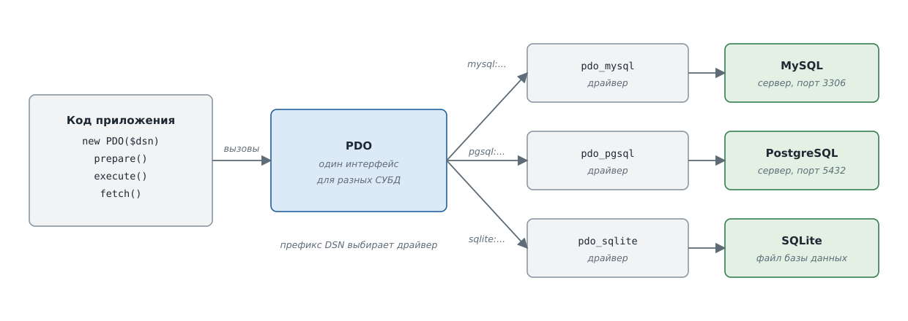

# Работа с базой данных в PHP

## Содержание

- [Работа с базой данных в PHP](#работа-с-базой-данных-в-php)
  - [Содержание](#содержание)
  - [Вопросы для самопроверки](#вопросы-для-самопроверки)
  - [Результаты обучения](#результаты-обучения)
  - [Ретроспектива](#ретроспектива)
  - [Создание базы данных](#создание-базы-данных)
    - [MySQL и XAMPP](#mysql-и-xampp)
      - [Запуск сервера баз данных](#запуск-сервера-баз-данных)
      - [Создание базы данных](#создание-базы-данных-1)
      - [Данные для подключения к базе данных](#данные-для-подключения-к-базе-данных)
    - [PostgreSQL и pgAdmin](#postgresql-и-pgadmin)
      - [Создание пользователя](#создание-пользователя)
      - [Создание базы данных](#создание-базы-данных-2)
      - [Данные для подключения к базе данных](#данные-для-подключения-к-базе-данных-1)
  - [Конфигурация PHP для работы с базами данных](#конфигурация-php-для-работы-с-базами-данных)
    - [Настройка окружения для работы с базами данных](#настройка-окружения-для-работы-с-базами-данных)
      - [Выбор системы управления базами данных](#выбор-системы-управления-базами-данных)
      - [Установка PHP и необходимых расширений](#установка-php-и-необходимых-расширений)
      - [Дополнительная конфигурация](#дополнительная-конфигурация)
  - [Учебная таблица `users`](#учебная-таблица-users)
  - [Драйверы и PDO](#драйверы-и-pdo)
  - [Расширение mysqli](#расширение-mysqli)
  - [Подключение через PDO](#подключение-через-pdo)
    - [Строка подключения DSN](#строка-подключения-dsn)
    - [Создание объекта PDO](#создание-объекта-pdo)
    - [Закрытие соединения](#закрытие-соединения)
  - [Выполнение запросов в PDO](#выполнение-запросов-в-pdo)
    - [Метод `query()`](#метод-query)
    - [Метод `exec()`](#метод-exec)
    - [Чтение результата: `fetch()` и `fetchAll()`](#чтение-результата-fetch-и-fetchall)
  - [Подготовленные запросы](#подготовленные-запросы)
    - [Зачем нужны подготовленные запросы](#зачем-нужны-подготовленные-запросы)
    - [Методы `prepare()` и `execute()`](#методы-prepare-и-execute)
    - [Повторное выполнение запроса](#повторное-выполнение-запроса)
    - [Изменение данных: UPDATE и DELETE](#изменение-данных-update-и-delete)
  - [Обработка ошибок PDO](#обработка-ошибок-pdo)
  - [SQL-инъекции и параметризованные запросы](#sql-инъекции-и-параметризованные-запросы)
    - [Как возникает SQL-инъекция](#как-возникает-sql-инъекция)
    - [Подготовка запроса ещё не защищает](#подготовка-запроса-ещё-не-защищает)
    - [Параметризованные запросы](#параметризованные-запросы)
    - [Что нельзя передать параметром](#что-нельзя-передать-параметром)
  - [Транзакции](#транзакции)
    - [Транзакция, фиксация и откат](#транзакция-фиксация-и-откат)
    - [Транзакции в PDO](#транзакции-в-pdo)
  - [Хранение конфигурации базы данных](#хранение-конфигурации-базы-данных)
    - [Хранение конфигурации в `.php` файле](#хранение-конфигурации-в-php-файле)
    - [Хранение конфигурации в `.env` файле](#хранение-конфигурации-в-env-файле)
      - [Зачем нужен .env?](#зачем-нужен-env)
      - [Пример содержимого .env:](#пример-содержимого-env)
      - [Как использовать `.env` в PHP](#как-использовать-env-в-php)
      - [Безопасность .env](#безопасность-env)
  - [Введение в миграции базы данных](#введение-в-миграции-базы-данных)
    - [Зачем нужны миграции?](#зачем-нужны-миграции)
    - [Как реализуются миграции?](#как-реализуются-миграции)
    - [Инструменты для миграций в PHP](#инструменты-для-миграций-в-php)
  - [ООП-подход: классы MiniShop для работы с базой](#ооп-подход-классы-minishop-для-работы-с-базой)
  - [Резюме](#резюме)

## Вопросы для самопроверки

1. Чем драйвер базы данных отличается от PDO? Что меняется в коде на PDO при переходе с MySQL на PostgreSQL, а что остаётся прежним?
2. Из каких частей состоит DSN? Как выглядит DSN для MySQL и для SQLite?
3. Чем метод `query()` отличается от `exec()`? Что возвращает каждый из них?
4. Когда удобнее `fetch()`, а когда `fetchAll()`? Что вернёт `fetch()`, когда строки закончились?
5. Зачем нужны подготовленные запросы? Что делают методы `prepare()` и `execute()`?
6. Почему запрос, переданный в `prepare()` склеенной строкой, остаётся уязвимым? Какие три правила делают запрос параметризованным?
7. Почему имя столбца для `ORDER BY` нельзя передать плейсхолдером? Как безопасно отсортировать строки по столбцу, который выбрал пользователь?
8. Что такое транзакция? Что произойдёт с изменениями, если внутри транзакции будет выброшено исключение и вызван `rollBack()`?
9. Что такое репозиторий? Почему репозиторий получает объект `PDO` через конструктор, а не создаёт его сам?

## Результаты обучения

После изучения этой главы вы сможете:

- Создать базу данных в MySQL через phpMyAdmin и в PostgreSQL через pgAdmin и назвать параметры подключения к ней.
- Объяснить, чем PDO отличается от `mysqli` и зачем PDO нужны драйверы.
- Прочитать код, который работает с MySQL через `mysqli`.
- Подключиться к базе данных через PDO с помощью DSN и обработать ошибку подключения.
- Выполнить запросы `SELECT`, `INSERT`, `UPDATE` и `DELETE` через PDO и прочитать результат методами `fetch()` и `fetchAll()`.
- Объяснить, как возникает SQL-инъекция, и защитить от неё запрос с помощью параметров.
- Безопасно подставить в запрос имя столбца, которое выбрал пользователь.
- Объединить несколько запросов в транзакцию и откатить её при ошибке.
- Вынести данные подключения в конфигурационный файл.
- Собрать запросы к таблице в класс-репозиторий.

## Ретроспектива

В главе о суперглобальных переменных форма обратной связи сохраняла каждое сообщение строкой JSON в файл `messages.txt`. В главе об организации кода страница заказа MiniShop получила классы `Product` и `Cart`, но товары по-прежнему создавались прямо в коде. Composer и шаблоны из прошлых глав изменили устройство проекта, но данные по-прежнему хранятся в файлах и в коде.

В этой главе данные переезжают в базу данных. Разберём, как PHP подключается к СУБД, как выполнять запросы так, чтобы ввод пользователя не мог изменить их структуру, и как объединять несколько запросов в одно целое.

## Создание базы данных

На других курсах вы уже знакомились с процессом создания баз данных. Тем не менее, мы повторим этот этап, чтобы закрепить знания. В этом разделе будет показан пример создания базы данных с использованием MySQL в составе пакета XAMPP и PostgreSQL с использованием pgAdmin.

### MySQL и XAMPP

> [!TIP]  
> Установка XAMPP описана во второй главе, в разделе "Установка XAMPP".

#### Запуск сервера баз данных

1. Откройте XAMPP.
2. Запустите сервер MySQL, нажав кнопку `Start` в секции `MySQL`.  
   
3. При успешном запуске сервер станет активным, надпись `MySQL` подсветится зелёным цветом, а кнопка `Start` изменится на `Stop`.  
   
4. Если сервер базы данных не запускается, попробуйте запустить XAMPP от имени администратора.
5. Также запустите сервер `Apache`, нажав кнопку `Start` в блоке `Apache`. Он потребуется для работы веб-интерфейса _phpMyAdmin_, используемого для администрирования баз данных.  
   

#### Создание базы данных

1. Нажмите кнопку _Admin_ напротив строки `MySQL`.  
   
2. Откроется веб-интерфейс _phpMyAdmin_ в браузере. С помощью него вы можете управлять базами данных через визуальный интерфейс.  
   
3. Для создания новой базы данных нажмите вкладку _Создать БД_.  
   
4. Укажите имя базы данных (1) и нажмите кнопку _Создать_ (2).  
   
5. После создания база данных появится в списке слева.  
   

#### Данные для подключения к базе данных

Для последующей работы с базой данных вам понадобятся следующие параметры подключения:

| Параметр       | Значение                              |
| -------------- | ------------------------------------- |
| _Хост_         | `localhost`                           |
| _Порт_         | `3306` (порт по умолчанию для MySQL)  |
| _База данных_  | Имя вашей базы (например, `test_app`) |
| _Пользователь_ | `root` (по умолчанию)                 |
| _Пароль_       | пустой (по умолчанию)                 |

> [!TIP]  
> В реальных проектах рекомендуется создать отдельного пользователя с ограниченными правами вместо использования `root`.

### PostgreSQL и pgAdmin

Для выполнения шагов, описанных ниже, на вашем компьютере должны быть установлены:

- [PostgreSQL Server](https://www.postgresql.org/download/) - сервер баз данных PostgreSQL;
- [pgAdmin](https://www.pgadmin.org/download/) - графический интерфейс для управления PostgreSQL.

#### Создание пользователя

1. Запустите _pgAdmin_.  
   

2. При первом запуске программа запросит пароль для доступа к интерфейсу. Введите его и нажмите _OK_.

3. В левой части окна находится дерево объектов. Разверните пункт `Servers`.  
   

4. Щёлкните правой кнопкой мыши на _Login/Group Roles_ и выберите `Create` → `Login/Group Role...`.  
   

5. Во вкладке _General_ введите имя нового пользователя (например, `test_usr`).  
   

6. Перейдите на вкладку _Definition_ и установите пароль для пользователя.  
   

7. Затем откройте вкладку _Privileges_ и установите флажок _Can Login_.  
   

8. Нажмите кнопку _Save_ в правом нижнем углу, чтобы создать пользователя.

#### Создание базы данных

1. В дереве объектов щёлкните правой кнопкой мыши на _Databases_ и выберите `Create` → `Database...`.  
   

2. Во вкладке _General_ укажите имя базы данных (например, `test`) (#1) и выберите ранее созданного пользователя в поле _Owner_ (#2).
   

3. Нажмите кнопку _Save_ в правом нижнем углу.

4. Новая база данных появится в списке слева, а внутри неё вы сможете создавать таблицы и другие объекты.  
   

#### Данные для подключения к базе данных

Для подключения к созданной базе данных в своём приложении используйте следующие параметры:

| Параметр       | Значение                                                 |
| -------------- | -------------------------------------------------------- |
| _Хост_         | `localhost`                                              |
| _Порт_         | `5432` (порт по умолчанию для PostgreSQL)                |
| _База данных_  | Имя базы (например, `test`)                              |
| _Пользователь_ | Имя созданного пользователя (например, `test_usr`)       |
| _Пароль_       | Пароль, заданный при создании пользователя               |
| _Кодировка_    | `UTF-8`                                                  |
| _Драйвер_      | `pgsql` (так PostgreSQL называется в строке подключения) |

## Конфигурация PHP для работы с базами данных

Ранее для хранения данных мы использовали файлы. Однако такой подход имеет ряд существенных недостатков:

- _Ограниченный объём данных_. Файлы плохо масштабируются при работе с большими объёмами информации.
- _Сложности при поиске и обработке_. Извлечение нужных данных требует ручного перебора или дополнительной логики.
- _Трудности с обновлением_. Изменение данных в файле может быть неудобным и неэффективным.
- _Невозможность совместного доступа_. Одновременная работа нескольких пользователей с файлами может привести к конфликтам.
- _Недостаточный уровень безопасности_. Файлы сложно защитить от несанкционированного доступа без дополнительных механизмов.

Для преодоления этих ограничений используются базы данных. База данных - это структурированное хранилище, которое обеспечивает удобное и эффективное управление данными: их хранение, поиск, обновление и защиту.

Вы уже знакомы с базами данных из курса по SQL. В этом разделе мы рассмотрим, как взаимодействовать с базами данных в PHP.

### Настройка окружения для работы с базами данных

Прежде чем приступить к написанию кода для взаимодействия с базой данных, необходимо правильно настроить окружение PHP. Без соответствующей конфигурации подключение к базе данных и выполнение SQL-запросов будут невозможны, так как это требует наличия определённых расширений, которые могут быть отключены в настройках PHP.

#### Выбор системы управления базами данных

PHP поддерживает множество систем управления базами данных (далее СУБД). В зависимости от того, с какой СУБД вы планируете работать, необходимо подключить соответствующее расширение.

> [!TIP]
> В этой главе в качестве примера будет использоваться MySQL, однако принципы работы с другими СУБД во многом аналогичны.

#### Установка PHP и необходимых расширений

Для работы с базами данных в PHP необходимо установить расширения, которые обеспечивают взаимодействие с конкретными СУБД. Наиболее распространённые расширения:

- `mysqli`. Это расширение предназначено для работы только с MySQL и поддерживает как процедурный, так и объектно-ориентированный подход.
- PDO (PHP Data Objects). Это расширение даёт один интерфейс для работы с разными базами данных, включая _MySQL_, _SQLite_ и _PostgreSQL_. Для каждой СУБД к PDO подключается свой драйвер:
  - `pdo_mysql` (для работы с MySQL),
  - `pdo_sqlite` (для работы с SQLite),
  - `pdo_pgsql` (для работы с PostgreSQL),
  - и другие.

Если вы используете готовые сборки, такие как _XAMPP_, _MAMP_ или _OpenServer_, расширения `mysqli` и `pdo_mysql`, как правило, уже активированы. В ином случае потребуется вручную раскомментировать соответствующие строки в файле конфигурации `php.ini`, _например_:

```ini
extension=mysqli
extension=pdo_mysql
```

После внесения изменений в `php.ini` необходимо перезапустить веб-сервер, чтобы новые настройки вступили в силу.

#### Дополнительная конфигурация

Помимо активации расширений, рекомендуется проверить и другие параметры конфигурации:

- _Кодировка_. Установите `default_charset = "UTF-8"` для корректной работы с Unicode-данными.
- _Ошибки_. В режиме разработки следует включить отображение ошибок, установив:
  ```ini
  display_errors = On
  error_reporting = E_ALL
  ```
  Это поможет быстрее находить и устранять проблемы при подключении и выполнении запросов.

> [!WARNING]
> В продакшн-окружении не следует отображать ошибки пользователю. Вместо этого их стоит логировать. Убедитесь, что `display_errors = Off`, чтобы избежать утечки чувствительной информации.

## Учебная таблица `users`

Все примеры главы, кроме раздела "ООП-подход", работают с одной таблицей `users` в базе данных `test_app`, созданной в начале главы через phpMyAdmin. Таблицу создают один раз, например на вкладке _SQL_:

```sql
CREATE TABLE users (
    id INT AUTO_INCREMENT PRIMARY KEY,
    name VARCHAR(50) NOT NULL,
    email VARCHAR(100) NOT NULL UNIQUE,
    balance INT NOT NULL DEFAULT 0,
    created_at TIMESTAMP DEFAULT CURRENT_TIMESTAMP
);

INSERT INTO users (name, email, balance) VALUES
    ('Ivan Ivanov', 'ivan@gmail.com', 50),
    ('Maria Popescu', 'maria@gmail.com', 100),
    ('Andrei Rusu', 'andrei@gmail.com', 0);
```

Поле `balance` хранит бонусные баллы пользователя. Оно понадобится в разделе "Транзакции". После выполнения запроса в таблице три строки:

| `id` | `name`        | `email`            | `balance` |
| ---- | ------------- | ------------------ | --------- |
| 1    | Ivan Ivanov   | `ivan@gmail.com`   | 50        |
| 2    | Maria Popescu | `maria@gmail.com`  | 100       |
| 3    | Andrei Rusu   | `andrei@gmail.com` | 0         |

## Драйверы и PDO

Сам PHP не умеет обмениваться данными с сервером MySQL или PostgreSQL. У каждой СУБД свой протокол: свой формат, в котором клиент отправляет запрос и получает ответ.

**Драйвер базы данных (database driver)** - программный модуль, который знает протокол конкретной СУБД: передаёт ей запросы и получает ответы.

PHP работает с базами данных через расширения. Для MySQL их два:

- _`mysqli`_. Расширение с собственными функциями для MySQL. Оно появилось в PHP 5.0 на смену старому расширению `mysql`[^1], которое в PHP 7.0 удалили совсем[^2].
- _PDO_. Более новое расширение. Оно появилось в PHP 5.1[^3] и даёт один интерфейс для разных СУБД.

**PDO (PHP Data Objects)** - расширение PHP, которое даёт один набор классов и методов для работы с разными СУБД. Сам PDO с сервером не связывается: запросы передаёт драйвер выбранной СУБД[^4].

Схема на рисунке 12.1 показывает, как это устроено. Код приложения вызывает одни и те же методы PDO. Какой драйвер передаст запрос, решает строка подключения: для MySQL это `pdo_mysql`, для PostgreSQL `pdo_pgsql`, для SQLite `pdo_sqlite`.



_Рисунок 12.1. Код PHP работает с разными СУБД через PDO и драйверы_

Расширения можно сравнить следующим образом:

| Вопрос                                   | `mysqli`                              | PDO                                                              |
| ---------------------------------------- | ------------------------------------- | ---------------------------------------------------------------- |
| С какими СУБД работает                   | только MySQL                          | MySQL, PostgreSQL, SQLite и другие, всего 11 драйверов[^5]       |
| Как выглядит код                         | функции `mysqli_*` или класс `mysqli` | только классы                                                    |
| Что меняется при переходе на другую СУБД | все вызовы `mysqli_*`                 | строка подключения и запросы, в которых диалекты SQL различаются |

Дальше в главе используется PDO: один и тот же код вызовов работает с разными СУБД, а при переходе меняется строка подключения, и вместе с ней драйвер.

> [!IMPORTANT]
>
> Единый интерфейс не означает единый SQL. PDO одинаково отправляет запросы разным СУБД, но не переводит их с одного диалекта SQL на другой. Например, автоматическую нумерацию строк в MySQL задаёт `AUTO_INCREMENT`, а в PostgreSQL другая запись. При переходе на другую СУБД меняют строку подключения и такие запросы, а код PHP вокруг них остаётся прежним.

## Расширение mysqli

Расширение `mysqli` часто встречается в старых проектах и учебниках, поэтому его код нужно уметь читать. Достаточно одного примера: подключиться к базе и вывести всех пользователей.

_Пример_. _Вывод пользователей через `mysqli`_

```php
<?php

$conn = mysqli_connect('localhost', 'root', '', 'test_app');
mysqli_set_charset($conn, 'utf8mb4');

$result = mysqli_query($conn, 'SELECT id, name, email FROM users');

while ($user = mysqli_fetch_assoc($result)) {
    echo "{$user['id']}. {$user['name']} ({$user['email']})" . PHP_EOL;
}

mysqli_close($conn);

// 1. Ivan Ivanov (ivan@gmail.com)
// 2. Maria Popescu (maria@gmail.com)
// 3. Andrei Rusu (andrei@gmail.com)
```

В примере пять функций:

| Функция                                | Что делает                                                                                 |
| -------------------------------------- | ------------------------------------------------------------------------------------------ |
| `mysqli_connect(host, user, pass, db)` | открывает соединение с сервером MySQL и возвращает объект соединения                       |
| `mysqli_set_charset($conn, 'utf8mb4')` | задаёт кодировку соединения; `utf8mb4` - название полной кодировки UTF-8 в MySQL           |
| `mysqli_query($conn, $sql)`            | выполняет запрос; для `SELECT` возвращает объект результата `mysqli_result`                |
| `mysqli_fetch_assoc($result)`          | возвращает следующую строку результата как ассоциативный массив или `null`, если строк нет |
| `mysqli_close($conn)`                  | закрывает соединение                                                                       |

Цикл `while` повторяется, пока `mysqli_fetch_assoc()` возвращает строку. Когда строки заканчиваются, функция возвращает `null`, и цикл останавливается.

Каждая функция в этом коде относится только к MySQL. Чтобы перейти на PostgreSQL, пришлось бы заменить их все функциями другого расширения. Дальше тот же запрос выполняется через PDO.

## Подключение через PDO

Чтобы выполнить запрос, PDO должен знать три вещи:

- какой драйвер использовать,
- где находится сервер,
- к какой базе подключиться.

Всё это записывают в одну строку.

### Строка подключения DSN

**DSN (Data Source Name, имя источника данных)** - строка, которая содержит имя драйвера, адрес сервера, имя базы данных и дополнительные параметры, например кодировку.

DSN начинается с имени драйвера и двоеточия, а дальше идут пары `ключ=значение` через точку с запятой. Для разных СУБД строка выглядит так[^3]:

| СУБД       | Драйвер      | Пример DSN                                                       |
| ---------- | ------------ | ---------------------------------------------------------------- |
| MySQL      | `pdo_mysql`  | `mysql:host=localhost;port=3306;dbname=test_app;charset=utf8mb4` |
| PostgreSQL | `pdo_pgsql`  | `pgsql:host=localhost;port=5432;dbname=test`                     |
| SQLite     | `pdo_sqlite` | `sqlite:/var/data/app.db`                                        |

У SQLite нет сервера: база данных - это один файл, поэтому в DSN указан только путь к нему.

Если представить, что DSN существует в реальном мире, его можно сравнить с адресом, по которому можно найти конкретного человека. Такой адрес содержит всю необходимую информацию для установления связи. _Например_: `city=London;street=OxfordStreet;number=10` - это аналог DSN, указывающего на точное местоположение в Лондоне.

### Создание объекта PDO

Соединение открывается в момент, когда создаётся объект класса `PDO`.

_Синтаксис_

```php
new PDO(string $dsn, ?string $username = null, ?string $password = null, ?array $options = null)
```

- `$dsn` - строка подключения.
- `$username` и `$password` - имя пользователя и пароль СУБД.
- `$options` - необязательный массив настроек соединения.
- Возвращает объект `PDO`, через который выполняются все запросы. Если подключиться не удалось, выбрасывает исключение `PDOException`.

_Пример_

```php
<?php

$dsn = 'mysql:host=localhost;dbname=test_app;charset=utf8mb4';

try {
    $pdo = new PDO($dsn, 'root', '');
    echo 'Соединение установлено' . PHP_EOL;
} catch (PDOException $e) {
    die('Ошибка подключения: ' . $e->getMessage());
}

// Соединение установлено
```

В данном примере:

- Строка DSN включает в себя:
  - драйвер (`mysql`),
  - хост (`localhost`),
  - имя базы данных (`test_app`),
  - кодировку (`charset=utf8mb4`), которая устанавливается сразу при подключении.
- Имя пользователя и пароль передаются отдельно - это упрощает смену данных авторизации без изменения DSN.
- Используется конструкция `try...catch`, поскольку при ошибке подключения (_например_, если сервер недоступен или пароль указан неверно) PDO выбрасывает исключение `PDOException`[^6]. Функция `die()` выводит сообщение и завершает скрипт: без соединения продолжать работу нет смысла.

Чтобы подключиться к базе `test` в PostgreSQL, созданной через pgAdmin, достаточно заменить DSN на `pgsql:host=localhost;port=5432;dbname=test` и передать пользователя `test_usr` с его паролем. Остальной код примера не меняется.

Во всех следующих примерах переменная `$pdo` уже содержит соединение, открытое этим кодом.

### Закрытие соединения

При завершении работы с базой данных соединение автоматически закрывается, как только объект PDO уничтожается (обычно в конце выполнения скрипта). Однако при необходимости соединение можно закрыть явно, присвоив значение `null` переменной с объектом PDO и всем переменным с объектами запросов:

```php
<?php

$stmt = null;
$pdo = null;  // Явное закрытие соединения
```

Закрывать соединение вручную имеет смысл в двух случаях:

- _Освобождение ресурсов_. Каждое активное соединение потребляет ресурсы сервера. При большом числе одновременных подключений важно освобождать их как можно раньше.
- _Контроль за временем жизни соединения_. При пакетной обработке данных или работе с несколькими базами важно вручную управлять моментом закрытия соединения.

> [!NOTE]
>
> В обычных веб-приложениях, где каждый запрос обрабатывается отдельно, в большинстве случаев не требуется явно закрывать соединение - PHP сделает это автоматически по завершении скрипта. Однако в фоновом режиме, в CLI-скриптах, демонах и тестах ручное управление соединением становится полезным.

## Выполнение запросов в PDO

Запрос, в котором нет значений от пользователя, можно выполнить сразу.

Для этого у объекта `PDO` есть два метода:

- `query()` для выборки,
- `exec()` для изменения данных.

**PDOStatement** - класс объекта запроса в PDO. Объект хранит запрос и его результат, а из него читают строки результата.

### Метод `query()`

Метод `query()` выполняет SQL-запрос и возвращает его результат[^7].

_Синтаксис_

```php
$pdo->query(string $query): PDOStatement|false
```

- `$query` - текст SQL-запроса.
- Возвращает объект `PDOStatement` с результатом запроса.

_Пример_

```php
<?php

$stmt = $pdo->query('SELECT id, name, email FROM users');
$users = $stmt->fetchAll(PDO::FETCH_ASSOC);

foreach ($users as $user) {
    echo "{$user['id']}. {$user['name']} ({$user['email']})" . PHP_EOL;
}

// 1. Ivan Ivanov (ivan@gmail.com)
// 2. Maria Popescu (maria@gmail.com)
// 3. Andrei Rusu (andrei@gmail.com)
```

Вывод такой же, как у кода на `mysqli`, но в коде нет ни одной функции, привязанной к MySQL. Константа `PDO::FETCH_ASSOC` просит вернуть каждую строку как ассоциативный массив, как `mysqli_fetch_assoc()`. Метод `fetchAll()` описан в подразделе "Чтение результата: fetch() и fetchAll()".

### Метод `exec()`

Запросы `INSERT`, `UPDATE` и `DELETE` не возвращают строк. Для них важно другое: сколько строк изменилось. Это число возвращает метод `exec()`[^8].

_Синтаксис_

```php
$pdo->exec(string $statement): int|false
```

- `$statement` - текст SQL-запроса.
- Возвращает количество изменённых или удалённых строк.

_Пример_. _Начисление всем пользователям 10 бонусных баллов_

```php
<?php

$count = $pdo->exec('UPDATE users SET balance = balance + 10');

echo "Изменено строк: $count" . PHP_EOL;

// Изменено строк: 3
```

Запрос изменил все три строки таблицы, поэтому `exec()` вернул `3`. Для `SELECT` метод `exec()` не подходит: он возвращает число, а не строки результата.

### Чтение результата: `fetch()` и `fetchAll()`

Объект `PDOStatement`, который вернул `query()`, содержит строки результата. Прочитать их можно двумя методами. Какой выбрать, зависит от числа ожидаемых строк:

- `fetchAll()` возвращает все строки сразу в виде массива[^9].
- `fetch()` возвращает одну следующую строку и сдвигает указатель на строку после неё. Когда строки заканчиваются, метод возвращает `false`[^10].

Оба метода принимают режим выборки - константу, которая задаёт, в каком виде вернуть строку:

- `PDO::FETCH_ASSOC` - массив с ключами по названиям столбцов.
  - Пример: `['id' => 1, 'name' => 'Ivan Ivanov']`
- `PDO::FETCH_NUM` - массив с индексами `0`, `1`, `2`
  - Пример: `['Ivan Ivanov', 50]`
- `PDO::FETCH_BOTH` - массив с индексами и ассоциативными ключами (по умолчанию).
  - Пример: `['id' => 1, 'name' => 'Ivan Ivanov', 0 => 1, 1 => 'Ivan Ivanov']`
- `PDO::FETCH_OBJ` - объект, поля которого читаются как `$row->name`.
  - Пример: `$row->name`

_Пример_. _Пользователи по убыванию баллов_

```php
<?php

$stmt = $pdo->query('SELECT name, balance FROM users ORDER BY balance DESC');

$first = $stmt->fetch(PDO::FETCH_ASSOC);
echo "Больше всего баллов: {$first['name']}" . PHP_EOL;

while ($user = $stmt->fetch(PDO::FETCH_ASSOC)) {
    echo "{$user['name']}: {$user['balance']}" . PHP_EOL;
}

// Больше всего баллов: Maria Popescu
// Ivan Ivanov: 50
// Andrei Rusu: 0
```

Первый вызов `fetch()` вернул первую строку, поэтому цикл `while` начал со второй. Цикл остановился, когда `fetch()` вернул `false`.

> [!TIP]
> 
> Если нужна одна строка (например, пользователь по `id`), удобнее `fetch()`. Если нужно обработать все строки, удобнее `fetchAll()`. Цикл `while` с `fetch()` не собирает строки в один большой массив, но драйвер MySQL по умолчанию всё равно загружает весь результат запроса в память сразу.

## Подготовленные запросы

Во многих запросах меняется только значение. Страница профиля ищет пользователя по `email`, который пришёл из формы, и для каждого посетителя адрес свой. Если каждый раз вписывать значение в текст SQL, получается новый текст запроса, а значение приходится правильно брать в кавычки: апостроф в имени `O'Connor` закроет строку раньше времени и сломает запрос.

**Подготовленный запрос (prepared statement)** - SQL-запрос, который сначала передают без значений, с метками на их местах, а значения передают отдельно при каждом выполнении[^11].

**Плейсхолдер (placeholder)** - метка в тексте подготовленного запроса на месте будущего значения. В PDO это знак `?` или имя с двоеточием, например `:email`.

### Зачем нужны подготовленные запросы

Подготовленные запросы используют по четырём причинам:

- _Один запрос выполняется много раз_. Запрос подготавливают один раз, а выполняют сколько угодно раз с разными значениями. Если драйвер готовит запрос на сервере СУБД, сервер разбирает текст запроса только один раз[^11]. Драйвер `pdo_mysql` по умолчанию эмулирует подготовку: значения подставляет сам PHP[^12]. Поэтому в примерах этой главы выигрыша в скорости нет, но остальные причины действуют.
- _Значения не нужно брать в кавычки и экранировать_. Это делает драйвер, поэтому апостроф в `O'Connor` запрос не ломает[^11].
- _Текст SQL не меняется_. Запрос - постоянная строка, а данные лежат отдельно в массиве. Такой код проще читать и проверять.
- _На них построена защита от SQL-инъекций_, то есть от атак, при которых ввод пользователя меняет текст запроса. Защищает не сам вызов `prepare()`, а то, что значения передаются отдельно от текста запроса. Подробно это разбирает раздел "SQL-инъекции и параметризованные запросы".

### Методы `prepare()` и `execute()`

Работа с подготовленным запросом идёт в три шага:

- подготовить запрос,
- выполнить его со значениями,
- прочитать результат.

_Синтаксис_

```php
$pdo->prepare(string $query): PDOStatement|false
$stmt->execute(?array $params = null): bool
```

- `prepare()` принимает текст запроса с плейсхолдерами и возвращает объект `PDOStatement`[^13]. Запрос при этом ещё не выполняется.
- `execute()` выполняет подготовленный запрос. Массив `$params` содержит значения для плейсхолдеров: по порядку для `?` или по именам для `:email`[^14]. Метод возвращает `true`, если запрос выполнен.

_Пример_. _Поиск пользователя по `email`_

```php
<?php

$email = $_GET['email'];  // например, maria@gmail.com

$stmt = $pdo->prepare('SELECT id, name FROM users WHERE email = ?');
$stmt->execute([$email]);
$user = $stmt->fetch(PDO::FETCH_ASSOC);

if ($user) {
    echo "Найден пользователь: {$user['name']}" . PHP_EOL;
} else {
    echo 'Пользователь не найден' . PHP_EOL;
}

// Найден пользователь: Maria Popescu
```

В данном примере:

- Метод `prepare()` подготавливает SQL-запрос с плейсхолдером `?` вместо конкретного значения.
- Метод `execute()` выполняет запрос и подставляет значение из массива на место `?`.
- Метод `fetch(PDO::FETCH_ASSOC)` извлекает одну строку результата. Если пользователь не найден, он вернёт `false`, и сработает ветка `else`.

Подготовленные запросы могут использовать именованные плейсхолдеры, начинающиеся с `:`. Это делает код более читаемым, особенно при большом количестве параметров:

```php
$stmt = $pdo->prepare('SELECT id, name FROM users WHERE email = :email');
$stmt->execute(['email' => $email]);
$user = $stmt->fetch(PDO::FETCH_ASSOC);
```

Ключи массива совпадают с именами плейсхолдеров, поэтому значения можно перечислять в любом порядке. Двоеточие в ключе можно писать или опускать: `['email' => ...]` и `[':email' => ...]` работают одинаково.

Метод `prepare()` только подготавливает запрос, но не выполняет его. Если забыть вызвать `execute()`, запрос не выполнится, а `fetch()` вернёт `false`, как будто пользователь не найден.

### Повторное выполнение запроса

Первая причина использовать подготовленные запросы видна, когда один запрос выполняется много раз. Например, в таблицу нужно добавить сразу несколько пользователей.

_Пример_. _Один подготовленный запрос для двух вставок_

```php
<?php

$newUsers = [
    ['name' => 'Elena Ceban', 'email' => 'elena@gmail.com'],
    ['name' => 'Victor Lungu', 'email' => 'victor@gmail.com'],
];

$stmt = $pdo->prepare('INSERT INTO users (name, email) VALUES (:name, :email)');

foreach ($newUsers as $newUser) {
    $stmt->execute($newUser);
    echo "Добавлен {$newUser['name']}, id = " . $pdo->lastInsertId() . PHP_EOL;
}

// Добавлен Elena Ceban, id = 4
// Добавлен Victor Lungu, id = 5
```

Метод `prepare()` вызван один раз, а `execute()` вызывается для каждого пользователя. Ключи массива `$newUser` совпадают с именами плейсхолдеров, поэтому массив передаётся в `execute()` целиком. Метод `lastInsertId()` возвращает `id`, который СУБД присвоила последней добавленной строке через `AUTO_INCREMENT`[^15].

### Изменение данных: UPDATE и DELETE

Запросы `UPDATE` и `DELETE` тоже выполняются через `prepare()` и `execute()`, когда в них есть значения. Сколько строк они изменили, показывает метод `rowCount()` объекта `PDOStatement`[^16].

_Пример_

```php
<?php

$stmt = $pdo->prepare('UPDATE users SET email = ? WHERE id = ?');
$stmt->execute(['ivan.ivanov@gmail.com', 1]);
echo 'Обновлено строк: ' . $stmt->rowCount() . PHP_EOL;

$stmt = $pdo->prepare('DELETE FROM users WHERE id = ?');
$stmt->execute([99]);
echo 'Удалено строк: ' . $stmt->rowCount() . PHP_EOL;

// Обновлено строк: 1
// Удалено строк: 0
```

Первый запрос изменил адрес пользователя с `id = 1`. Пользователя с `id = 99` в таблице нет, поэтому второй запрос ничего не удалил. Это не ошибка: запрос выполнен, просто ни одна строка не подошла под условие. Чтобы убедиться, что строка действительно удалена, проверяют `rowCount()`. Для `UPDATE` MySQL считает только те строки, значения в которых изменились: запрос, который записывает в поле прежнее значение, вернёт 0.

> [!WARNING]
> Всегда проверяйте наличие условия `WHERE` в запросах на обновление и удаление. Отсутствие этого условия может привести к критическим последствиям. Например, запрос `DELETE FROM users` удалит всех пользователей из таблицы. Поэтому перед выполнением запросов стоит внимательно проверять логику и значения переменных.

## Обработка ошибок PDO

С PHP 8.0 PDO по умолчанию сообщает о любой ошибке исключением `PDOException`[^6], например:

- о синтаксической ошибке в SQL,
- об обращении к несуществующей таблице,
- о нарушении уникальности.

До PHP 8.0 по умолчанию действовал "тихий" режим: метод возвращал `false`, а текст ошибки приходилось получать вручную. Поэтому в старом коде после подключения часто стоит строка `$pdo->setAttribute(PDO::ATTR_ERRMODE, PDO::ERRMODE_EXCEPTION)`, которая включает исключения явно.

_Пример_. _Обработка ошибок при выполнении SQL-запроса_

```php
<?php

try {
    $pdo->query('SELECT * FROM nonexistent_table');
} catch (PDOException $e) {
    error_log($e->getMessage());
    echo 'Произошла ошибка. Попробуйте позже.' . PHP_EOL;
}

// Произошла ошибка. Попробуйте позже.
```

Таблицы `nonexistent_table` нет, поэтому `query()` выбрасывает исключение, и управление переходит в блок `catch`. Функция `error_log()` записывает текст ошибки в журнал ошибок PHP. В журнал попадает строка:

```text
SQLSTATE[42S02]: Base table or view not found: 1146 Table 'test_app.nonexistent_table' doesn't exist
```

Пользователь видит только общее сообщение.

> [!IMPORTANT]
> Технические детали ошибок базы данных пользователю не показывают. Такие сообщения содержат имена баз, таблиц и столбцов, а это помогает злоумышленнику. В рабочем окружении ошибки записывают в журнал, а пользователю показывают безопасное сообщение, например: _"Произошла ошибка. Попробуйте позже."_

## SQL-инъекции и параметризованные запросы

Главная причина передавать значения отдельно от текста запроса - защита от SQL-инъекций. Сначала разберём, как возникает эта уязвимость.

### Как возникает SQL-инъекция

**SQL-инъекция (SQL injection)** - уязвимость, при которой данные от пользователя (из формы, URL и других источников) попадают прямо в текст SQL-запроса и меняют его структуру. В результате злоумышленник может получить доступ к чужим данным, изменить или удалить их[^17].

Само название "SQL-инъекция" легко объяснить. Вспомните, что такое инъекция в медицине - это введение в организм вещества, которого там изначально не было. Аналогично, при SQL-инъекции злоумышленник "вводит" в SQL-запрос свой код, чтобы изменить его поведение.

Рассмотрим пример. Страница показывает пользователя по адресу почты из параметра URL `email`. Значение вклеивается прямо в текст запроса.

_Пример_. _Уязвимый поиск пользователя_

```php
<?php

$email = $_GET['email'];

$sql = "SELECT id, name, email FROM users WHERE email = '$email'";
echo $sql . PHP_EOL;

$users = $pdo->query($sql)->fetchAll(PDO::FETCH_ASSOC);
echo 'Найдено пользователей: ' . count($users) . PHP_EOL;
```

Для обычного значения `maria@gmail.com` страница находит одного пользователя. Если же передать в параметре `email` строку `' OR '1'='1`, программа выведет:

```text
SELECT id, name, email FROM users WHERE email = '' OR '1'='1'
Найдено пользователей: 3
```

Первый апостроф из ввода закрыл строку, которую открыл код. Дальше идёт уже не значение, а часть SQL: условие `OR '1'='1'`. Оно истинно для каждой строки, поэтому запрос вернул всю таблицу. Если бы страница выводила найденные строки, она показала бы адреса всех пользователей. Тем же приёмом злоумышленник может прочитать другие таблицы или изменить данные[^17].

### Подготовка запроса ещё не защищает

Частая ошибка - считать, что любой вызов `prepare()` защищает от инъекций. Рассмотрим тот же поиск, переписанный через `prepare()`.

_Пример_. _`prepare()` со склейкой строки_

```php
<?php

$email = $_GET['email'];  // ' OR '1'='1

$stmt = $pdo->prepare("SELECT id, name, email FROM users WHERE email = '$email'");
$stmt->execute();

echo 'Найдено пользователей: ' . count($stmt->fetchAll(PDO::FETCH_ASSOC)) . PHP_EOL;

// Найдено пользователей: 3
```

Результат тот же: найдены все три пользователя. Переменная `$email` вклеилась в строку раньше, чем её получил `prepare()`. Метод подготовил уже испорченный запрос и не может отличить, какую часть написал программист, а какую ввёл пользователь. Документация PHP предупреждает об этом прямо: инъекция возможна, если часть запроса собрана из необработанного ввода[^11].

### Параметризованные запросы

Защищает от инъекции не подготовка, а то, как значение попадает в запрос.

**Параметризованный запрос (parameterized query)** - запрос, в котором текст SQL не содержит данных, а каждое значение передаётся отдельно, через параметр на месте плейсхолдера.

_Пример_. _Безопасный поиск пользователя_

```php
<?php

$email = $_GET['email'];  // ' OR '1'='1

$stmt = $pdo->prepare('SELECT id, name, email FROM users WHERE email = ?');
$stmt->execute([$email]);

echo 'Найдено пользователей: ' . count($stmt->fetchAll(PDO::FETCH_ASSOC)) . PHP_EOL;

// Найдено пользователей: 0
```

Текст запроса теперь постоянный, а строка `' OR '1'='1` передана в `execute()` как значение. Драйвер подставляет её целиком как данные, и СУБД сравнивает её с полем `email`. Пользователя с таким странным адресом нет, поэтому запрос ничего не нашёл. Апострофы из ввода остались частью значения и не стали частью SQL.

Три варианта поиска для ввода `' OR '1'='1` дают такой результат:

| Вариант                      | Как значение попадает в запрос    | Найдено строк |
| ---------------------------- | --------------------------------- | ------------- |
| склейка строки и `query()`   | вклеено в текст SQL               | 3             |
| склейка строки и `prepare()` | вклеено в текст SQL до подготовки | 3             |
| плейсхолдер и `execute()`    | передано отдельно, как параметр   | 0             |

Параметризованные запросы - основной способ защиты от SQL-инъекций[^18]. Запрос получается параметризованным, если выполнены три правила:

1. Текст запроса - постоянная строка без значений, которые пришли извне.
2. На месте каждого значения от пользователя стоит плейсхолдер.
3. Значения передаются в `execute()`.

### Что нельзя передать параметром

Плейсхолдер может заменить только значение, например строку или число. Имена таблиц и столбцов и ключевые слова SQL, например `ASC` и `DESC`, параметром передать нельзя[^13].

Рассмотрим пример. Страница выводит пользователей, а столбец для сортировки приходит из параметра URL `sort`. Если поставить плейсхолдер после `ORDER BY`, ошибки не будет, но и сортировки тоже:

```php
<?php

$stmt = $pdo->prepare('SELECT name, balance FROM users ORDER BY ?');
$stmt->execute(['balance']);

foreach ($stmt->fetchAll(PDO::FETCH_ASSOC) as $user) {
    echo "{$user['name']}: {$user['balance']}" . PHP_EOL;
}

// Ivan Ivanov: 50
// Maria Popescu: 100
// Andrei Rusu: 0
```

Строка `'balance'` подставилась как значение, а не как имя столбца. СУБД отсортировала строки по одной и той же постоянной строке, поэтому сортировка не подействовала: строки пришли в том порядке, в каком их вернула СУБД, здесь по `id`.

Имя столбца приходится вставлять в текст запроса, но только из перечня, который задал программист.

**Белый список (allowlist)** - перечень допустимых значений, заданный в коде. Значение от пользователя проверяется по этому перечню, а всё остальное отклоняется или заменяется значением по умолчанию.

_Пример_. _Сортировка по белому списку_

```php
<?php

$sort = match ($_GET['sort'] ?? 'id') {
    'name' => 'name',
    'balance' => 'balance',
    default => 'id',
};

$stmt = $pdo->query("SELECT name, balance FROM users ORDER BY $sort");

foreach ($stmt->fetchAll(PDO::FETCH_ASSOC) as $user) {
    echo "{$user['name']}: {$user['balance']}" . PHP_EOL;
}

// Для адреса ?sort=balance:
// Andrei Rusu: 0
// Ivan Ivanov: 50
// Maria Popescu: 100
```

Конструкция `match` возвращает одну из трёх строк, записанных в коде. Если параметра `sort` нет или в нём неизвестное значение, строки сортируются по `id`. Что бы ни пришло в `$_GET['sort']`, в запрос попадёт `name`, `balance` или `id`, поэтому вклеивать `$sort` в текст запроса безопасно[^18].

> [!NOTE]
> Иногда вместо параметров данные экранируют вручную функциями `PDO::quote()` или `mysqli_real_escape_string()`. Они экранируют опасные символы, например апостроф, способом, принятым в СУБД, а `PDO::quote()` ещё и заключает значение в кавычки. Такой способ ненадёжен: достаточно забыть обработать одно значение, и запрос снова уязвим. Документация PHP рекомендует вместо него подготовленные запросы с параметрами[^19].

## Транзакции

Одно действие пользователя часто требует нескольких запросов. Чтобы перевести бонусные баллы от одного пользователя другому, нужно уменьшить баланс первого и увеличить баланс второго. Если между этими запросами случится ошибка, например упадёт скрипт или пропадёт связь с сервером, баллы спишутся и никому не начислятся.

### Транзакция, фиксация и откат

**Транзакция (transaction)** - группа запросов, которую СУБД выполняет как одно целое: изменения либо сохраняются все вместе, либо не сохраняется ни одно.

**Фиксация (commit)** - завершение транзакции, при котором все её изменения сохраняются в базе.

**Откат (rollback)** - завершение транзакции, при котором все её изменения отменяются, и данные возвращаются к состоянию до её начала.

Пока транзакция не начата явно, PDO работает в режиме _автофиксации (auto-commit)_: каждый запрос сразу фиксируется как отдельная транзакция[^20]. Чтобы объединить несколько запросов, транзакцию начинают и завершают методами объекта `PDO`. Их три:

| Метод                | Что делает                                                  |
| -------------------- | ----------------------------------------------------------- |
| `beginTransaction()` | начинает транзакцию: следующие запросы не фиксируются сразу |
| `commit()`           | фиксирует транзакцию                                        |
| `rollBack()`         | откатывает транзакцию                                       |

### Транзакции в PDO

Рассмотрим пример. Функция `transferBonus()` переводит баллы от пользователя `$fromId` пользователю `$toId`. Оба запроса выполняются внутри одной транзакции.

_Пример_. _Перевод бонусных баллов_

```php
<?php

function transferBonus(PDO $pdo, int $fromId, int $toId, int $amount): void
{
    $pdo->beginTransaction();

    try {
        $stmt = $pdo->prepare('UPDATE users SET balance = balance - ? WHERE id = ? AND balance >= ?');
        $stmt->execute([$amount, $fromId, $amount]);
        if ($stmt->rowCount() === 0) {
            throw new RuntimeException('Недостаточно баллов');
        }

        $stmt = $pdo->prepare('UPDATE users SET balance = balance + ? WHERE id = ?');
        $stmt->execute([$amount, $toId]);
        if ($stmt->rowCount() === 0) {
            throw new RuntimeException('Получатель не найден');
        }

        $pdo->commit();
    } catch (Throwable $e) {
        $pdo->rollBack();
        throw $e;
    }
}
```

Функция работает так:

1. `beginTransaction()` начинает транзакцию.
2. Первый запрос списывает баллы, только если их хватает: за это отвечает условие `balance >= ?`. Если ни одна строка не изменилась, функция выбрасывает исключение.
3. Второй запрос начисляет баллы получателю. Если получателя нет, функция тоже выбрасывает исключение.
4. Если оба запроса прошли, `commit()` фиксирует оба изменения.
5. Любое исключение внутри `try` передаёт управление в `catch`: `rollBack()` отменяет всё, что транзакция успела изменить, а `throw $e` передаёт исключение дальше, чтобы вызывающий код узнал о неудаче. В `catch` указан `Throwable`, потому что транзакцию нужно откатить при любой ошибке, в том числе при `PDOException` от самой базы.

Теперь вызовем функцию дважды: сначала с существующим получателем, потом с получателем `id` 99, которого нет.

```php
<?php

transferBonus($pdo, 1, 2, 30);   // выполнен

try {
    transferBonus($pdo, 1, 99, 20);
} catch (RuntimeException $e) {
    echo 'Перевод отменён: ' . $e->getMessage() . PHP_EOL;
}

$stmt = $pdo->query('SELECT id, balance FROM users WHERE id IN (1, 2)');
foreach ($stmt->fetchAll(PDO::FETCH_ASSOC) as $user) {
    echo "id {$user['id']}: {$user['balance']}" . PHP_EOL;
}

// Перевод отменён: Получатель не найден
// id 1: 20
// id 2: 130
```

Баланс пользователей с `id` 1 и 2 меняется так:

| Шаг                                   | `id` 1 | `id` 2 |
| ------------------------------------- | ------ | ------ |
| до переводов                          | 50     | 100    |
| первый перевод: 30 баллов, `commit()` | 20     | 130    |
| второй перевод: списано 20 баллов     | 0      | 130    |
| второй перевод: получатель не найден  | 0      | 130    |
| второй перевод: `rollBack()`          | 20     | 130    |

Во втором переводе первый запрос успел списать 20 баллов. Без транзакции они бы пропали. Откат вернул баланс к 20, то есть к значению после первого перевода.

Если в блоке `catch` забыть вызвать `rollBack()`, транзакция останется открытой. Следующие запросы скрипта попадут в ту же транзакцию, а при завершении скрипта PDO автоматически откатит её целиком[^20]. В результате пропадут и те изменения, которые выглядели успешными.

> [!NOTE]
> В MySQL каждую таблицу хранит _движок хранения (storage engine)_, и транзакции работают, только если он их поддерживает. По умолчанию MySQL создаёт таблицы с движком InnoDB, который транзакции поддерживает[^21], а старый движок MyISAM их молча игнорирует. Кроме того, запросы, меняющие структуру базы, например `CREATE TABLE` и `DROP TABLE`, в MySQL сами фиксируют текущую транзакцию[^20].

## Хранение конфигурации базы данных

Во всех примерах выше имя пользователя и пароль записаны прямо в коде. Существует множество способов хранения конфигурации (в том числе переменные окружения, `.env`-файлы, YAML, JSON и XML), но основное правило одно: _конфигурация - это чувствительная информация, которая не должна быть доступна публично_. Данные для подключения (логины, пароли, имена баз данных) нельзя оставлять в открытом виде, особенно в публичных репозиториях или в коде, доступном из браузера.

### Хранение конфигурации в `.php` файле

Один из простых и надёжных способов - хранить конфигурацию в `.php`-файле, который возвращает массив настроек. _Например_:

```php
<?php

return [
    'host'     => 'localhost',
    'user'     => 'root',
    'password' => 'password',
    'database' => 'test_app',
    'charset'  => 'utf8mb4',
];
```

Такой файл можно подключить через `require` и использовать данные из массива:

```php
<?php

$config = require 'config/config.php';

$dsn = sprintf(
    'mysql:host=%s;dbname=%s;charset=%s',
    $config['host'],
    $config['database'],
    $config['charset']
);

$pdo = new PDO($dsn, $config['user'], $config['password']);
```

Функция `sprintf()` подставляет значения по порядку на места `%s` в строке-шаблоне и возвращает готовую строку.

_Безопасность конфигурационного файла_:

- Поместите файл конфигурации вне корневой папки сайта `public/`, например в `config/`, чтобы он был недоступен из браузера.
- Убедитесь, что веб-сервер не отдаёт `.php`-файлы в виде текста.
- Добавьте путь к файлу в `.gitignore`, чтобы он не попал в систему контроля версий:
  ```text
  # .gitignore
  config/config.php
  ```

Для работы в команде можно создать файл-пример (`config.sample.php`), который содержит ту же структуру, но без чувствительных данных. Разработчики смогут скопировать его и ввести свои значения локально.

Такой подход прост, удобен и надёжно работает во многих проектах, особенно на этапе обучения или в небольших приложениях.

### Хранение конфигурации в `.env` файле

> [!NOTE]
> Этот раздел является дополнительным и предназначен для тех, кто хочет углубить знания в вопросах конфигурации и безопасности.

Файл `.env` (от "environment" - окружение) используется для хранения конфиденциальной информации, такой как:

- логины и пароли,
- API-ключи,
- параметры подключения к БД,
- пути к файлам,
- переменные, зависящие от среды (dev/test/prod).

Это позволяет разделить конфигурацию и код, не размещая чувствительные данные в репозитории[^22].

#### Зачем нужен .env?

- _Параметры для каждой среды_. В файле задают значения, специфичные для среды, например разные базы данных для разработки и продакшена.
- _Безопасность_. Файл `.env` не попадает в систему контроля версий.
- _Простая настройка_. Достаточно скопировать `.env.example` и ввести свои значения.

#### Пример содержимого .env:

```ini
DB_HOST=localhost
DB_USER=root
DB_PASSWORD=password
DB_NAME=test
DB_CHARSET=utf8mb4
```

#### Как использовать `.env` в PHP

По умолчанию PHP не умеет автоматически загружать `.env`-файлы. Для этого можно использовать библиотеку `vlucas/phpdotenv`, которая является стандартом де-факто во многих проектах.

_Установка (с помощью Composer)_:

```bash
composer require vlucas/phpdotenv
```

_Пример_. _Использование .env в PHP_

```php
<?php

require_once __DIR__ . '/vendor/autoload.php';

// Инициализация dotenv (файл .env должен быть в корне проекта)
$dotenv = Dotenv\Dotenv::createImmutable(__DIR__);
$dotenv->load();

// Получение переменных окружения
$dbHost = $_ENV['DB_HOST'];
$dbName = $_ENV['DB_NAME'];
$dbUser = $_ENV['DB_USER'];
$dbPass = $_ENV['DB_PASSWORD'];
```

После вызова `$dotenv->load()` библиотека читает содержимое `.env` и записывает пары ключ-значение в суперглобальные массивы `$_ENV` и `$_SERVER`. Функция `getenv()` эти значения по умолчанию не видит: для неё библиотеку создают методом `createUnsafeImmutable()`, но сами авторы библиотеки так делать не советуют[^22].

#### Безопасность .env

- Всегда добавляйте файл `.env` в `.gitignore`:
  ```text
  # .gitignore
  .env
  ```
- В репозитории можно оставить только `.env.example` - файл-шаблон со структурой, но без чувствительных данных. Это упростит настройку проекта для других разработчиков.

## Введение в миграции базы данных

> [!NOTE]
> Этот раздел является дополнительным и предназначен для тех, кто хочет углубить знания.

В процессе разработки приложения структура базы данных (таблицы, поля, типы данных, связи и ограничения) часто изменяется: добавляются новые таблицы, поля, индексы, меняются типы и правила. Миграции позволяют управлять такими изменениями последовательно и контролируемо.

**Миграция (migration)** - файл (SQL или скрипт), описывающий, как перевести базу данных из одного состояния в другое.

### Зачем нужны миграции?

- _Версионирование базы_. Миграции позволяют вести учёт всех изменений в структуре БД, так же как система контроля версий отслеживает изменения в коде. Это даёт возможность понять, кто и когда внёс изменения в схему.
- _Командная разработка_. Каждый разработчик может применять миграции и получать актуальную версию базы без ручного вмешательства. Это исключает ситуации, когда структура БД на локальной машине отличается от общей.
- _Деплой на разные окружения_. При переносе приложения на другие среды (dev, staging, production) миграции позволяют легко и безопасно обновить базу данных, применив все нужные изменения в правильной последовательности.
- _Откат изменений_. Некоторые системы миграций поддерживают откат (`rollback`) - возможность отменить последнее изменение, если оно оказалось ошибочным.

### Как реализуются миграции?

В самом простом виде миграция - это SQL-файл. Например:

```sql
-- файл: 20250401_create_users_table.sql
CREATE TABLE users (
    id INT AUTO_INCREMENT PRIMARY KEY,
    name VARCHAR(100) NOT NULL,
    email VARCHAR(100) NOT NULL UNIQUE,
    created_at TIMESTAMP DEFAULT CURRENT_TIMESTAMP
);
```

По имени файла видно, что таблица `users` создана 1 апреля 2025 года. Принято использовать префикс с датой или номером, чтобы определить порядок применения миграций.

Такие файлы можно вручную запускать через `phpMyAdmin`, `mysql`, `psql` или другие клиенты. Однако ручное применение неудобно и подвержено ошибкам, особенно в команде или при частых изменениях.

### Инструменты для миграций в PHP

Существуют готовые решения, которые упрощают управление миграциями:

- Phinx[^23] - один из самых популярных инструментов миграций в PHP-проектах без фреймворков. _Позволяет_:
  - генерировать миграции на PHP или SQL;
  - применять (migrate) и откатывать (rollback) изменения;
  - отслеживать состояние миграций.

- migrate[^24] - мигратор баз данных (_CLI-утилита_), написанный на Go, поддерживает работу с различными СУБД. _Позволяет_:
  - генерировать файлы миграций на чистом SQL;
  - применять (migrate) и откатывать (rollback) изменения;
  - отслеживать состояние миграций.

  Хотя это не PHP-решение, его можно использовать в проектах на PHP, так как он поддерживает работу с MySQL и PostgreSQL.

Если вы пока не используете фреймворки или сторонние инструменты, можно начать с простого:

- создавать SQL-файлы с изменениями (`create_table_users.sql`, `alter_table_add_status.sql` и подобные),
- хранить их в отдельной папке (`migrations/`),
- упорядочивать по времени создания,
- обмениваться этими файлами с коллегами,
- документировать, какие изменения применялись и когда.

## ООП-подход: классы MiniShop для работы с базой

В примерах главы SQL-запросы записаны прямо в скриптах. В настоящем приложении один и тот же запрос, например "найти товар по `id`", нужен на странице каталога, в корзине и при оформлении заказа. Копии запроса оказываются на разных страницах, и при изменении таблицы приходится править каждую.

Объектно-ориентированный подход собирает все запросы к одной таблице в одном классе.

**Репозиторий (repository)** - класс, который прячет работу с хранилищем для одного вида данных, обычно для одной таблицы: все запросы собраны в его методах, а остальной код получает готовые данные. Он вызывает методы вроде `all()` и `find()` и не знает, какой SQL выполняется внутри. Это не репозиторий Git: здесь репозиторий - класс в коде приложения.

Теперь переведём на этот подход каталог и заказы MiniShop. Полный проект лежит в папке `code/minishop`:

```text
minishop/
├── composer.json          автозагрузка MiniShop\ из src/
├── config/
│   └── config.sample.php  пример конфигурации
├── schema.sql             таблицы products и orders
├── src/
│   ├── OrderRepository.php
│   ├── OrderService.php
│   └── ProductRepository.php
└── run.php                точка входа
```

_Шаг 1. Создаём таблицы_. Файл `schema.sql` создаёт две таблицы:

- `products` с полями `name`, `price` и `stock` (остаток на складе),
- `orders` с полями `product_id`, `quantity` и `total`.

В каталоге три товара:

| `id` | `name`     | `price`  | `stock` |
| ---- | ---------- | -------- | ------- |
| 1    | Ноутбук    | 12500.00 | 3       |
| 2    | Мышь       | 250.00   | 10      |
| 3    | Клавиатура | 600.00   | 0       |

_Шаг 2. Пишем репозиторий товаров_.

```php
<?php

namespace MiniShop;

use PDO;

class ProductRepository
{
    public function __construct(private PDO $pdo)
    {
    }

    public function all(): array
    {
        $stmt = $this->pdo->query('SELECT id, name, price, stock FROM products ORDER BY id');

        return $stmt->fetchAll(PDO::FETCH_ASSOC);
    }

    public function find(int $id): ?array
    {
        $stmt = $this->pdo->prepare('SELECT id, name, price, stock FROM products WHERE id = ?');
        $stmt->execute([$id]);
        $product = $stmt->fetch(PDO::FETCH_ASSOC);

        return $product === false ? null : $product;
    }

    public function decreaseStock(int $id, int $quantity): bool
    {
        $stmt = $this->pdo->prepare('UPDATE products SET stock = stock - ? WHERE id = ? AND stock >= ?');
        $stmt->execute([$quantity, $id, $quantity]);

        return $stmt->rowCount() === 1;
    }
}
```

Репозиторий получает готовый объект `PDO` через конструктор и сам соединение не открывает. Поэтому все классы приложения работают через одно соединение. Это важно для транзакций: транзакция принадлежит соединению, и если бы каждый репозиторий открывал своё, `beginTransaction()` на одном соединении не охватил бы запросы другого. Каждый запрос со значениями параметризован. Метод `decreaseStock()` уменьшает остаток, только если товара хватает, и возвращает `false`, если строка не изменилась.

_Шаг 3. Пишем репозиторий заказов_. Класс `OrderRepository` устроен так же, и в нём один метод:

```php
public function create(int $productId, int $quantity, float $total): int
{
    $stmt = $this->pdo->prepare('INSERT INTO orders (product_id, quantity, total) VALUES (?, ?, ?)');
    $stmt->execute([$productId, $quantity, $total]);

    return (int) $this->pdo->lastInsertId();
}
```

_Шаг 4. Оформляем заказ в транзакции_. Заказ меняет две таблицы: уменьшает остаток в `products` и добавляет строку в `orders`. Такое действие не принадлежит ни одному из двух репозиториев, поэтому для него нужен отдельный класс `OrderService`:

```php
<?php

namespace MiniShop;

use PDO;
use RuntimeException;
use Throwable;

class OrderService
{
    public function __construct(
        private PDO $pdo,
        private ProductRepository $products,
        private OrderRepository $orders,
    ) {
    }

    public function place(int $productId, int $quantity): int
    {
        $this->pdo->beginTransaction();

        try {
            $product = $this->products->find($productId);
            if ($product === null) {
                throw new RuntimeException('Товар не найден');
            }

            if (!$this->products->decreaseStock($productId, $quantity)) {
                throw new RuntimeException('Недостаточно товара на складе');
            }

            $orderId = $this->orders->create($productId, $quantity, $product['price'] * $quantity);

            $this->pdo->commit();

            return $orderId;
        } catch (Throwable $e) {
            $this->pdo->rollBack();
            throw $e;
        }
    }
}
```

Метод `place()` повторяет схему транзакции:

1. Начать транзакцию.
2. Выполнить запросы.
3. Зафиксировать изменения.
4. При любом исключении откатить их.

Если строку заказа не удастся добавить, остаток товара вернётся к прежнему значению.

_Шаг 5. Собираем точку входа_. Файл `run.php` читает массив настроек из `config/config.php`, открывает соединение и оформляет два заказа: первый на два ноутбука, второй на одну клавиатуру.

```php
<?php

require __DIR__ . '/vendor/autoload.php';

use MiniShop\OrderRepository;
use MiniShop\OrderService;
use MiniShop\ProductRepository;

$config = require __DIR__ . '/config/config.php';

$dsn = sprintf('mysql:host=%s;dbname=%s;charset=%s', $config['host'], $config['database'], $config['charset']);
$pdo = new PDO($dsn, $config['user'], $config['password']);

$products = new ProductRepository($pdo);
$orderService = new OrderService($pdo, $products, new OrderRepository($pdo));

$requests = [[1, 2], [3, 1]]; // пары: id товара и количество

foreach ($requests as $request) {
    try {
        $orderId = $orderService->place($request[0], $request[1]);
        echo "Заказ №$orderId оформлен" . PHP_EOL;
    } catch (RuntimeException $e) {
        echo 'Заказ не оформлен: ' . $e->getMessage() . PHP_EOL;
    }
}

foreach ($products->all() as $product) {
    echo "{$product['name']}: {$product['price']} лей, на складе {$product['stock']}" . PHP_EOL;
}
```

Проект запускают так:

1. Копируют конфигурацию из `config/config.sample.php` в `config/config.php`.
2. Создают базу `minishop` и выполняют в ней `schema.sql`.
3. Выполняют в папке проекта две команды. Первая создаёт папку `vendor` с автозагрузчиком классов, который `run.php` подключает первой строкой, вторая запускает программу:

```bash
composer dump-autoload
php run.php
```

Программа выведет:

```text
Заказ №1 оформлен
Заказ не оформлен: Недостаточно товара на складе
Ноутбук: 12500.00 лей, на складе 1
Мышь: 250.00 лей, на складе 10
Клавиатура: 600.00 лей, на складе 0
```

Первый заказ уменьшил остаток ноутбуков с 3 до 1. Клавиатур на складе нет, поэтому второй заказ откатился, и в таблице `orders` осталась одна строка. В `run.php` нет ни одного SQL-запроса: точка входа только создаёт объекты и вызывает их методы.

## Резюме

- Для MySQL у PHP два расширения: `mysqli` работает только с MySQL, а PDO даёт один интерфейс для разных СУБД через драйверы.
- DSN задаёт драйвер, сервер, базу и кодировку. При смене СУБД меняется DSN, а вызовы PDO остаются прежними.
- `query()` выполняет выборку, `exec()` изменяет данные и возвращает число строк, а `fetch()` и `fetchAll()` читают результат.
- Подготовленный запрос выполняется много раз с разными значениями, и значения не нужно брать в кавычки.
- От SQL-инъекции защищают параметры: постоянный текст запроса, плейсхолдеры и значения в `execute()`. Вызов `prepare()` со склеенной строкой уязвим.
- Имена столбцов и ключевые слова параметром не передаются, их выбирают по белому списку.
- Транзакция выполняет группу запросов целиком: `commit()` сохраняет все изменения, `rollBack()` отменяет все.
- Данные подключения хранят вне кода, а запросы к одной таблице собирают в класс-репозиторий.

[^1]: The PHP Group (n.d.). _Overview: mysqli_. PHP Manual. Available at: https://www.php.net/manual/en/mysqli.overview.php

[^2]: The PHP Group (n.d.). _Changelog: MySQL (Original)_. PHP Manual. Available at: https://www.php.net/manual/en/changelog.mysql.php

[^3]: The PHP Group (n.d.). _PDO::\_\_construct_. PHP Manual. Available at: https://www.php.net/manual/ru/pdo.construct.php

[^4]: The PHP Group (n.d.). _PHP Data Objects_. PHP Manual. Available at: https://www.php.net/manual/ru/book.pdo.php

[^5]: The PHP Group (n.d.). _PDO Drivers_. PHP Manual. Available at: https://www.php.net/manual/en/pdo.drivers.php

[^6]: The PHP Group (n.d.). _Errors and error handling_. PHP Manual. Available at: https://www.php.net/manual/en/pdo.error-handling.php

[^7]: The PHP Group (n.d.). _PDO::query_. PHP Manual. Available at: https://www.php.net/manual/ru/pdo.query.php

[^8]: The PHP Group (n.d.). _PDO::exec_. PHP Manual. Available at: https://www.php.net/manual/ru/pdo.exec.php

[^9]: The PHP Group (n.d.). _PDOStatement::fetchAll_. PHP Manual. Available at: https://www.php.net/manual/ru/pdostatement.fetchall.php

[^10]: The PHP Group (n.d.). _PDOStatement::fetch_. PHP Manual. Available at: https://www.php.net/manual/ru/pdostatement.fetch.php

[^11]: The PHP Group (n.d.). _Prepared statements and stored procedures_. PHP Manual. Available at: https://www.php.net/manual/ru/pdo.prepared-statements.php

[^12]: The PHP Group (n.d.). _MySQL Functions (PDO_MYSQL)_. PHP Manual. Available at: https://www.php.net/manual/ru/ref.pdo-mysql.php

[^13]: The PHP Group (n.d.). _PDO::prepare_. PHP Manual. Available at: https://www.php.net/manual/ru/pdo.prepare.php

[^14]: The PHP Group (n.d.). _PDOStatement::execute_. PHP Manual. Available at: https://www.php.net/manual/ru/pdostatement.execute.php

[^15]: The PHP Group (n.d.). _PDO::lastInsertId_. PHP Manual. Available at: https://www.php.net/manual/ru/pdo.lastinsertid.php

[^16]: The PHP Group (n.d.). _PDOStatement::rowCount_. PHP Manual. Available at: https://www.php.net/manual/ru/pdostatement.rowcount.php

[^17]: PortSwigger (n.d.). _SQL injection_. Web Security Academy. Available at: https://portswigger.net/web-security/sql-injection

[^18]: OWASP (n.d.). _SQL Injection Prevention Cheat Sheet_. OWASP Cheat Sheet Series. Available at: https://cheatsheetseries.owasp.org/cheatsheets/SQL_Injection_Prevention_Cheat_Sheet.html

[^19]: The PHP Group (n.d.). _PDO::quote_. PHP Manual. Available at: https://www.php.net/manual/ru/pdo.quote.php

[^20]: The PHP Group (n.d.). _Transactions and auto-commit_. PHP Manual. Available at: https://www.php.net/manual/ru/pdo.transactions.php

[^21]: Oracle (n.d.). _Alternative Storage Engines_. MySQL 8.4 Reference Manual. Available at: https://dev.mysql.com/doc/refman/8.4/en/storage-engines.html

[^22]: vlucas (n.d.). _phpdotenv_. GitHub. Available at: https://github.com/vlucas/phpdotenv

[^23]: Phinx (n.d.). _Phinx_. phinx.org. Available at: https://phinx.org

[^24]: golang-migrate (n.d.). _migrate_. GitHub. Available at: https://github.com/golang-migrate/migrate
